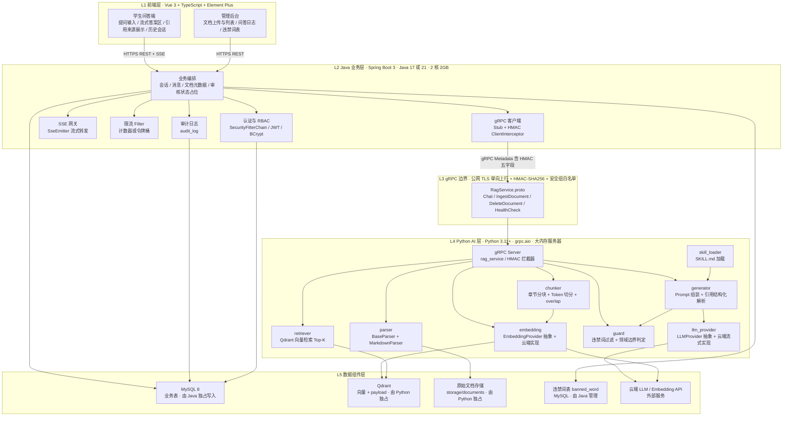
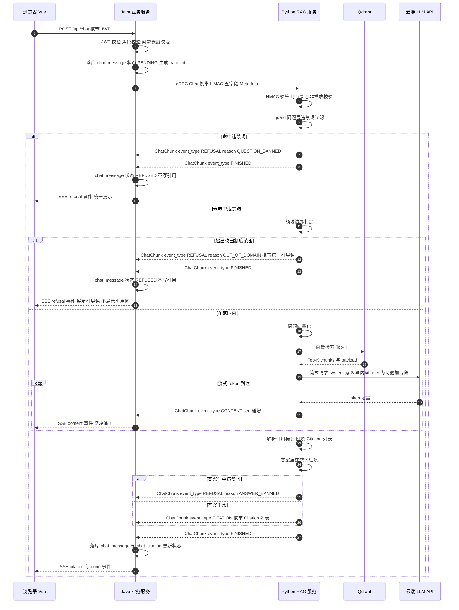
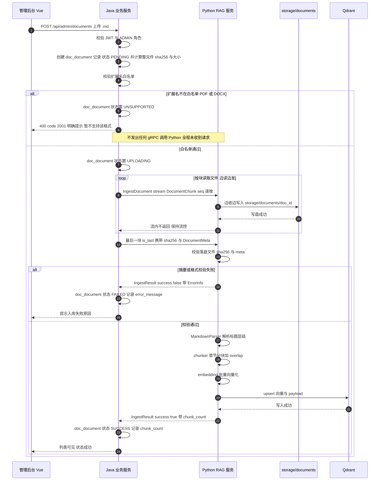
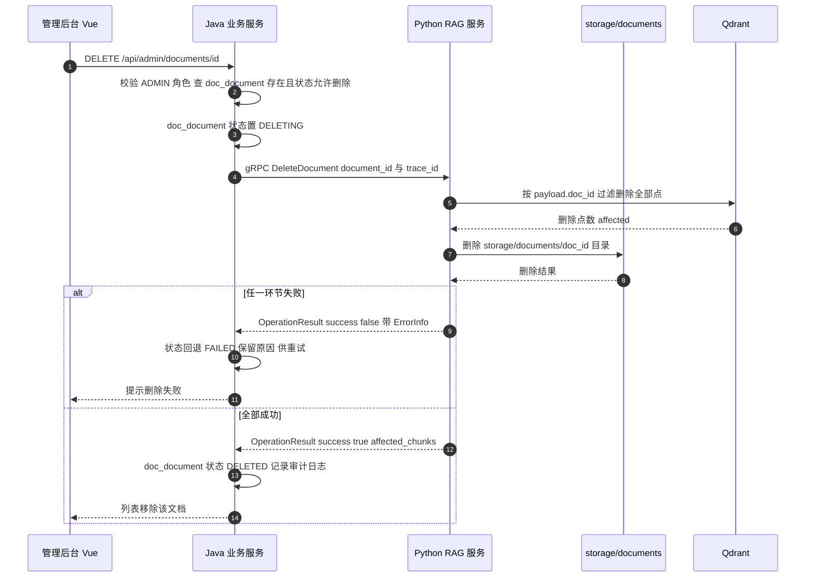
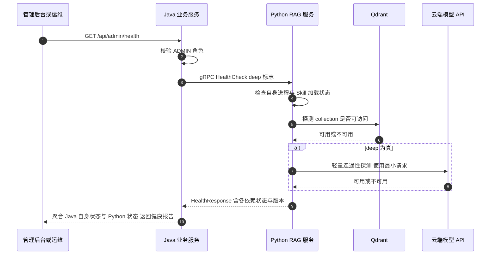
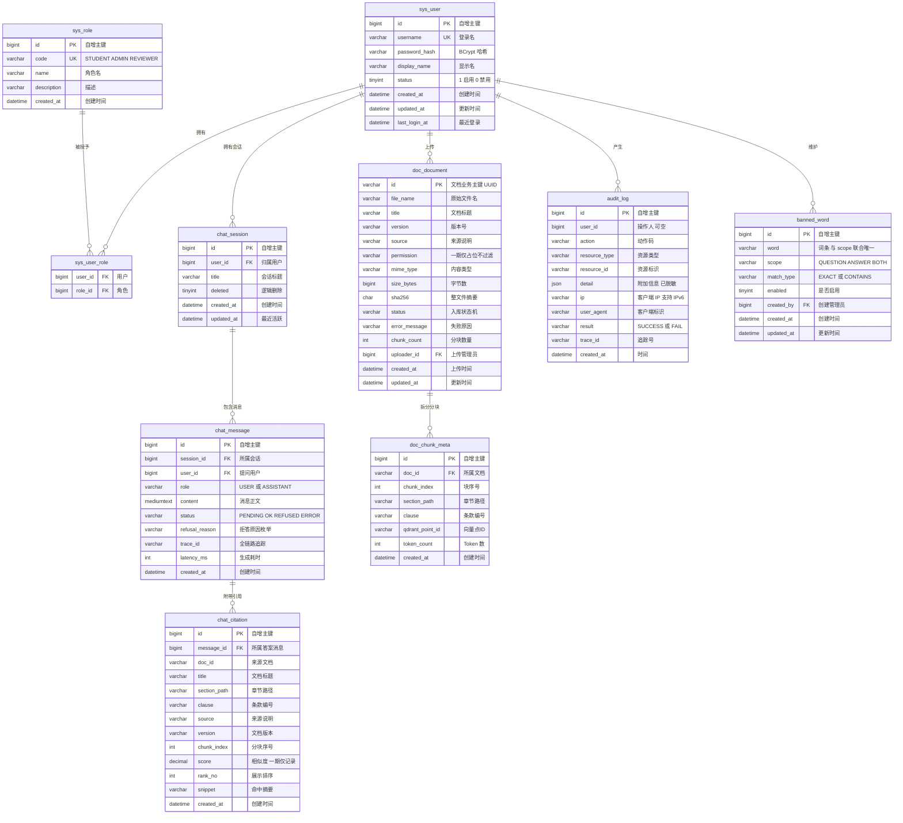

# 02 · 总体设计 · 华电学生手册 RAG 智能问答系统

> 版本：**v1.2** ｜ 日期：2026-11-26 ｜ 角色：架构师
> 上游依据：`学生手册rag.md`（课题摘录，下称 S1）、`学生手册rag-技术文档.md` v1.1（下称 S2）、`docs/00-项目背景与约束提炼.md` **v1.3**（下称 00）、`docs/01-PRD.md` **v1.2**（下称 01）
> 下游文档：`03-详细设计技术方案.md`（怎么实现）、`04-开发排期表.md`（什么时候做完什么）
>
> **编号空间**：`UD-01~UD-08` = 用户决策（见 00 号 §1.5）；`D-01~D-04` = 课程交付约束（见 00 号 §6.4）；`D-01~D-07` = 交付物验收项（见 PRD §7.4）；`Q-01~Q-22` = 待确认项。

### 修订记录

| 版本 | 主要变更 |
|---|---|
| v1.0 | 初版：11 章 + 自检清单，覆盖一期架构、模块、数据流、数据模型、接口、选型、非功能、二期扩展点、风险 |
| **v1.1** | ① 用户决策编号全量回写为 `UD-01~UD-08`，并加「编号空间」声明；② 上游版本对齐为 00 v1.2 / 01 v1.2；③ **本轮基于 QA 审计返工**（4 阻塞 / 9 重要 / 11 建议）：ER 图补齐至与 DDL 字段完全相等（阻塞-3）、`UNSUPPORTED` 状态可达性改造（阻塞-2）、SSE 事件集合统一为 6 业务 + 1 心跳（重要-3）、补 `3004` 语义对齐（重要-2）、`banned_word` 唯一键改为 `(word, scope)`、新增文档状态迁移白名单表、补引用两张 Mermaid 独立素材（建议-11） |
| **v1.2** | ① **§3.2 新增「一期单机基线」对照表**（`UD-08`：一期不规划 MySQL 外置部署与跨机访问，全部组件同机；双机拓扑降为二期目标形态），§3.2 标题改为「一期单机基线 · 二期双机」；② §3.3 的「Java 机禁止部署 MySQL」注明**仅适用于双机生产形态**；③ **§6.2.7 `doc_chunk_meta` 由「可选表」改为「分块清单表」**，补数据来源（`IngestResult.chunks`）、两个用途与三处一致性约束（表行数 == `chunk_count` == Qdrant 点数） |

---

## 1. 文档信息与设计范围

| 项 | 内容 |
|---|---|
| 文档名称 | 华电学生手册 RAG 智能问答系统 · 总体设计 |
| 版本 | v1.0 |
| 日期 | 2026-11-26 |
| 设计范围 | **只覆盖一期**（P0 + 一期 P1）。二期能力仅在 §10「一期 → 二期扩展点」中以扩展点形式登记，不设计、不排期【UD-01】【源：技术文档 §14.1】 |
| 设计口径 | 架构与选型以 S2 §16「开发基准」为准；课程交付要求（4 类图、≥10 溯源用例、可运行原型）不受 S2 覆盖，仍为一期交付内容【源：00 号文档 §1.4 R2】【源：课题摘录 §3】 |
| 人力与排期 | 单人开发、相对周次，详见 04【UD-04 / UD-03】 |
| 术语 | 「一期」= 技术文档 §14.1 的最小可运行闭环；「chunk」= 分块后的文本单元；「Skill」= Python 侧提示词与业务规范层文件集 |

### 1.1 本文的溯源标记规则

| 标记 | 含义 |
|---|---|
| `【源：技术文档 §X.Y】` | 结论来自 S2 原文 |
| `【源：课题摘录 §X】` | 结论来自 S1 原文 |
| `【源：PRD FR-xx / NFR-xx】` | 结论来自 01 号 PRD |
| `【源：技术文档 §X + §Y（推导）】` | 由 S2 多处条款合并推导 |
| `【UD-xx】` | 来自用户已确认的 7 项决策（`UD-01`~`UD-07`），效力最高 |
| `【设计裁决：理由…】` | 文档未规定，由架构师做的工程选择，**不是文档规定**，可被推翻 |
| `【待确认】` 或 `【待确认 Q-xx】` | 需人确认，复用 00 号文档 Q 编号 |

### 1.2 已确认的 7 项决策（最高优先级）

> **编号口径说明（重要）**：用户决策统一使用 **`UD-`** 前缀（`UD-01`~`UD-07`），与 `docs/00-项目背景与约束提炼.md` §1.5「用户决策记录」完全一致。
> **不使用 `D-` 前缀表示用户决策的原因**：`D-` 前缀已被两个编号空间占用——**00 号 §6.4 D-01~D-04**（课程交付约束：可运行原型 / 4 类设计图 / ≥10 溯源用例 / 引用格式）与 **PRD §7.4 D-01~D-07**（交付物验收项）。若用户决策也用 `D-`，同一份文档里会出现「D-01 既指设计范围口径、又指可运行原型」的三重冲突。因此本文凡引用这两类时一律带全前缀：`00 号 §6.4 D-xx` 或 `PRD §7.4 D-xx`，与 `UD-` 严格区分。

| 编号 | 决策 | 对本文的影响 |
|---|---|---|
| UD-01 | PRD 全量，设计与排期只覆盖一期 | 本文不设计二期能力 |
| UD-02 | 领域边界拒答 + 违禁词过滤 = 一期；AI 答案人工审核 = 二期 | §4.2 有 `guard` 模块；无审核状态机 |
| UD-03 | 排期用相对周次 | 本文不写日历日期 |
| UD-04 | 单人开发 | 设计优先「少组件、可单人维护」 |
| UD-05 | 一期云端 LLM API，后期不引入本地化大模型部署；接受问题与检索片段发送至第三方，对外不得声称「完全本地化」 | 无 Ollama / vLLM / 本地 8B 方案；§3.1 图注禁止「数据不出校」表述 |
| UD-06 | 已有两台云服务器（硬件具备双机条件） | §3.2 绘制双机**目标**拓扑；**一期实施口径已被 UD-08 收窄为单机** |
| UD-07 | 一期不做文档 ACL 过滤，`permission` 仅占位 | §6.4 明确 payload 含该字段但不参与过滤 |
| UD-08 | **一期部署基线 = 单机**：不规划 MySQL 外置部署与跨机访问，全部组件同机；双机拆分、安全组白名单、跨机 NTP 顺延二期 | §3.2 新增单机基线对照表；§3.3「Java 机禁止部署 MySQL」限定为双机生产形态；§6.2.7 `doc_chunk_meta` 数据源补充 |

---

## 2. 设计目标与非目标

### 2.1 设计目标（对应 00 号文档 G1~G5 与 PRD 度量 M-01~M-05）

| 编号 | 目标 | 落地判据 | 来源 |
|---|---|---|---|
| DG-1 | 答案可溯源到「文件名 + 章节 + 条款编号」 | 每次成功回答返回 ≥1 条结构化 `Citation`，前端可渲染 | 【源：课题摘录 §1、§5.1】【源：PRD FR-26 / FR-27 / M-05】【源：00 号文档 §6.4 D-04 引用形态】 |
| DG-2 | 内容可维护：上传 Markdown 即完成入库，新增文档不重建全库 | 逐文档独立入库，Qdrant 按 `doc_id` 管理，无全量重建路径 | 【源：课题摘录 §2 知识库构建模块】【源：PRD FR-18】 |
| DG-3 | 边界可控：只答校园制度问题，无关问题统一拒答 | 拒答在 Python pipeline 内终结，不走向量检索与 LLM，不产生虚假引用 | 【源：课题摘录 §1、§5.2】【源：PRD FR-29 / FR-30】【UD-02】 |
| DG-4 | 打通 `Vue → Java → gRPC → Python → SSE → Vue` 完整可演示闭环 | gRPC Server Streaming 与 Java SSE 两段链路可分别演示 | 【源：技术文档 §8、§15】【源：PRD NFR-01 / M-03】 |
| DG-5 | 服务间调用安全 + 业务侧最小 RBAC | 明文 gRPC 被拒；缺失签名被拒；未认证 401、越权 403 | 【源：技术文档 §9.2、§12、§4.4】【源：PRD NFR-03~NFR-08 / A-05】 |

### 2.2 设计非目标（一期明确不做）

> 本节每条均来自技术文档 §14.1「一期明确不做」清单与 00 号文档 §5.3。二期排期与设计均不在本文范围内。

| 非目标 | 说明 | 来源 |
|---|---|---|
| WireGuard 私有网络 | 一期只用「公网 gRPC + TLS + HMAC + 安全组 IP 白名单」，不建隧道、不出现 `wg0`/`10.20.0.x` | 【源：技术文档 §14.1 一期明确不做、§11.4】 |
| PDF / DOCX 在线解析 | 只保留 `BaseParser` 扩展点，上传即明确「暂不支持」 | 【源：技术文档 §14.1、§5.2】【源：PRD FR-08 / FR-12】 |
| BM25 / RRF / Reranker | 一期仅向量检索；`retriever` 不预留混合检索实现代码，仅在 Proto 与采集字段留 `score` | 【源：技术文档 §14.1、§5.1】 |
| AI 答案人工审核 | 无「草稿 → 审核 → 发布」状态机，无审核员页面 | 【UD-02】【源：技术文档 §14.2】【源：PRD FR-32】 |
| 文档级 ACL 过滤 | 仅 `permission` 字段落库占位，检索时不作为过滤条件 | 【UD-07】【源：PRD NFR-20】 |
| OAuth2 / SSO | 只用最小化 Spring Security + JWT | 【源：技术文档 §4.4、§14.1】 |
| Kubernetes / 微服务注册中心 | 两份独立 Docker Compose | 【源：技术文档 §13.3、§14.1】 |
| 多端接入（公众号/App/QQ Bot/企业微信） | 无任何实施阶段 | 【源：课题摘录 §1；待确认：技术文档未规定】 |
| 本地大模型部署（Ollama / vLLM / 本地 8B 等 **LLM 推理服务**） | 一期云端 API，**且后期不引入本地化大模型部署**，Provider 抽象仅用于换云厂商。**注意范围**：本条只针对 LLM；Embedding 侧的「本地 BGE」仍作为备选保留在 `EmbeddingProvider` 抽象后（见 §4.4 A-4 口径关系表） | 【UD-05】【源：技术文档 §5.4】【源：00 号文档 §6.1 T-14】 |
| Redis Streams 异步任务 / 聊天走 Redis 队列 | 聊天流式固定 `gRPC Streaming → SSE` | 【源：技术文档 §4.5、§14.1】 |
| 监控告警平台 | 一期只有 `audit_log` + 应用日志 | 【源：技术文档 §14.2】【源：PRD FR-44】 |

---

## 3. 架构总览

### 3.1 分层架构图

> 五层划分：前端层 / Java 业务层 / gRPC 边界 / Python AI 层 / 数据组件层。层间只允许箭头方向的调用，见 §3.4「架构边界铁律」。



**图注**：`P8 skill_loader` 只向 `generator` 提供 system prompt 文本，不进入 Qdrant【源：技术文档 §2.2】。`D5 云端 LLM / Embedding API` 是一期唯一出校的数据出口，对外表述不得声称「数据不出校」【源：PRD NFR-21】【UD-05】。

> **配套独立素材（课程交付物 D-02 用）**：本节的类图与 §5 的四张数据流时序图另存为可直接渲染的独立文件，交付时无需从 Markdown 中手工截图：
> - **类图（Java + Python + 数据模型，含继承与依赖）** → `docs/class-diagram.mermaid`
> - **时序图（流 1 问答含拒答分支 / 流 2 入库 / 流 3 删除 / 流 4 健康检查）** → `docs/sequence-diagram.mermaid`
>
> 这两份文件与本文保持一致；若正文改动，两份素材需同步（已纳入 04 号 P15 的交付物清单）。【设计裁决：为满足 D-02「架构图/数据流图/ER 图/接口文档」四类交付而单独落盘】

### 3.2 部署拓扑图（一期单机基线 · 二期双机，UD-06 + UD-08）

> **一期部署基线（UD-08，先看这一条）**：一期**不规划 MySQL 的独立部署与跨机访问**，全部组件跑在**同一台机器**上，验收基线是「本机能跑通」而非「两台云服务器跑通」。本节下方的双机拓扑是**目标形态**（二期/生产），一期只要求单机 Compose 能拉起整套。
>
> | 项 | 一期（单机基线） | 二期/生产（双机） |
> |---|---|---|
> | `nginx` + `java-app` + `rag-service` + `qdrant` + `mysql` | **同一台机器**，一个 Compose | 拆到服务器 A / B |
> | MySQL 位置 | 跟 Java 同机，**不做外置规划** | 大内存机或云数据库【源：技术文档 §4.3、§13.1】 |
> | 「Java 机禁止部署 MySQL」（2 核 2GB） | **不适用**：本机不是该生产规格，此约束只在双机生产形态生效 | 适用【源：技术文档 §4.3】 |
> | gRPC 地址 | `127.0.0.1:50051` | 公网 IP B 或私网 IP |
> | 安全组 IP 白名单、跨机 NTP 偏差 | **不涉及**（同机 localhost，无跨机链路） | 适用【源：技术文档 §9.2】 |
> | TLS + HMAC | **仍要做**，在单机上验证验签、重放、时钟偏移 | 同 |
>
> 依据：用户决策 UD-08「一期不考虑 MySQL 部署问题，先本机能跑起来」。**这与 S2 §13.1/§13.3 的双机拓扑存在明确偏离，偏离原因即此决策**，二期恢复双机形态。【用户决策 UD-08】

```text
                        互联网 / 校园网
                              │
                              │ HTTPS 443
                              ▼
        ┌───────────────────────────────────────────────────┐
        │  服务器 A · Java 机 · 2 核 2GB                     │
        │  公网 IP A（弹性公网 IP，固定）                     │
        │                                                   │
        │  ┌─────────────┐      ┌──────────────────────┐    │
        │  │  nginx      │─────▶│  java-app            │    │
        │  │  :443 TLS   │ :8080│  Spring Boot 3       │    │
        │  │  静态资源    │      │  JWT / SSE / 限流    │    │
        │  └─────────────┘      └──────────┬───────────┘    │
        │                                  │ gRPC Client     │
        │                                  │ TLS + HMAC      │
        └──────────────────────────────────┼────────────────┘
                                           │
             安全组出方向：允许 TCP 50051  │
             安全组入方向：仅允许 Java 机  │
             固定公网出口 IP → 50051      │
                                           │  TCP 50051
                                           │  TLS 服务端认证
                                           │  HMAC-SHA256 五字段
                                           │  【一期无 WireGuard】
                                           ▼
        ┌───────────────────────────────────────────────────┐
        │  服务器 B · 大内存服务器 · Python 机               │
        │  公网 IP B                                        │
        │                                                   │
        │  ┌──────────────────────────┐                     │
        │  │  rag-service             │                     │
        │  │  Python 3.11+ grpc.aio   │                     │
        │  │  :50051 TLS + HMAC 拦截器│                     │
        │  └──────┬────────────┬──────┘                     │
        │         │            │                            │
        │         ▼            ▼                            │
        │  ┌────────────┐  ┌──────────────┐                 │
        │  │  qdrant    │  │  storage/    │                 │
        │  │  :6333 内网 │  │  documents/  │                 │
        │  │  不对公网   │  │  原始 Markdown│                │
        │  └────────────┘  └──────────────┘                 │
        │                                                   │
        │  ┌──────────────────────────┐                     │
        │  │  mysql :3306 内网         │  ← 一期可放大内存机  │
        │  │  或改用云数据库            │     或云数据库       │
        │  │  不对公网                 │                     │
        │  └──────────────────────────┘                     │
        │                                                   │
        │  ┌──────────────────────────┐                     │
        │  │  redis :6379 可选         │  ← 可选增强，不对公网│
        │  └──────────────────────────┘                     │
        └───────────────────────────────────────────────────┘

  两台服务器均启用 NTP 时间同步（chronyd / systemd-timesyncd）
  偏差需小于 HMAC 时间窗 ±60s，否则验签随机失败
```

> **端口表的口径**：下图为**二期双机形态**的端口规划。一期单机基线下：`50051` 由 Java 经 `127.0.0.1` 访问，`3306`/`6333`/`6379` **只监听 `127.0.0.1`**，`443` 仍对外提供 HTTPS。【用户决策 UD-08】

| 端口 | 位置 | 方向 | 用途 | 来源 |
|---|---|---|---|---|
| 443 | 服务器 A | 入方向对公网 | Nginx HTTPS 唯一对外入口 | 【源：技术文档 §4.1、§13.3】 |
| 8080 | 服务器 A | 仅本机 | Spring Boot | 【设计裁决：由 Nginx 反代，不直接暴露，端口号可改】 |
| 50051 | 服务器 B | 入方向**仅允许服务器 A 固定公网出口 IP** | Python gRPC + TLS | 【源：技术文档 §9.2、§10.2】 |
| 3306 | 服务器 B | 不入公网 | MySQL | 【源：技术文档 §9.2】 |
| 6333 | 服务器 B | 不入公网 | Qdrant HTTP/gRPC 管理口 | 【源：技术文档 §5.3、§9.2】 |
| 6379 | 服务器 B | 不入公网 | Redis（可选） | 【源：技术文档 §4.5】 |
| 51820 UDP | — | **一期不开放** | WireGuard，二期 | 【源：技术文档 §11.4、§14.1】 |

> **注意（Q-16）**：若两台服务器同云同 VPC，可优先走私网 IP 通信，比公网直连更轻【源：技术文档 §9.2】。拓扑是否改私网取决于 Q-16，确认前按公网 + 白名单设计。`【待确认 Q-16】`

### 3.3 组件与进程清单（按机器）

| 机器 | 容器/进程 | 说明 | 来源 |
|---|---|---|---|
| 服务器 A | `nginx` | HTTPS 终止、静态资源、反代 `/api` | 【源：技术文档 §13.3】 |
| 服务器 A | `java-app` | Spring Boot 3 单体，含 Web + gRPC Client | 【源：技术文档 §13.3】 |
| 服务器 B | `rag-service` | Python gRPC Server | 【源：技术文档 §13.3】 |
| 服务器 B | `qdrant` | 向量库 | 【源：技术文档 §13.3】 |
| 服务器 B 或云 | `mysql` | 业务库 | 【源：技术文档 §4.3、§13.1】 |
| 服务器 B 或云 | `redis`（可选） | nonce / 限流 / 缓存 | 【源：技术文档 §4.5、§13.1】 |

**Java 机严禁部署**：MySQL、Qdrant、Redis、Ollama、任何模型服务【源：技术文档 §4.3】【源：PRD NFR-02】。

> **该禁令的适用范围**：仅对「2 核 2GB 的服务器 A（双机生产形态）」成立。**一期单机基线下所有组件同机运行，此禁令不适用**【用户决策 UD-08】。上表的「服务器 A / 服务器 B」列仅表示二期拆分后的归属，一期不按此分机。

### 3.4 架构边界铁律

| 编号 | 铁律 | 违反后果 | 来源 |
|---|---|---|---|
| B-01 | **浏览器永远只访问 Java 服务**，不直连 Python、不直连 Qdrant、不直连 MySQL | 绕过鉴权与审计，暴露内部服务 | 【源：技术文档 §2.2、§1.2-1】 |
| B-02 | **Python 不暴露公网业务入口**：只开 gRPC 端口且安全组白名单 | 公网可直调 AI 接口，无鉴权 | 【源：技术文档 §9.2】 |
| B-03 | **Java 不访问 Qdrant**：Java 侧不得出现任何 Qdrant 客户端依赖或配置 | 破坏数据归属，双写向量 | 【源：技术文档 §5.3、§13.2】【源：PRD FR-17】 |
| B-04 | **Python 不写 Java 业务表**：不写 `sys_user`/`sys_role`/`sys_user_role`/`chat_session`/`chat_message`/`doc_document` | 数据归属混乱，事务边界破防 | 【源：技术文档 §2.2、§13.2】 |
| B-05 | **Skill 不入向量库**：Skill 是提示词与业务规范层文件，由 `SkillLoader` 读取 | 提示词被当知识切片召回，污染引用 | 【源：技术文档 §2.2、§6】 |
| B-06 | **gRPC 是 Java↔Python 唯一 AI 调用接口**：不额外开 HTTP 旁路 | 两套契约并存，无法维护 | 【源：技术文档 §1.2-3、§7.1】 |
| B-07 | **HMAC 不替代 TLS**，Secret 不下发前端 | 明文公网传输，签名可被窃听重放 | 【源：技术文档 §1.2-5、§12.1】 |
| B-08 | **原始文档只由 Python 读写**（`storage/documents/`） | 双写磁盘，摘要校验失效 | 【源：技术文档 §13.2】【源：PRD NFR-25】 |

---

## 4. 模块划分与职责

### 4.1 Java 侧模块

| 编号 | 模块 | 职责 | 关键约束 | 对应 FR |
|---|---|---|---|---|
| JM-01 | 认证模块 `auth` | 登录校验密码（BCrypt）、签发 JWT、解析 JWT 写入 `SecurityContext`、登出 | stateless，禁用 formLogin/httpBasic/Session | 【源：PRD FR-01、NFR-09、NFR-10】 |
| JM-02 | 用户与角色模块 `user`/`role` | 用户查询、角色查询、`sys_user_role` 维护、`@PreAuthorize` 数据来源 | 一期只有普通用户/管理员两个生效角色 | 【源：PRD FR-02、FR-04】【源：技术文档 §4.4】 |
| JM-03 | 会话模块 `session` | 创建会话、按用户列出会话、会话归属校验（防越权） | 只能操作本人会话 | 【源：PRD FR-35、FR-37】 |
| JM-04 | 消息模块 `message` | 落库问题与答案、状态、拒答原因、耗时、`trace_id`；会话消息分页 | MySQL 为唯一最终依据 | 【源：PRD FR-36】【源：技术文档 §4.5】 |
| JM-05 | 文档元数据模块 `document` | 文档记录 CRUD、状态机迁移、扩展名白名单校验、`sha256` 记录 | 只存元数据，不存正文 | 【源：PRD FR-06、FR-10】 |
| JM-06 | 审核状态模块 `review` | **仅保留 `doc_document.status` 状态字段与枚举值**，不实现审核流（二期接入） | 一期不出现 `review_status` 业务逻辑 | 【UD-02】【源：PRD FR-32】 |
| JM-07 | 审计日志模块 `audit` | 关键操作落 `audit_log`，从 `SecurityContext` 取当前用户；日志脱敏 | 不打印 Secret / Signature | 【源：PRD FR-40】【源：技术文档 §12.6】 |
| JM-08 | 限流模块 `ratelimit` | 对登录与提问接口限流（Filter 层） | 阈值待确认 Q-14；非核心强依赖 | 【源：PRD FR-42、NFR-19】 |
| JM-09 | gRPC 客户端模块 `grpc` | Stub 管理、连接复用、超时、HMAC `ClientInterceptor` 注入 Metadata | `Chat` 不重试 | 【源：PRD NFR-04】【源：技术文档 §12.2】 |
| JM-10 | SSE 网关模块 `sse` | `SseEmitter` 生命周期、心跳、把 gRPC 流式回调转成 SSE 事件、断连处理 | 首块尽早，超时需显式设置 | 【源：PRD FR-25、NFR-01】【源：技术文档 §4.2、§8】 |
| JM-11 | 管理端模块 `admin` | 文档上传/列表/删除、问答日志、违禁词 CRUD、健康状态 | `/api/admin/**` 仅管理员 | 【源：PRD FR-02、FR-11、FR-33、FR-39、FR-41】 |
| JM-12 | 公共模块 `common` | 统一响应体 **`{code, data, message, traceId}`**、异常体系、`trace_id` 生成与透传、401/403 统一出口 | 全模块共用；**字段集与 02 §7.1 表头、03 §8.1 三处必须一致** | 【设计裁决：响应体格式文档未规定，为使前端与错误码体系统一而引入；含 `traceId` 是为让用户报错时能提供可检索的追踪号】 |

### 4.2 Python 侧模块

| 编号 | 模块 | 职责 | 关键约束 | 对应 FR |
|---|---|---|---|---|
| PM-01 | `grpc_server/rag_service.py` | 实现 4 个 RPC：`Chat`（Server Streaming）、`IngestDocument`（Client Streaming）、`DeleteDocument`、`HealthCheck`；参数校验；异常映射为 gRPC status | 不承担业务权限判断（Java 已做） | 【源：PRD FR-25、FR-41】【源：技术文档 §7.2】 |
| PM-02 | `grpc_server/interceptors.py` | HMAC 验签拦截器（5 步）；`trace_id` 注入日志上下文 | 用 `hmac.compare_digest` 常量时间比较 | 【源：PRD NFR-04、NFR-05】【源：技术文档 §12.4】 |
| PM-03 | `rag/parser.py` | `BaseParser` 抽象 + `MarkdownParser`；输出 `ParsedDocument`（含 H2/H3 层级树与 `section_path`）；按扩展名选择解析器；非支持格式抛 `UnsupportedFormatError` | 不写死文件名 | 【源：PRD FR-08、FR-09、NFR-14】【源：技术文档 §5.2】 |
| PM-04 | `rag/chunker.py` | 章节分块（按 H2/H3）+ Token 长度切分 + overlap；产出 `Chunk`（含 6 个元数据） | 单块不超 Token 上限，相邻块有 overlap | 【源：PRD FR-09、FR-15】【源：技术文档 §5.2】 |
| PM-05 | `rag/embedding.py` | `EmbeddingProvider` 抽象 + 云端实现；批量、重试、超长截断；维度由模型决定 | 不硬编码维度 | 【源：PRD FR-16、NFR-15】【源：技术文档 §5.4】 |
| PM-06 | `rag/retriever.py` | Qdrant 检索：问题向量化 → `search` Top-K → 组装 `RetrievedChunk`；**payload 过滤一期为空** | 不直连 Java 表 | 【源：PRD FR-17、FR-19】【UD-07】 |
| PM-07 | `rag/generator.py` | Prompt 组装（system=Skill 内容，user=问题+片段）；调用 LLMProvider 流式生成；**引用标记结构化解析并回填 `Citation`** | 引用必须结构化，不靠模型自由发挥 | 【源：PRD FR-24、FR-26】【源：技术文档 §8 第 4–5 步】 |
| PM-08 | `rag/skill_loader.py` | 扫描 `app/skills/`，加载 `SKILL.md` 与 `references/`；拼接 system prompt | Skill 不入 Qdrant；一期不做热更新 | 【源：PRD FR-28】【源：技术文档 §6、§2.2】 |
| PM-09 | `models/llm_provider.py` | `LLMProvider` 抽象 + 云端流式实现；token 回调；超时与错误映射 | Provider 可替换 | 【源：PRD NFR-15】【源：技术文档 §5.4】 |
| PM-10 | `guard`（新增模块，一期 P0） | 违禁词过滤（问题层 / 答案层）+ 领域边界判定；命中即产出拒答事件并终止 pipeline | 判定在 Python 侧（见 §4.4 裁决） | 【源：PRD FR-29、FR-30、FR-31】【UD-02】 |
| PM-11 | 文档存储与摘要校验 | 边收边写盘到 `storage/documents/{doc_id}/`，收完后校验 `sha256` | 目录归 Python 独占 | 【源：PRD FR-07、NFR-25】【源：技术文档 §8.1、§12.6】 |

### 4.3 职责不重叠核对表

> 目的：把「谁都不干」和「只有一方干」显式写清，避免实现期出现双份逻辑或三不管地带。

| 能力 | Java | Python | 一期是否有归属 | 说明 |
|---|---|---|---|---|
| JWT 签发与校验 | ✅ 独占 | ❌ | 是 | Python 不感知用户身份，只接收 `user_id` 字符串 |
| 角色 / 权限判定 | ✅ 独占 | ❌ | 是 | Python 不做越权判断【源：技术文档 §4.2】 |
| 会话归属校验 | ✅ 独占 | ❌ | 是 | |
| 问题长度校验 | ✅ 独占 | ❌ | 是 | 【源：技术文档 §8 第 2 步】 |
| 违禁词过滤 | ⚠️ 只做词表 CRUD | ✅ 执行过滤 | 是 | 词表存 MySQL 由 Java 管理；过滤动作在 Python（见 §4.4 裁决 3） |
| 领域边界判定 | ❌ | ✅ 独占 | 是 | 【设计裁决：见 §4.4 裁决 1】 |
| Markdown 解析 | ❌ | ✅ 独占 | 是 | 【源：技术文档 §4.2「Java 不应负责 PDF/Word 解析」+ §5.2】 |
| **PDF / DOCX 解析** | ❌ | ❌ | **无人做（二期）** | 一期只返回「暂不支持」【源：技术文档 §5.2】 |
| 文本分块 | ❌ | ✅ 独占 | 是 | |
| Embedding | ❌ | ✅ 独占 | 是 | 【源：技术文档 §4.2「Java 不应负责文本向量化」】 |
| 向量检索 | ❌ | ✅ 独占 | 是 | Java 不访问 Qdrant【源：技术文档 §5.3】 |
| **BM25 / RRF / Reranker** | ❌ | ❌ | **无人做（二期）** | 【源：技术文档 §14.1】 |
| LLM 调用 | ❌ | ✅ 独占 | 是 | 【源：技术文档 §4.2「Java 不应负责大模型调用」】 |
| 引用结构化解析 | ❌ | ✅ 独占 | 是 | Java 只透传与落库 |
| 流式转发到浏览器 | ✅ 独占 | ❌ | 是 | SSE 只在 Java |
| 业务数据落库 | ✅ 独占 | ❌ | 是 | Python 不写 Java 表 |
| 向量与原始文件存储 | ❌ | ✅ 独占 | 是 | |
| **AI 答案人工审核** | ❌ | ❌ | **无人做（二期）** | 【UD-02】 |
| **文档级 ACL 过滤** | ❌ | ❌ | **无人做（一期）** | 字段占位不消费【UD-07】 |
| 限流 | ✅ 独占 | ❌ | 是 | 落点在 Java Filter |
| **WireGuard / mTLS / 密钥轮换** | ❌ | ❌ | **无人做（二期）** | 【源：技术文档 §11.4】 |
| 监控告警 | ⚠️ 仅应用日志 + `audit_log` | ⚠️ 仅应用日志 | 部分（无告警） | 【源：PRD FR-44 二期】 |
| **离线 PDF→Markdown 预转换脚本** | ❌ | ❌ | **独立脚本，无服务归属** | 一期 P1，是否必做待确认 Q-11【源：PRD FR-14】 |

### 4.4 四处关键设计裁决（说明理由，可被推翻）

| 编号 | 裁决 | 理由 | 依据 |
|---|---|---|---|
| A-1 | **领域边界拒答放在 Python 侧 pipeline 内**，Java 只透传与落库 | S2 §4.2 明确「Java 不承担重 AI 计算」「Java 不应负责大模型调用」；§8 第 4 步把「问题分析」放在 Python 的 RAG 流程内。若放 Java，则 Java 需引入分类模型或关键词规则，违反职责边界，且与 Skill 提示词规范割裂 | 【源：技术文档 §4.2 + §8 第 4 步（推导）】【源：00 号文档 Q-08 建议确认方为架构师】 |
| A-2 | **`ChatChunk` 扩展为多事件类型**：区分内容增量 / 引用 / 拒答 / 错误 / 结束 | S2 §7.3 明确「后续需要补充：…更细粒度的流式事件类型」，属文档授权扩展。若只保留 `content`+`finished`，则拒答与错误无法与正常内容区分，前端只能靠字符串匹配，不可靠 | 【源：技术文档 §7.3】 |
| A-3 | **违禁词表存 MySQL、由 Java 管理**；Python 通过「启动加载 + 定期刷新」或「Java 随 `ChatRequest` 传入」两种方式之一获取 | 与 B-04 同源推理：Java 是业务数据 owner，Python 不直接改 Java 表。两种方式取舍见下 | 【源：技术文档 §2.2 + §13.2（推导）】【设计裁决：存储位置与获取方式文档未规定】【待确认 Q-07】 |
| A-4 | **Embedding 默认走云端 API**（与 LLM 同为云端），**本地 BGE 作为备选**，两者都由 `EmbeddingProvider` 抽象承接，切换不改 RAG 主流程 | 「默认云端」与 00 号文档 `T-14` 原文「Embedding 可选本地 BGE 或云端 API」**不矛盾**：`T-14` 是**约束原文**（不能排除本地 BGE 这条路），「默认云端」是**默认选择**（避免在服务器上额外部署本地模型、与 LLM 的部署形态保持一致）。选云端即可省掉模型权重与运行时内存预算；保留抽象即可在 Q-02 最终选型变化时不重写流程。向量维度、批次大小等一切取决于最终模型，不写死 | 【UD-05】【源：技术文档 §5.4、§5.1】【源：00 号文档 §6.1 T-14（约束原文）+ UD-05（默认选择）（推导）】【待确认 Q-02（部分确认：默认云端）】 |

**A-4 口径关系表（三层，必须分清，避免后续文档互相「打脸」；A-3 的取舍表紧随本章末尾）**：

| 层次 | 表述 | 出处 | 含义 |
|---|---|---|---|
| ① 约束原文 | 「Embedding 可选本地 BGE 或云端 API」 | 【源：技术文档 §5.4】→ 00 号文档 §6.1 `T-14` | **两条路都不排除**。这是对源文档的忠实引用，不是选型结论 |
| ② 默认选择 | **默认走云端 Embedding API**（与 LLM 同为云端） | 【UD-05】+【设计裁决：避免额外部署本地模型】 | 一期实施默认值。理由是 LLM 已确定云端（UD-05），Embedding 若走本地则需要在服务器上额外准备模型权重、推理依赖与内存预算，与「一期不引入本地化大模型部署」的整体取向不一致 |
| ③ 备选与扩展点 | **本地 BGE 作为备选**，由 `EmbeddingProvider` 抽象承接；若最终 Q-02 选本地 BGE，只新增一个 `LocalBGEEmbeddingProvider`，**不改 `parser`/`chunker`/`retriever`/`generator`/proto** | 【源：PRD NFR-15】 | 保证 00 号 `T-14` 的「可选」不是空话，也保证 `T-15`（Provider 可替换）可被验证 |

> **必须说明的连带影响**：无论走云端还是本地 BGE，**向量维度都由最终模型决定，本文与 03 均不出现任何具体维度数字**；切换模型必须 drop 并重建 Qdrant collection（见 03 §7.1、§7.2）。


**A-3 两种获取方式的取舍（必须显式记录，不留含糊）**：

| 方案 | 做法 | 优点 | 缺点 | 适用 |
|---|---|---|---|---|
| A-3-a 定期刷新 | Python 启动时从……**注意：Python 不能直连 Java 的 MySQL 表**（B-04），因此本方案需 Java 额外暴露一个 gRPC/内部形态的词表拉取接口，或由部署期把词表导出为 Python 可读文件 | 词表更新不依赖每次请求载荷，问答 QPS 低时无额外开销 | 需要新增接口或导出机制，属对 S2「4 个 RPC」的扩展；有刷新延迟窗口 | 词表条目多、变更低频时 |
| A-3-b 随请求传入 | Java 在 `ChatRequest` 中携带启用中的词表（或词表版本号 + 差量） | 无需新增 RPC，无需 Python 访问业务库；生效即时，与「变更后对后续问答生效」验收最贴合 | 每次请求载荷变大；词表规模大时不可接受 | 词表条目少（一期演示场景）时 |

> **一期建议**：取 **A-3-b**，并在 `ChatRequest` 增加 `banned_words` 与 `banned_words_version` 字段；Python 侧保留进程内只读缓存与版本号比对，为将来切 A-3-a 留口。理由：不新增 RPC、不违反 B-04、与 FR-33「变更后对后续问答生效」最直接对齐；一期词表规模由管理员手工维护，条目数很小。**该取舍最终需确认**：`【待确认 Q-07】`

---

## 5. 关键数据流

### 5.1 流 1 · 一次问答的完整时序（含拒答分支）



**这条流程体现的工程能力**（对齐 S1 §3「数据流图」交付要求）：

1. **跨语言 RPC 与 Protobuf 契约**：Java 与 Python 用同一 `.proto` 交换结构化事件，而非字符串拼接【源：技术文档 §7.1、§8】。
2. **gRPC Server Streaming 与 SSE 两段流式的衔接**：Python 逐 token 回，Java 逐事件推，前端逐字渲染【源：技术文档 §4.2、§15】。
3. **拒答是「正常业务结果」而非异常**：走独立事件类型，前端能区分「答不了」和「系统坏了」（详见 03 §8）。
4. **安全前置**：HMAC 校验发生在任何业务逻辑之前，未通过不产生任何检索或模型调用成本【源：技术文档 §12.4】。
5. **数据归属清晰**：Python 只回事件，落库全部在 Java；`trace_id` 贯穿两侧日志，便于对账【源：PRD FR-40】。

### 5.2 流 2 · 文档入库时序（Client Streaming）



**这条流程体现的工程能力**：

1. **Java 侧内存受控**：文件按块读取发送，Java 2GB 内存不因大文件被撑爆【源：技术文档 §8.1】【源：PRD FR-07 / NFR-02】。
2. **gRPC Client Streaming 的正确用法**：单向流 + 单次响应，天然适合「上传 + 处理结果」半双工语义【源：技术文档 §8.1】。
3. **完整性校验**：整文件 `sha256` 作为最后一块的校验依据，避免截断文件被静默入库【源：技术文档 §12.6】【源：PRD FR-07 验收「可用摘要校验」】。
4. **状态机可观测**：文档从 `UPLOADING → SUCCESS/FAILED` 有明确迁移，管理后台能指认哪份失败【源：PRD FR-10】。
5. **增量入库天然成立**：每次上传只对本次 `doc_id` 做 upsert，不触碰其他文档向量【源：PRD FR-18】。

### 5.3 流 3 · 文档删除时序



**这条流程体现的工程能力**：

1. **向量与原文一致清理**：只删 MySQL 记录而不删向量，会导致「查得到但引不到原文」；本流程两处一起清【源：PRD FR-11 验收「删除后不再被检索命中」】。
2. **按 `doc_id` 过滤删除**：不依赖本地缓存点 ID 列表，幂等且可重试（详见 03 §7.4）。
3. **失败可重试**：Java 保留 `DELETING/FAILED` 状态与外层重试入口，不因 Python 短暂不可用而丢数据。
4. **审计留痕**：删除是破坏性操作，必须有 `audit_log`【源：PRD FR-40】。

### 5.4 流 4 · 健康检查



**这条流程体现的工程能力**：

1. **分层探活**：不是简单 ping，而是逐依赖探测，能把「Python 活着但 Qdrant 挂了」区分出来【源：技术文档 §7.2 HealthCheck】。
2. **deep 开关**：模型 API 探测会产生外部调用与费用，因此做成显式开关，默认浅探。
3. **Java 侧聚合**：浏览器只能看到 Java 的健康视图，不直连 Python，符合 B-01。
4. **验收可判定**：Python 停机时返回不可用，是 A-07 的可执行判据【源：PRD A-07 / FR-41】。

---

## 6. 数据模型设计

> **重要声明**：以下表结构与字段集**不是两篇源文档给定的**，而是由 PRD 的 FR 逐条推导出的实现结构。属【设计裁决：字段集由 FR 推导】，可随实现调整。表名、字段名的命名风格（`sys_` / `chat_` / `doc_` 前缀）同样是设计裁决。

### 6.1 ER 图



### 6.2 表结构明细

#### 6.2.1 `sys_user`

| 字段 | 类型 | 约束 | 说明 | 依据 |
|---|---|---|---|---|
| `id` | BIGINT UNSIGNED | PK, AUTO_INCREMENT | 主键 | 由 FR-01 推导 |
| `username` | VARCHAR(64) | NOT NULL, UNIQUE | 登录名 | 【源：PRD FR-01】 |
| `password_hash` | VARCHAR(100) | NOT NULL | BCrypt 哈希，长度容未来算法升级 | 【源：PRD NFR-09】【源：技术文档 §4.4】 |
| `display_name` | VARCHAR(64) | NULL | 展示名 | 由 FR-01 推导 |
| `status` | TINYINT | NOT NULL DEFAULT 1 | 1 启用 / 0 禁用 | 【设计裁决：禁用能力文档未规定，为运维必要项】 |
| `created_at` | DATETIME(3) | NOT NULL DEFAULT CURRENT_TIMESTAMP(3) | 创建时间 | 由 FR-01 推导 |
| `updated_at` | DATETIME(3) | NOT NULL ON UPDATE CURRENT_TIMESTAMP(3) | 更新时间 | 通用 |
| `last_login_at` | DATETIME(3) | NULL | 最近登录 | 【源：PRD FR-40 审计需要】 |

#### 6.2.2 `sys_role` / `sys_user_role`

| 字段 | 类型 | 约束 | 说明 | 依据 |
|---|---|---|---|---|
| `sys_role.id` | BIGINT UNSIGNED | PK | 主键 | 由 FR-02 推导 |
| `sys_role.code` | VARCHAR(32) | NOT NULL UNIQUE | `STUDENT` / `ADMIN` / `REVIEWER`（`REVIEWER` 一期仅建码不赋权） | 【源：PRD FR-02、§3.1】【源：技术文档 §4.4】 |
| `sys_role.name` | VARCHAR(64) | NOT NULL | 角色中文名 | 同上 |
| `sys_role.description` | VARCHAR(255) | NULL | 角色描述 | 【设计裁决：文档未规定，便于后台展示】 |
| `sys_role.created_at` | DATETIME(3) | NOT NULL DEFAULT CURRENT_TIMESTAMP(3) | 创建时间 | 【设计裁决：通用审计字段】 |
| `sys_user_role.user_id` | BIGINT UNSIGNED | PK 之一, FK | 用户 | 由 FR-02 推导 |
| `sys_user_role.role_id` | BIGINT UNSIGNED | PK 之一, FK | 角色 | 由 FR-02 推导 |

> 「教师」角色不存在于一期：角色枚举不纳入 `TEACHER`，等 Q-05 确认后再加码值【待确认 Q-05】。

#### 6.2.3 `chat_session`

| 字段 | 类型 | 约束 | 说明 | 依据 |
|---|---|---|---|---|
| `id` | BIGINT UNSIGNED | PK | 会话 ID，作为 `ChatRequest.session_id` 的字符串形态 | 【源：PRD FR-35】 |
| `user_id` | BIGINT UNSIGNED | NOT NULL, FK, INDEX | 归属用户，越权校验依据 | 【源：PRD FR-35、FR-37】 |
| `title` | VARCHAR(128) | NULL | 会话标题，取首问前 N 字（N 待定） | 【设计裁决：文档未规定会话标题】 |
| `created_at` | DATETIME(3) | NOT NULL | 创建时间 | 由 FR-35 推导 |
| `updated_at` | DATETIME(3) | NOT NULL, INDEX | 最近活跃，用于会话列表排序 | 由 FR-37 推导 |
| `deleted` | TINYINT | NOT NULL DEFAULT 0 | 逻辑删除 | 【设计裁决：文档未规定删除方式】 |

#### 6.2.4 `chat_message`

| 字段 | 类型 | 约束 | 说明 | 依据 |
|---|---|---|---|---|
| `id` | BIGINT UNSIGNED | PK | 消息 ID | 【源：PRD FR-36】 |
| `session_id` | BIGINT UNSIGNED | NOT NULL, FK, INDEX | 所属会话 | 【源：PRD FR-35、FR-36】 |
| `user_id` | BIGINT UNSIGNED | NOT NULL, FK | 提问用户（冗余便于按用户查日志） | 【源：PRD FR-37、FR-39】 |
| `role` | VARCHAR(16) | NOT NULL | `USER` / `ASSISTANT` | 由 FR-36 推导 |
| `content` | MEDIUMTEXT | NULL | 问题或答案正文；拒答时为引导语 | 【源：PRD FR-36】 |
| `status` | VARCHAR(16) | NOT NULL, INDEX | `PENDING` / `OK` / `REFUSED` / `ERROR` | 【设计裁决：**取值集合无文档依据**——PRD §6.2 对状态取值明确标注「待确认：文档未定义具体状态机」，此处四个值是为满足 FR-39「是否被拒答」筛选与 §3.7.1「先落 PENDING」而定的实现选择，可随 Q-09/Q-10 结论调整】 |
| `refusal_reason` | VARCHAR(32) | NULL | `OUT_OF_DOMAIN` / `QUESTION_BANNED` / `ANSWER_BANNED` / `NO_CONTEXT` | 【源：PRD FR-29、FR-31】【设计裁决：枚举值为设计补充】 |
| `trace_id` | VARCHAR(64) | NULL, INDEX | 与 gRPC `x-request-id` 同值，便于对账 | 【源：技术文档 §7.3 请求追踪】 |
| `latency_ms` | INT | NULL | 首块/总耗时（记录口径见 03） | 【源：PRD M-06 待确认，故仅记录不设阈值】 |
| `created_at` | DATETIME(3) | NOT NULL, INDEX | 时间 | 【源：PRD FR-39】 |

#### 6.2.5 `chat_citation`

| 字段 | 类型 | 约束 | 说明 | 依据 |
|---|---|---|---|---|
| `id` | BIGINT UNSIGNED | PK | 主键 | 【源：PRD FR-26】 |
| `message_id` | BIGINT UNSIGNED | NOT NULL, FK, INDEX | 所属答案消息 | 【源：PRD FR-26】 |
| `doc_id` | VARCHAR(36) | NOT NULL | 来源文档 | 【源：PRD FR-26】 |
| `title` | VARCHAR(255) | NULL | 文档标题 | 【源：课题摘录 §1「文件名」】 |
| `section_path` | VARCHAR(512) | NULL | 章节路径，如「第三章 学籍管理 > 转专业」 | 【源：PRD FR-09、FR-26】 |
| `clause` | VARCHAR(128) | NULL | 条款编号，如「第 12 条」 | 【源：课题摘录 §1、§5.1】【源：00 号文档 §6.4 D-04 引用形态】 |
| `source` | VARCHAR(255) | NULL | 来源说明 | 【源：PRD FR-09 元数据 `source`】 |
| `version` | VARCHAR(32) | NULL | 文档版本 | 【源：PRD FR-09 元数据 `version`】 |
| `chunk_index` | INT | NULL | 分块序号，便于回溯原文位置 | 【源：PRD FR-09】 |
| `score` | DECIMAL(6,4) | NULL | 向量相似度，一期仅记录不参与排序（为二期 Reranker 留痕） | 【设计裁决：**Q-18 是「要不要预留」的问句，不能作为依据**；此列是为二期 Reranker 对比留痕而加，一期只写不读，用户可否决（Q-18）】 |
| `rank_no` | INT | NOT NULL | 展示顺序 | 【源：PRD FR-27】 |
| `snippet` | VARCHAR(512) | NULL | 命中的片段摘要 | 【设计裁决：为二期「查看引用原文」预留】 |

#### 6.2.6 `doc_document`

| 字段 | 类型 | 约束 | 说明 | 依据 |
|---|---|---|---|---|
| `id` | VARCHAR(36) | PK | UUID，即 Proto 中的 `document_id` | 【源：PRD FR-06、FR-11】 |
| `file_name` | VARCHAR(255) | NOT NULL | 原始文件名 | 【源：PRD FR-10】 |
| `title` | VARCHAR(255) | NULL | 文档标题，供引用展示 | 【源：PRD FR-09 元数据 `title`】 |
| `version` | VARCHAR(32) | NOT NULL DEFAULT 'v1' | 版本号；升级语义见 Q-12 | 【源：PRD FR-09】【待确认 Q-12】 |
| `source` | VARCHAR(255) | NULL | 来源说明（如「教务处 2026 版」） | 【源：PRD FR-09 元数据 `source`】 |
| `permission` | VARCHAR(32) | NOT NULL DEFAULT 'ALL' | **一期仅落库、不参与检索过滤** | 【UD-07】【源：PRD FR-09】 |
| `mime_type` | VARCHAR(64) | NULL | `text/markdown` / `text/plain` | 由 FR-08 推导 |
| `size_bytes` | BIGINT UNSIGNED | NOT NULL | 文件大小 | 【源：PRD FR-07】 |
| `sha256` | CHAR(64) | NULL | 整文件摘要，用于完整性校验 | 【源：技术文档 §12.6】【源：PRD FR-07】 |
| `status` | VARCHAR(24) | NOT NULL, INDEX | 状态机见 03 §3.5 | 【源：PRD FR-10】 |
| `error_message` | VARCHAR(512) | NULL | 失败原因，供后台展示 | 【源：PRD FR-10「失败文档可识别」】 |
| `chunk_count` | INT | NULL | 分块数量 | 【源：PRD FR-15】 |
| `uploader_id` | BIGINT UNSIGNED | NOT NULL, FK | 上传管理员 | 【源：PRD FR-40】 |
| `created_at` | DATETIME(3) | NOT NULL, INDEX | 上传时间 | 【源：PRD FR-10】 |
| `updated_at` | DATETIME(3) | NOT NULL | 更新时间 | 通用 |

**文档状态机（一期）**：`PENDING → UPLOADING → PROCESSING → SUCCESS`，任一步失败转 `FAILED`，删除走 `DELETING → DELETED`，**扩展名不在白名单时由 `PENDING` 直接转 `UNSUPPORTED`**（该记录由 Java 侧创建并留在库中可查，Python 从未收到请求）。**不含任何审核态**。【源：PRD FR-10、6.2 节注「状态机待确认」；枚举与本迁移为本设计补充】【UD-02】

| from → to | 是否合法 | 触发点 |
|---|---|---|
| `PENDING → UPLOADING` | ✅ | 扩展名白名单通过，开始 Client Streaming |
| `PENDING → UNSUPPORTED` | ✅ | 扩展名不在白名单（`.pdf` / `.docx` 等），**不发 gRPC** |
| `UPLOADING → PROCESSING` | ✅ | Python 已收全文件并开始解析 |
| `PROCESSING → SUCCESS` | ✅ | `IngestResult.success = true` |
| `UPLOADING / PROCESSING → FAILED` | ✅ | 摘要不符、解析失败、Python 不可用 |
| `SUCCESS → DELETING` | ✅ | 管理员删除 |
| `DELETING → DELETED` | ✅ | `OperationResult.success = true` |
| `DELETING → FAILED` | ✅ | 删除失败，保留原因供重试 |
| `FAILED → UPLOADING` | ✅ | 允许重试：重新上传同 `doc_id` |
| 其余任意迁移（如 `FAILED → SUCCESS`、`SUCCESS → UPLOADING`、`UNSUPPORTED → SUCCESS`） | ❌ | 抛 `IllegalStateException`，不属于白名单 |

#### 6.2.7 `doc_chunk_meta`（分块清单表）

| 字段 | 类型 | 约束 | 说明 | 依据 |
|---|---|---|---|---|
| `id` | BIGINT UNSIGNED | PK | 主键 | — |
| `doc_id` | VARCHAR(36) | NOT NULL, FK, INDEX | 所属文档 | 【源：PRD FR-09】 |
| `chunk_index` | INT | NOT NULL | 块序号 | 【源：PRD FR-15】 |
| `section_path` | VARCHAR(512) | NULL | 章节路径 | 【源：PRD FR-09】 |
| `clause` | VARCHAR(128) | NULL | 条款编号（从正文抽取，抽不到为空） | 【源：00 号文档 §6.4 D-04 引用形态】 |
| `qdrant_point_id` | VARCHAR(64) | NULL | 向量点 ID | 【设计裁决】 |
| `token_count` | INT | NULL | Token 数 | 【源：PRD FR-15】 |
| `created_at` | DATETIME(3) | NOT NULL DEFAULT CURRENT_TIMESTAMP(3) | 创建时间 | 【设计裁决：通用审计字段】 |

**做什么用的**：一行对应一个文本块，记录「这块来自哪份文档的哪一章哪一条、排第几、多大、对应 Qdrant 里哪个向量点」。**不存正文**——正文在 Qdrant payload 里，本表只存定位信息。

**数据来源**：Python 分块完成后逐块产出 `ChunkBrief`，随 `IngestResult.chunks` 一次性回传；Java `DocumentService` 在一个事务内批量插入。【设计裁决：S2 §7.2 未定义该字段，为本期补充】

**两个用途**：
1. **人工核对分块质量（主要用途）**：管理后台据此展示「某文档被拆成哪些块、各对应哪一节」。分块参数是 RAG 最容易出错的地方——若某章只出 1 个超大块，检索精度会下降；若碎成几十块，引用又会断章。管理员看这张表就能判断 `CHUNK_MAX_TOKENS` 是否需要调。
2. **溯源证据链**：答辩被问「你怎么保证引用的条款和原文块对得上」时，可直接答「第 12 条在 `doc_id` 的第 0 块，`section_path` 为第三章第二节，`qdrant_point_id` 为 xxx」。

**为什么它不是检索必需**：检索、生成、引用全链路只读 Qdrant payload，payload 已含 `doc_id`/`section_path`/`clause`/`chunk_index`。本表是**为人工排查与展示而存在的冗余视图**，检索链路删掉它也能跑。

**一致性约束（必须由测试锁住）**：`doc_chunk_meta` 的行数 == `IngestResult.chunk_count` == 该文档在 Qdrant 中的点数。三者不一致即视为入库缺陷（见 03 号 §10 的 `test_ingest_chunk_briefs` 与 `test_chunk_meta_persist`）。

#### 6.2.8 `audit_log`

| 字段 | 类型 | 约束 | 说明 | 依据 |
|---|---|---|---|---|
| `id` | BIGINT UNSIGNED | PK | 主键 | 【源：PRD FR-40】 |
| `user_id` | BIGINT UNSIGNED | NULL, INDEX | 操作人；系统动作可空 | 【源：PRD FR-40】【源：技术文档 §4.4】 |
| `action` | VARCHAR(64) | NOT NULL, INDEX | `LOGIN` / `LOGIN_FAIL` / `DOC_UPLOAD` / `DOC_DELETE` / `BANNED_WORD_UPSERT` 等 | 【源：PRD FR-40】 |
| `resource_type` | VARCHAR(32) | NULL | `DOCUMENT` / `USER` / `BANNED_WORD` | 【源：PRD FR-40】 |
| `resource_id` | VARCHAR(64) | NULL | 资源标识 | 【源：PRD FR-40】 |
| `detail` | JSON | NULL | 附加信息，**必须已脱敏** | 【源：PRD NFR-12】【源：技术文档 §12.6】 |
| `ip` | VARCHAR(45) | NULL | 支持 IPv6 | 【源：PRD FR-40】【设计裁决】 |
| `user_agent` | VARCHAR(255) | NULL | 客户端标识 | 【设计裁决】 |
| `result` | VARCHAR(16) | NOT NULL | `SUCCESS` / `FAIL` | 【源：PRD FR-40】 |
| `trace_id` | VARCHAR(64) | NULL, INDEX | 追踪号 | 【源：技术文档 §7.3】 |
| `created_at` | DATETIME(3) | NOT NULL, INDEX | 时间 | 【源：PRD FR-39】 |

#### 6.2.9 `banned_word`

| 字段 | 类型 | 约束 | 说明 | 依据 |
|---|---|---|---|---|
| `id` | BIGINT UNSIGNED | PK | 主键 | 【源：PRD FR-33】 |
| `word` | VARCHAR(128) | NOT NULL, **与 `scope` 联合唯一（`UNIQUE KEY uk_word_scope (word, scope)`）** | 词条。**注**：`word` 单列**不唯一**——同一个词可以在 `QUESTION` 与 `ANSWER` 两个 scope 下分别存在并各自启停 | 【源：PRD FR-31、FR-33】【设计裁决：联合唯一键，理由见下】 |
| `scope` | VARCHAR(16) | NOT NULL DEFAULT 'BOTH' | `QUESTION` / `ANSWER` / `BOTH` | 【源：PRD FR-31「问题层与答案层」】 |
| `enabled` | TINYINT | NOT NULL DEFAULT 1 | 是否启用 | 【源：PRD FR-33】 |
| `match_type` | VARCHAR(16) | NOT NULL DEFAULT 'CONTAINS' | `EXACT` / `CONTAINS`；是否支持正则 **待确认** | 【待确认 Q-07】 |
| `created_by` | BIGINT UNSIGNED | NULL, FK | 创建管理员 | 【源：PRD FR-40】 |
| `created_at` / `updated_at` | DATETIME(3) | NOT NULL | 时间戳 | 【源：PRD FR-33】 |

> **归属声明**：`banned_word` 由 **Java 独占读写**，Python 不直连该表（B-04）。Python 获取词表的方式见 §4.4 A-3。【设计裁决】
>
> **唯一键为什么是 `(word, scope)` 而不是 `word` 单列**：同一条词条往往只需要在答案层拦（如某些敏感表述出现在模型输出里要拦，但用户问题里出现它反而是合法咨询），若 `word` 单列唯一，就无法为同一个词配置两个不同 scope 的启停策略。因此取联合唯一。【设计裁决：理由如上；03 §6 的 DDL 与本表一致】

### 6.3 字符集、时区与类型约定

| 项 | 约定 | 理由 |
|---|---|---|
| 字符集 / 排序规则 | `utf8mb4` / `utf8mb4_0900_ai_ci`（MySQL 8 默认） | 手册含中文与特殊符号，`utf8mb4` 避免四字节字符丢失【设计裁决】 |
| 引擎 | `InnoDB` | 事务与外键【设计裁决】 |
| 时间类型 | `DATETIME(3)`，存 UTC，应用层按需转本地时区 | 【设计裁决：文档未规定，统一 UTC 避免双机时区差异】 |
| 主键策略 | 业务表 BIGINT 自增；`doc_document.id` 用 UUID 字符串 | 文档 ID 需跨服务透传，UUID 无中心发号依赖 |
| JSON 字段 | MySQL 原生 `JSON` 类型 | `audit_log.detail` 结构多变 |
| 布尔 | `TINYINT(1)` | MySQL 无原生 bool |

### 6.4 向量侧数据结构（Qdrant）

**Collection**：`campus_policy_chunks`（单 collection，多 skill 复用同一 collection 时以 `skill` 字段隔离；一期只有 `campus-policy-qa` 一个 skill）【设计裁决】

| 项 | 取值 | 说明 | 依据 |
|---|---|---|---|
| 向量维度 | **待确认，取决于最终所选模型**（云端 API 与本地 BGE 的输出维度不同，具体值必须等 Q-02 定稿） | 不写死数字；建 collection 时由 `EmbeddingProvider.dim` 运行时提供 | 【待确认 Q-02】【设计裁决：维度不写死】 |
| 距离度量 | `Cosine` | 中文语义检索常用且对向量长度不敏感；具体待模型选型后确认归一化约定 | 【设计裁决：文档未规定，建议值 Cosine，待确认】 |
| 索引 | payload 索引建在 `doc_id`、`section_path`、`skill` | 删除按 `doc_id` 过滤、引用回溯、多 skill 隔离都需要 | 【源：PRD FR-11】【设计裁决】 |
| 点 ID | UUID 字符串 | 与 `doc_chunk_meta.qdrant_point_id` 对应 | 【设计裁决】 |

**payload 字段（对齐 T-12 的 6 个元数据 + 引用所需字段）**：

| 字段 | 类型 | 一期是否参与过滤 | 说明 | 依据 |
|---|---|---|---|---|
| `doc_id` | keyword | ✅ 用于删除 | 文档业务主键 | 【源：技术文档 §5.2 T-12】 |
| `title` | text | ❌ | 文档标题 | 【源：技术文档 §5.2】 |
| `section_path` | keyword/text | ❌ | 章节路径 | 【源：技术文档 §5.2】 |
| `version` | keyword | ❌ | 文档版本 | 【源：技术文档 §5.2】 |
| `source` | keyword | ❌ | 来源说明 | 【源：技术文档 §5.2】 |
| `permission` | keyword | **❌ 一期仅落库不参与过滤** | 二期 ACL 启用后才进入过滤条件 | 【UD-07】【源：PRD FR-09】 |
| `chunk_index` | integer | ❌ | 块序号 | 【源：PRD FR-26】 |
| `clause` | keyword | ❌ | 条款编号（从标题/正文抽取，抽取规则见 03 §4.1） | 【源：课题摘录 §1】 |
| `text` | text | ❌ | 原始块文本，供 prompt 组装与引用摘要 | 【源：PRD FR-24】 |
| `token_count` | integer | ❌ | Token 数，便于 prompt 预算控制 | 【设计裁决】 |
| `skill` | keyword | ✅（多 skill 隔离时） | 所属 Skill 命名空间 | 【源：技术文档 §6「不同 Skill 检索范围应独立管理」】 |
| `updated_at` | integer（epoch 秒） | ❌ | 便于排查陈旧数据 | 【设计裁决】 |

> **必须显式写明**：`permission` 一期**只写不读**。检索请求的 `filter` 里**不得**出现 `permission` 条件。二期启用时只改 `retriever` 的 filter 组装，不动 payload 结构。【UD-07】

---

## 7. 接口清单

> **交付约束归属说明**：本章的接口清单属于**课程交付约束（00 号 §6.4）D-02**「软件设计文档需含架构图、数据流图、ER 图、接口文档四类」中的「接口文档」，**与用户决策 `UD-05`（云端模型口径）无关**——此处曾误标为「D-05 交付物」，现更正为「00 号 §6.4 D-02」。
> 注意区分两套编号：**`UD-01`~`UD-07`** 是用户决策（00 号文档 §1.5）；**`D-01`~`D-04`** 是课程交付约束（00 号文档 §6.4：D-01 可运行原型 / **D-02 四类设计图与接口文档** / D-03 ≥10 溯源用例 / D-04 引用形态）。【源：课题摘录 §3】【源：00 号文档 §6.4】

### 7.1 REST 接口（面向浏览器，属 00 号 §6.4 D-02「接口文档」的骨架）

> 统一前缀 `/api`；**响应字段集为 `{ code, data, message, traceId }`，该字段集为【设计裁决：源文档（S1/S2）均未规定响应体格式】**，与 02 §4.1 JM-12、03 §8.1 三处保持一致；完整错误码见 03 §8.1。`/api/admin/**` 需 `ROLE_ADMIN`。【源：技术文档 §4.4 统一 401/403】

| 编号 | 方法 | 路径 | 说明 | 权限 | 请求体要点 | 响应要点 | 对应 FR |
|---|---|---|---|---|---|---|---|
| R-01 | POST | `/api/auth/login` | 登录换取 JWT | 匿名 | `username`, `password` | `token`, `expiresIn`, `roles`, `displayName` | 【源：PRD FR-01】 |
| R-02 | GET | `/api/auth/me` | 当前用户信息 | 已登录 | — | `userId`, `username`, `roles` | 【源：PRD FR-01】 |
| R-03 | POST | `/api/auth/logout` | 登出（可选，依赖黑名单是否启用） | 已登录 | — | 204 | 【待确认 Q-15】【源：技术文档 §4.5 JWT 黑名单可选】 |
| R-04 | GET | `/api/sessions` | 本人会话列表 | 已登录 | `page`, `size` | 会话摘要数组 + 分页 | 【源：PRD FR-37】 |
| R-05 | POST | `/api/sessions` | 新建会话 | 已登录 | `title`（可空） | `sessionId` | 【源：PRD FR-35】 |
| R-06 | GET | `/api/sessions/{id}/messages` | 会话消息（含引用） | 已登录 + 归属校验 | `page`, `size` | 消息数组，每条含 `citations` | 【源：PRD FR-36、FR-37】 |
| R-07 | DELETE | `/api/sessions/{id}` | 删除本人会话 | 已登录 + 归属校验 | — | 204 | 【设计裁决：文档未要求，但历史记录管理需此能力】 |
| R-08 | POST | `/api/chat` | **提问，SSE 流式响应** | 已登录 | `sessionId`, `question` | `text/event-stream`，**6 类业务事件 + 1 类心跳**：`started`（首帧，携带 `messageId`/`traceId`）/ `content` / `citation` / `refusal` / `error` / `done`（末帧），心跳 `ping` | 【源：PRD FR-23、FR-25、FR-26、FR-29】【设计裁决：事件集合见下注】 |
| R-09 | GET | `/api/health` | Java 自身健康 | 已登录 | — | `status`, `version` | 【源：PRD FR-41】 |
| R-10 | POST | `/api/admin/documents` | 上传文档（multipart） | ADMIN | `file`（`.md` / `.txt`） | `docId`, `status`, `message` | 【源：PRD FR-06、FR-07、FR-08】 |
| R-11 | GET | `/api/admin/documents` | 文档列表与状态 | ADMIN | `page`, `size`, `status?` | 文档数组（文件名/状态/时间/版本/错误） | 【源：PRD FR-10】 |
| R-12 | GET | `/api/admin/documents/{id}` | 文档详情（含分块预览） | ADMIN | — | 文档元数据 + `chunks[]` | 【源：PRD FR-10】【设计裁决：便于核对分块】 |
| R-13 | DELETE | `/api/admin/documents/{id}` | 删除文档与向量 | ADMIN | — | 204 或 `affectedChunks` | 【源：PRD FR-11】 |
| R-14 | GET | `/api/admin/chat-logs` | 全站问答日志 | ADMIN | `page`, `size`, `refused?`, `userId?`, `from`, `to` | 日志数组（用户/问题/时间/是否拒答/耗时） | 【源：PRD FR-39】 |
| R-15 | GET | `/api/admin/banned-words` | 违禁词列表 | ADMIN | `page`, `size`, `enabled?` | 词条数组 | 【源：PRD FR-33】 |
| R-16 | POST | `/api/admin/banned-words` | 新增词条 | ADMIN | `word`, `scope`, `enabled` | 新建词条 | 【源：PRD FR-33】 |
| R-17 | PUT | `/api/admin/banned-words/{id}` | 修改词条 | ADMIN | `word`, `scope`, `enabled` | 更新后词条 | 【源：PRD FR-33】 |
| R-18 | DELETE | `/api/admin/banned-words/{id}` | 删除词条 | ADMIN | — | 204 | 【源：PRD FR-33】 |
| R-19 | GET | `/api/admin/health` | 聚合健康（含 Python + Qdrant） | ADMIN | `deep?` | Java/Python 各依赖状态 | 【源：PRD FR-41】 |
| R-20 | GET | `/api/admin/audit-logs` | 审计日志查询 | ADMIN | `page`, `size`, `action?`, `from`, `to` | 审计数组 | 【源：PRD FR-40】 |

> **R-08 的关键设计点**：浏览器原生 `EventSource` 只支持 GET，无法携带自定义 `Authorization` Header。因此 R-08 采用 **POST + `fetch` 流式读取（ReadableStream）** 实现 SSE 语义，服务端仍返回 `text/event-stream` 帧格式。这是【设计裁决：理由如上，需前端配合；若前端坚持用 EventSource，则改为 GET 并把 JWT 放 query 或 Cookie —— 后者有 CSRF 风险，不推荐】。详见 03 §3.5。
>
> **R-08 的事件集合为什么是「6 业务 + 1 心跳」**：`ChatEventType`（gRPC 侧）是 5 类（CONTENT / CITATION / REFUSAL / ERROR / FINISHED），SSE 侧多一个 `started`——因为浏览器需要在**第一帧**就拿到 `messageId` 才能在流结束后对账或重连，而 gRPC 的 `ChatChunk` 没有"开始"语义（调用本身即开始）。因此 SSE 侧 = gRPC 5 类映射 + `started` 前置帧 + `ping` 心跳，共 7 个帧名。**该集合在 02 §7.1、03 §3.5 SSE-5、03 §10.2 `test_sse_event_mapping` 三处必须完全一致**。【设计裁决：理由如上】

### 7.2 gRPC 接口（只面向服务间，不暴露浏览器）

| 编号 | RPC | 流式类型 | 调用方 | 被调方 | 说明 | 对应 FR |
|---|---|---|---|---|---|---|
| G-01 | `Chat(ChatRequest) returns (stream ChatChunk)` | Server Streaming | Java | Python | 流式问答，含拒答与引用事件 | 【源：PRD FR-25、FR-29、FR-31】 |
| G-02 | `IngestDocument(stream DocumentChunk) returns (IngestResult)` | Client Streaming | Java | Python | 分块上传 + 解析入库 | 【源：PRD FR-06、FR-07】 |
| G-03 | `DeleteDocument(DeleteDocumentRequest) returns (OperationResult)` | Unary | Java | Python | 删除向量与原文件 | 【源：PRD FR-11】 |
| G-04 | `HealthCheck(HealthRequest) returns (HealthResponse)` | Unary | Java | Python | 探活 | 【源：PRD FR-41】 |

### 7.3 REST 与 gRPC 的职责分界

| 维度 | REST（HTTP/1.1 + JSON + SSE） | gRPC（HTTP/2 + Protobuf） |
|---|---|---|
| 面向对象 | 浏览器（Vue 3） | 服务之间（Java ↔ Python） |
| 契约 | OpenAPI 风格，字段可演进 | 单一 `.proto`，两侧代码生成【源：PRD NFR-16】 |
| 鉴权 | JWT（`Authorization` Header） | TLS + HMAC 五字段 Metadata【源：技术文档 §12.2】 |
| 流式 | SSE（单向服务端推送） | Server Streaming / Client Streaming【源：技术文档 §8】 |
| 谁能访问 | 公网，经 Nginx 443 | 仅 Java 服务器出口 IP，端口 50051【源：技术文档 §9.2】 |
| 是否可互换 | ❌ REST 不能替代 gRPC：B-06 要求 gRPC 是唯一 AI 调用接口 | ❌ gRPC 不能直接暴露浏览器：Web 端 gRPC-Web 需额外代理层，一期不引入 |

---

## 8. 技术选型表

> 版本号凡 S2 未给的，一律写「待确认」，不编造。

| 层 | 选型 | 版本 | 依据 | 状态 |
|---|---|---|---|---|
| 前端框架 | Vue 3 + TypeScript | Vue 3 待确认具体小版本；TS 待确认 | 【源：技术文档 §3.1】 | 文档规定（大版本）；小版本待确认 |
| 前端 UI 库 | Element Plus | 待确认 | 【源：技术文档 §3.1】 | 文档规定 |
| 前端构建 | Vite | 待确认 | 【设计裁决：Vue 3 生态默认构建工具，S2 未规定】 | 设计裁决 |
| Java 运行时 | Java 17 或 21（S2 二者皆可） | 建议 17（LTS，生态最稳） | 【源：技术文档 §3.1、§4.1】 | 文档规定范围；具体版本【设计裁决：建议 17】 |
| Java 框架 | Spring Boot 3.x | 待确认 | 【源：技术文档 §4.1】 | 文档规定（大版本） |
| 安全框架 | Spring Security 6（`SecurityFilterChain`） | 随 Boot 版本 | 【源：技术文档 §4.4】 | 文档规定 |
| 密码哈希 | `BCryptPasswordEncoder` | 随 Spring Security | 【源：技术文档 §4.1、§4.4】 | 文档规定 |
| 持久层 | MyBatis-Plus | 待确认 | 【源：技术文档 §4.1】 | 文档规定 |
| 关系库 | MySQL 8 | 待确认具体小版本 | 【源：技术文档 §3.1、§4.1】 | 文档规定（大版本） |
| Java gRPC | `grpc-java` + `protobuf-java` | 待确认 | 【源：技术文档 §4.1】 | 文档规定；版本待确认 |
| 流式响应 | Spring MVC `SseEmitter` | 随 Boot | 【源：技术文档 §4.1、§4.2】 | 文档规定 |
| 反向代理 | Nginx | 待确认 | 【源：技术文档 §4.1、§13.3】 | 文档规定 |
| 限流 | 自研计数器 / 令牌桶（进程内） | — | 【源：技术文档 §4.1、§4.5】 | 文档规定（方式可选，进程内为本设计选择）【待确认 Q-14 阈值】 |
| 缓存/可选 | Redis（一期可选） | 待确认 | 【源：技术文档 §3.1、§4.5】 | 文档规定（可选） |
| Python 运行时 | Python 3.11+ | 建议 3.11 | 【源：技术文档 §5.1】 | 文档规定 |
| gRPC（Python） | `grpcio` + `grpc.aio` | 待确认 | 【源：技术文档 §5.1】 | 文档规定；版本待确认 |
| Markdown 解析 | `markdown-it-py` 或 `mistune` | 待确认（建议 markdown-it-py，AST 更易取标题层级） | 【源：技术文档 §5.1】 | 文档规定（二选一）；具体选择【设计裁决】 |
| 分块 | 自定义章节分块 + Token 长度控制 | — | 【源：技术文档 §5.1、§5.2】 | 文档规定（不用 LangChain/LlamaIndex，因 S2 未采纳 S1 该建议） |
| Token 计数 | `tiktoken` 或模型自带 tokenizer | 待确认（取决于 LLM 供应商 Q-01） | 【设计裁决：需与所选模型 tokenizer 对齐】 | 待确认 |
| Embedding | **默认云端 Embedding API**（与 LLM 同为云端）；**本地 BGE 为备选**，由 `EmbeddingProvider` 抽象承接 | 待确认（取决于所选模型） | 【源：技术文档 §5.1、§5.4】【源：00 号文档 §6.1 T-14 约束原文】【UD-05】【设计裁决：默认云端，见 §4.4 A-4】 | **部分确认：默认云端，最终由 Q-02 定**；向量维度不写死 |
| 向量库 | Qdrant | 待确认 | 【源：技术文档 §5.3】 | 文档规定 |
| Qdrant 客户端 | `qdrant-client`（Python） | 待确认 | 【设计裁决：Qdrant 官方 Python 客户端】 | 设计裁决 |
| LLM | 云端 API：通义千问 / DeepSeek 等 | 待确认 | 【UD-05】【源：技术文档 §5.1、§5.4】 | 待确认 Q-01 |
| Skill 管理 | 自定义 `SkillLoader`（加载 `SKILL.md`） | — | 【源：技术文档 §6】 | 文档规定 |
| PDF 解析 | 一期不引入（二期 PyMuPDF） | — | 【源：技术文档 §5.1、§14.1】 | 一期明确不做 |
| DOCX 解析 | 一期不引入（二期 python-docx） | — | 【源：技术文档 §5.1、§14.1】 | 一期明确不做 |
| BM25 / RRF / Reranker | 一期不引入 | — | 【源：技术文档 §14.1】 | 一期明确不做 |
| 服务间安全 | TLS（服务端认证）+ HMAC-SHA256 + 安全组白名单 | — | 【源：技术文档 §9.2、§12】 | 文档规定 |
| 私有网络 | WireGuard | — | 【源：技术文档 §11.4】 | 二期，一期明确不做 |
| 编排 | Docker Compose（两份独立） | 待确认 | 【源：技术文档 §13.3】 | 文档规定 |
| 编排增强 | Kubernetes / 服务注册中心 | — | 【源：技术文档 §13.3、§14.1】 | 一期明确不做 |
| 时间同步 | NTP（chronyd 或 systemd-timesyncd） | — | 【源：技术文档 §9.2、§12.6】 | 文档规定（要求），工具选择【设计裁决】 |
| 监控告警 | 一期仅应用日志 + `audit_log` | — | 【源：PRD FR-44（二期）】 | 二期 |

---

## 9. 非功能设计要点

### 9.1 资源预算（2 核 2GB 下的部署原则）

| 项 | 设计 | 依据 |
|---|---|---|
| Java 机容器清单 | 只有 `nginx` + `java-app` 两个容器（**二期双机形态**；一期单机全部同机） | 【源：PRD NFR-02】【源：技术文档 §13.3】 |
| 内存分配原则 | 先给 JVM 设上限，余量留给 OS 与 Nginx；**不允许 JVM 无限增长** | 【源：技术文档 §4.3】 |
| JVM 参数建议 | `-Xms512m -Xmx1024m -XX:MaxMetaspaceSize=192m -XX:+UseSerialGC`（2 核机器小堆建议 SerialGC 或 ParallelGC，减少 GC 线程开销）。**属建议值，未压测，待确认** | 【设计裁决：文档未给 JVM 参数，此为建议值，待压测后调整】 |
| 线程/连接池 | Tomcat `max-threads` 建议 50 起步；HikariCP `maximum-pool-size` 建议 5–8（Java 机与 DB 不同机时不宜大）。**建议值，待压测** | 【设计裁决】 |
| Python 机 | 大内存服务器承载 `rag-service` + `qdrant` + 可选 `mysql` / `redis`；具体规格未定 | 【源：技术文档 §4.3、§13.1】【待确认 Q-02 影响规格】 |
| 文件内存占用 | 上传走 Client Streaming，Java 侧单块缓冲（建议 256KB–1MB，建议值待确认） | 【源：PRD FR-07、US-19】【源：技术文档 §8.1】 |

### 9.2 安全设计落点

| 要求 | 落点 | 实现要点 | 依据 |
|---|---|---|---|
| TLS | Nginx（浏览器侧）+ Python gRPC Server（服务间） | 浏览器 HTTPS 由 Nginx 终结；gRPC 用 `grpc.ssl_server_credentials` | 【源：PRD NFR-03】【源：技术文档 §9.2】 |
| HMAC | Java `ClientInterceptor` 注入 / Python `ServerInterceptor` 校验 | 5 字段 Metadata + canonical string + `compare_digest` | 【源：PRD NFR-04】【源：技术文档 §12】 |
| 防重放 | Python 侧 nonce TTL 缓存 + 时间窗 ±60s | 一期进程内实现；多实例限制需说明 | 【源：PRD NFR-05】【源：技术文档 §12.5、§12.6】 |
| IP 白名单 | 云安全组 | 只允许 Java 机固定出口 IP → 50051（**二期**，`UD-08` 单机不涉及） | 【源：PRD NFR-06】【源：技术文档 §9.2】 |
| 管理端口隔离 | 云安全组 + 只监听内网地址 | 3306 / 6333 / 6379 不开放公网 | 【源：PRD NFR-07】 |
| NTP | 两台服务器系统层 | 偏差须小于 HMAC 时间窗（**二期**，`UD-08` 单机同一时钟源） | 【源：PRD NFR-08】【源：技术文档 §9.2】 |
| 密码存储 | BCrypt | 禁止明文/可逆 | 【源：PRD NFR-09】 |
| 日志脱敏 | Java 与 Python 双侧日志配置 | 不打印 Secret / Signature / 完整 Metadata | 【源：PRD NFR-12】【源：技术文档 §12.6】 |
| 密钥管理 | 环境变量注入 | 禁入 Git、禁入库 | 【源：PRD NFR-13】【源：技术文档 §12.6】 |
| WireGuard | **一期不做** | 二期网络层扩展点 | 【源：技术文档 §11.4、§14.1】 |

### 9.3 性能设计要点

| 要点 | 设计 | 依据 |
|---|---|---|
| 首块尽早 | pipeline 顺序安排为「违禁词 → 边界判定 → 检索 → 生成」，拒答场景在毫秒级返回而无需等 LLM；正常场景检索完成后立即开始流式生成 | 【源：PRD NFR-01】【设计裁决：pipeline 顺序】 |
| 流式优先 | 全程不在 Java 侧做答案缓冲后再发，收到即转发；落库在流结束后异步完成（不影响首块） | 【源：PRD NFR-01】【源：技术文档 §8 第 6 步】 |
| Embedding 批量 | 入库时按批调用（建议批大小 16–64，**建议值待确认**，取决于云端 API 限制） | 【设计裁决】 |
| 检索参数 | `top_k` 建议 5（范围 3–8）；`score_threshold` 建议一期不启用（先观察真实分数分布再定）。**均为建议值，待确认** | 【设计裁决：文档未给 Top-K 值】【源：PRD FR-19】 |
| 量化指标 | 响应时间、并发量、准确率**一律不设**，因两篇文档均未给出 | 【源：PRD M-06】【待确认】 |
| 缓存 | 一期不做 RAG 答案缓存（S2 §4.5 要求 key 含用户/角色/文档版本且 TTL 短，成本高收益低） | 【源：技术文档 §4.5】【设计裁决：一期不做】 |

### 9.4 可维护性：三个扩展点

| 扩展点 | 抽象 | 二期挂载 | 依据 |
|---|---|---|---|
| `BaseParser` | `parse(bytes, file_name) -> ParsedDocument`；按扩展名注册 | PDF（PyMuPDF）/ DOCX（python-docx） | 【源：PRD NFR-14】【源：技术文档 §5.2】 |
| `LLMProvider` | `stream_chat(messages, ...) -> AsyncIterator[str]` | 换云厂商；**不用于本地部署** | 【源：PRD NFR-15】【UD-05】 |
| `EmbeddingProvider` | `embed_batch(texts) -> list[vector]` + `dim` 属性 | 换云端模型；或改走本地 BGE（备选，见 §4.4 A-4） | 【源：PRD NFR-15】【待确认 Q-02】 |

> 注：S2 §6 目录里还有 `rag/reranker.py`，二期才实现。一期**不创建该文件的实现**，只在 03 文档的「扩展点」说明中提到位置，避免交付物出现未使用空壳而违反 A-08「一期明确不做项未被误实现」。【源：PRD A-08】

### 9.5 可观测性（一期边界）

| 能力 | 一期做法 | 依据 |
|---|---|---|
| 审计 | `audit_log` 表，关键操作留痕 | 【源：PRD FR-40】 |
| 应用日志 | Java 与 Python 均输出结构化日志（JSON 行），带 `trace_id` | 【源：技术文档 §7.3 请求追踪】 |
| 链路串联 | 一个请求一个 `trace_id`，Java 生成 → HMAC Metadata 透传 → Python 日志 | 【设计裁决】 |
| 指标/面板 | **一期无 Prometheus / Grafana / 告警** | 【源：PRD FR-44（二期）】【源：技术文档 §14.2】 |
| 健康检查 | `HealthCheck` RPC + `/api/admin/health` | 【源：PRD FR-41】 |

---

## 10. 一期 → 二期扩展点

> 本节只登记「二期能力挂在哪里」，不设计、不排期。用途：证明一期结构不会阻碍二期。

| 二期能力 | 挂载点 | 一期已预留什么 | 二期要改什么 | 依据 |
|---|---|---|---|---|
| PDF / DOCX 在线解析 | `BaseParser` | 抽象接口 + 按扩展名注册表 + 「暂不支持」分支 | 新增 `PdfParser` / `DocxParser` 并注册；改白名单 | 【源：PRD FR-12】【源：技术文档 §5.2】 |
| BM25 关键词检索 | 检索层（`retriever` 同级新增 `keyword_retriever`） | `RetrievedChunk` 数据结构含 `score`；Proto 有 `retrieval_mode` 预留位 | 新增 BM25 索引与实现 | 【源：PRD FR-20】【源：技术文档 §5.1】 |
| RRF 结果融合 | 检索层融合器 | 同上 | 新增融合函数，输出仍为 `RetrievedChunk` 列表 | 【源：PRD FR-21】 |
| Reranker 重排 | `retriever` 之后的后置处理器 | `rag/reranker.py` 位置已在目录规划中 | 实现 `RerankerProvider` 并在 `retriever` 后插入 | 【源：PRD FR-22】【源：技术文档 §5.1、§6】 |
| AI 答案人工审核 | Java 审核状态机（`chat_message.status` 增 `DRAFT/PENDING_REVIEW/APPROVED/REJECTED`）+ 审核员页面 | `status` 字段已存在且为字符串枚举；`REVIEWER` 角色码已建 | 增加状态迁移与审核 API，SSE 改为「审核通过后才推送」 | 【源：PRD FR-32】【UD-02】 |
| 文档级 ACL | `retriever` 的 Qdrant `filter` | payload 已有 `permission` 字段并已落库；`doc_document.permission` 已存 | 启用 filter 条件 + Java Service 层 ACL 判定 | 【UD-07】【源：PRD NFR-20】 |
| WireGuard 私有网络 | 网络层（安全组 + 监听地址） | 一期已把 gRPC 地址做成配置项，切 IP 只改配置 | 建 `wg0`、改连接地址为 `10.20.0.x`、关闭 Python 公网入口 | 【源：技术文档 §11.4】 |
| mTLS / 密钥轮换 | gRPC 通道凭据 + HMAC `key-id` | HMAC 已按 `key-id` 设计，支持多把密钥 | 加客户端证书、加密钥版本管理 | 【源：PRD NFR-23】【源：技术文档 §12.6】 |
| Redis Streams 异步入库 | Java 侧任务队列 | `doc_document.status` 已有 `PENDING` 态可挂异步 | 引入 Streams + 消费者 + 补偿 | 【源：技术文档 §4.5】 |
| 监控告警 | 应用日志 → 采集器 | 已有 `trace_id` 与结构化日志 | 接 Prometheus / 日志平台 + 告警规则 | 【源：PRD FR-44】 |
| 多端接入 | 前端层 | REST + SSE 契约稳定，可复用于小程序/App | 新增端 | 【源：课题摘录 §1；无二期规划，仅登记扩展可能】 |
| 离线 PDF→Markdown 脚本 | 独立脚本目录 | 一期 P1 待确认是否做 | 加固章节与页码映射 | 【源：PRD FR-14】【待确认 Q-11】 |

---

## 11. 风险与待确认（对设计有实质影响的前 8 条）

| 编号 | 问题 | 若不确认会导致什么返工 | 建议确认方 |
|---|---|---|---|
| Q-01 | LLM 供应商与 Key/配额未定 | `LLMProvider` 实现、超时与错误码映射、Token 计数方式全部要重写；限流阈值也失去依据。返工点：`llm_provider.py` + `generator.py` prompt 预算 + 错误码表 | 用户 |
| Q-02 | Embedding 选型（**部分确认：默认云端已定；具体模型未定**，本地 BGE 为备选，见 §4.4 A-4） | **Qdrant collection 的向量维度直接由模型决定**，换模型必须重建 collection 并全量重新入库。返工点：`embedding.py` + Qdrant collection + 全部向量数据 | 用户 / 架构师 |
| Q-07 | 违禁词表的存储与获取方式（§4.4 A-3 建议 A-3-b）、是否支持正则 | 若最终要求 Python 直连词表或要求正则/模糊匹配，`guard.py` 与 `ChatRequest` 字段要重做。返工点：`guard.py` + proto 字段 + Java 后台接口 | 架构师 / 用户 |
| Q-08 | 边界判定的判定标准与验收阈值 | 一期只能用「Skill Prompt + 规则」实现，**没有量化验收标准则 A/B 组用例无法判定通过**。返工点：`guard.py` 判定逻辑 + 用例集 | 架构师 / 用户 |
| Q-09 | 多轮对话是否必须、保留几轮 | `ChatRequest` 是否需要 `history` 字段、Java 是否需要查历史拼上下文、prompt 是否要拼多轮。返工点：proto + Java 会话服务 + `generator.py` | 架构师 |
| Q-10 | 引用展示格式规范（最多几条、排序、无引用时怎么展示） | 前端引用区渲染逻辑与 B-03 用例判定口径都依赖它。返工点：`chat_citation.rank_no` 语义 + 前端组件 + 用例期望值 | 用户 / 架构师 |
| Q-14 | 限流阈值未定 | 阈值缺失则 FR-42 / NFR-19 无法验收；Filter 实现的窗口与粒度可能整个重做。返工点：`ratelimit` 模块 + 验收用例 | 用户 / 架构师 |
| Q-16 | 两机是否同 VPC、能否走私网 | 若走私网，安全组规则、TLS 证书 SAN、HMAC 联调步骤、拓扑图全部要改。返工点：03 §5 与部署脚本 + 04 的 P12/P13 两周 | 用户 |

> 其余待确认（Q-03 合规口径、Q-04 账号开通、Q-05 教师角色、Q-11 转换脚本、Q-12 版本语义、Q-13 日志保留、Q-15 Redis、Q-17 课程格式、Q-18 Proto 预留、Q-19 管理员初始账号、Q-20 关键词库）对本设计的结构影响较小，已在 03 §11 汇总。【源：00 号文档 §8】

---

## 12. 自检清单

> 自查口径：①是否存在无来源标记的设计结论 ②是否存在编造的具体数字 ③一期范围是否误含二期能力 ④FR 覆盖是否有漏 ⑤决策编号是否与 00 号文档 §1.5 对齐 ⑥Embedding 口径是否与 `T-14` 一致。

| 检查项 | 结论 | 说明 |
|---|---|---|
| ① 无来源标记的设计结论 | **已消除** | 本文所有非文档规定的结论均带 `【设计裁决：理由…】`：§3.1 `java-app` 端口 8080、§4.3 会话标题、`deleted` 逻辑删除、`chat_citation.snippet`/`score`、§6.3 字符集/时区/主键策略、§6.4 collection 命名与索引策略、§7.1 统一响应体、R-07 删除会话接口、R-08 POST+fetch 方案、§8 前端构建 Vite 与 Java 17 建议、markdown-it-py 选择、`qdrant-client`、NTP 工具、§9.1 JVM 与线程池参数、§9.3 top_k 与 embedding 批量、§9.3 一期不做答案缓存、§9.5 `trace_id` 串联 |
| ② 编造的具体数字 | **已核查** | 全文未出现 QPS / 响应毫秒 / 准确率 / 并发数等编造指标。出现的数字均已标注性质：端口号（来自文档）、JVM `-Xms512m -Xmx1024m`（标「建议值，未压测」）、线程池 5–8（标「建议值，待压测」）、分块缓冲 256KB–1MB（标「建议值待确认」）、`top_k` 建议 5（标「建议值」）、batch 16–64（标「建议值待确认」）。向量维度**未写任何数字**，标为取决于模型 |
| ③ 一期范围是否误含二期能力 | **已核查，无混入** | 全文检索确认：WireGuard 只在 §2.2 非目标、§3.2 拓扑标注「一期无 WireGuard」、§10 扩展点出现；PDF/DOCX 解析只在非目标与扩展点出现，一期行为为「明确暂不支持」；BM25/RRF/Reranker 只在非目标与扩展点；人工审核只在非目标（且 `doc_document` 无审核态）；ACL 只在 UD-07 占位说明；无 Kubernetes / 无注册中心 / 无 Redis Streams 设计 |
| ④ 一期 FR 覆盖 | **34 / 34 全覆盖，无遗漏** | 逐条对应见下表 |
| ⑤ 决策编号是否与 00 号文档 §1.5 对齐 | **已统一为 `UD-` 前缀** | 全文用户决策一律写 `UD-01`~`UD-07`（§1.2 已加「编号口径说明」）；交付约束写 `D-01`~`D-04`，且凡引用均显式标注来源（如 `【源：00 号文档 §6.4 D-04 引用形态】`）。§7 已加「交付约束归属说明」，明确接口清单属 **00 号 §6.4 D-02**（曾误标「D-05 交付物」，已更正）。**凡指用户决策的引用已全部改用 `UD-` 前缀（共 47 处），无任何以「用户决策」修饰的 `D-` 前缀写法残留（0 条）** |
| ⑥ Embedding 口径是否与 `T-14` 一致 | **已显式写清关系，不矛盾** | §4.4 A-4 给出「口径关系表」四层：①`T-14` 约束原文（本地 BGE 与云端 API 都不排除，忠实引用 S2 §5.4）②**默认云端**（`UD-05` + 设计裁决：避免额外部署本地模型）③**本地 BGE 作为备选**，由 `EmbeddingProvider` 承接，切换不改 RAG 主流程 ④选型状态 `Q-02（部分确认：默认云端）`。§2.2 非目标已限定「本地大模型部署」仅指 LLM，不含 Embedding 的本地 BGE。**全文向量维度未写任何数字** |
| **⑦ QA 审计问题闭环**（4 阻塞 / 9 重要 / 11 建议 = 24 条） | **本文相关的 10 条已全部落地** | 逐条明细见 04 §9.2（唯一权威表）。本文侧改动：阻塞-2（§5.2 时序重排 + §6.2.6 补 `PENDING→UNSUPPORTED` 与迁移白名单表）、阻塞-3（§6.1 ER 补齐至与 DDL 完全相等 + §6.2.9 唯一键改 `(word, scope)` + §6.2.7 补 `clause`）、重要-3（§7.1 R-08 改 6+1 帧）、重要-7（版本 v1.1 + 修订记录 + 上游 00 v1.2/01 v1.2）、重要-8（`chat_message.status` 与 `chat_citation.score` 改设计裁决）、重要-9（覆盖口径对准 03/04）、建议-4（JM-12 响应体含 `traceId`）、建议-11（§3.1 加独立素材引用）。**未在本轮修改的**：无 |

### 12.1 一期 FR 覆盖核对（34 条）

| FR | 承接章节 | FR | 承接章节 |
|---|---|---|---|
| FR-01 登录与 JWT | §4.1 JM-01、§7.1 R-01/R-02、§8 | FR-23 自然语言提问 | §5.1 流 1、§7.1 R-08 |
| FR-02 基础 RBAC | §4.1 JM-02、§7.1 `/api/admin/**` | FR-24 基于检索生成 | §4.2 PM-07、§5.1 流 1 |
| FR-03 统一 401/403 | §4.1 JM-12、§9.2 | FR-25 流式返回 | §4.1 JM-10、§5.1、§7.1 R-08 |
| FR-04 账号开通 | §4.1 JM-02（一期用管理员创建/初始化，待确认 Q-04/Q-19） | FR-26 引用列表 | §4.2 PM-07、§6.2.5、§7.2 G-01 |
| FR-06 Markdown 入库 | §5.2 流 2、§7.1 R-10、§7.2 G-02 | FR-27 前端引用展示 | §7.1 R-06/R-08 响应、§5.1 |
| FR-07 分块流式上传 | §5.2 流 2、§7.2 G-02、§9.1 | FR-28 Skill 加载 | §4.2 PM-08、§3.1 图注 |
| FR-08 非支持格式拒绝 | §4.2 PM-03、§5.2 流 2 分支、§7.1 R-10 | FR-29 边界拒答 | §4.2 PM-10、§4.4 A-1、§5.1 |
| FR-09 章节解析与元数据 | §4.2 PM-03/PM-04、§6.2.6、§6.4 | FR-30 统一引导语 | §4.2 PM-10、§5.1 拒答分支 |
| FR-10 文档列表与状态 | §6.2.6 状态机、§7.1 R-11/R-12 | FR-31 违禁词过滤 | §4.2 PM-10、§4.4 A-3、§6.2.9 |
| FR-11 文档删除 | §5.3 流 3、§7.2 G-03、§7.1 R-13 | FR-33 违禁词表维护 | §6.2.9、§7.1 R-15~R-18 |
| FR-14 离线转换脚本 | §4.3 核对表（独立脚本，待确认 Q-11） | FR-35 会话创建与归属 | §6.2.3、§7.1 R-05 |
| FR-15 章节语义分块 | §4.2 PM-04、§9.3 | FR-36 问答记录持久化 | §6.2.4、§5.1 流 1 末段 |
| FR-16 Embedding | §4.2 PM-05、§4.4 A-4、§6.4 | FR-37 个人历史查看 | §6.2.3、§7.1 R-04/R-06 |
| FR-17 向量入库与持久化 | §4.2 PM-06、§6.4、B-03 | FR-38 多轮对话 | §10（`ChatRequest.history` 预留）、待确认 Q-09 |
| FR-18 增量入库 | §5.2 流 2 图注第 5 点、§6.4 | FR-39 问答日志 | §6.2.4、§7.1 R-14 |
| FR-19 向量检索 Top-K | §4.2 PM-06、§9.3 检索参数 | FR-40 审计日志 | §4.1 JM-07、§6.2.8、§7.1 R-20 |
| FR-41 健康检查 | §5.4 流 4、§7.2 G-04、§7.1 R-19 | FR-42 请求限流 | §4.1 JM-08、§9.3 |

**一期 NFR 覆盖（19 条）**：NFR-01 §9.3 ／ NFR-03 §9.2 ／ NFR-04 §9.2 ／ NFR-05 §9.2 ／ NFR-07 §3.2、§9.2 ／ NFR-09 §9.2 ／ NFR-10 §4.1 JM-01 ／ NFR-11 §4.1 JM-12 ／ NFR-12 §9.2 ／ NFR-13 §9.2 ／ NFR-14 §9.4 ／ NFR-15 §9.4 ／ NFR-16 §7.3 ／ NFR-17 §3.3 ／ NFR-18 §7.1（前端契约） ／ NFR-19 §4.1 JM-08 ／ NFR-21 §3.1 图注 ／ NFR-22 §3.3、§9.2 ／ NFR-25 §3.4 B-08。

**划入二期的 NFR（3 条，`UD-08`）**：NFR-02（Java 机 2 核 2GB）／ NFR-06（安全组 IP 白名单）／ NFR-08（两机 NTP）——三条前提均为「两台服务器」，一期单机基线无从验收；本文 §3.2 单机基线表已说明其取代关系。

**未覆盖的一期 FR**：**无**。
