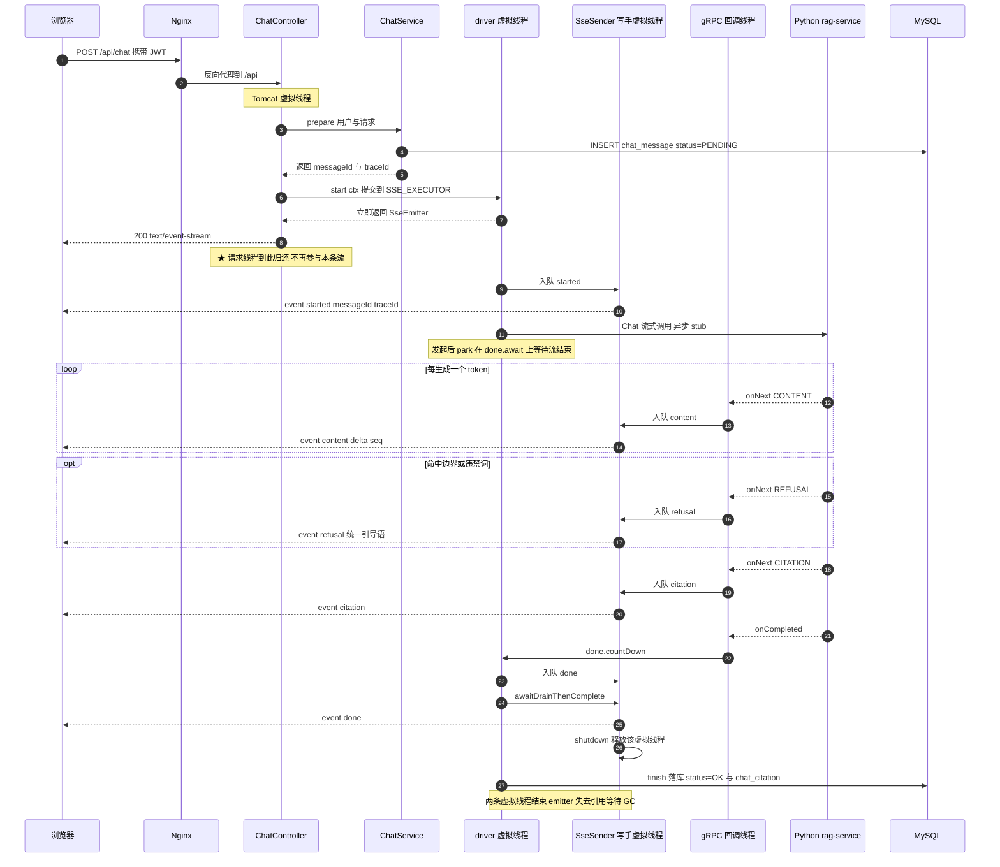
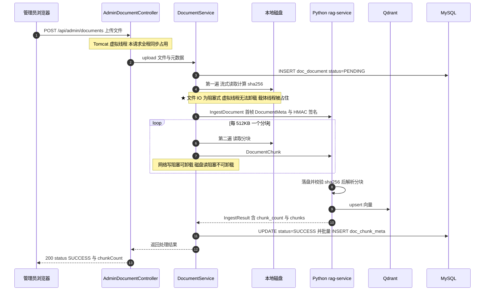
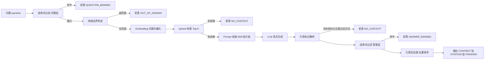

# 03 · 详细设计技术方案 · 华电学生手册 RAG 智能问答系统

> 版本：**v1.5** ｜ 日期：2026-11-27 ｜ 角色：架构师
> 上游依据：`docs/02-总体设计.md`（下称 02）、`docs/01-PRD.md` **v1.4**（下称 01）、`docs/00-项目背景与约束提炼.md` **v1.6**（下称 00）、`学生手册rag-技术文档.md` v1.1（下称 S2）、`学生手册rag.md`（下称 S1）
> 下游文档：`docs/04-开发排期表.md`（下称 04）
>
> **编号空间**：`UD-01~UD-09` = 用户决策（见 00 号 §1.5）；`D-01~D-04` = 课程交付约束（见 00 号 §6.4）；`D-01~D-07` = 交付物验收项（见 PRD §7.4）；`Q-01~Q-22` = 待确认项。

### 修订记录

| 版本 | 主要变更 |
|---|---|
| v1.0 | 初版：11 章 + 自检清单，含完整 `.proto`、Java/Python 详细设计、HMAC/TLS、DDL、Qdrant、错误码、配置项、单元测试范围 |
| **v1.1** | ① 用户决策编号回写 `UD-`；② 上游版本对齐 00 v1.3 / 01 v1.3；③ **本轮基于 QA 审计返工**（4 阻塞 / 9 重要 / 11 建议）：§10 补齐 18 条缺失用例并新增 §10.4 前端用例组（阻塞-1）、§5.1 新增跨语言黄金用例规格与 `banned_words_digest`（阻塞-1 + 建议-1）、新增 `3004` 错误码并将其作为 HMAC 失败的唯一映射（重要-2）、SSE 事件集合统一为 6 业务 + 1 心跳（重要-3）、**删除 `Citation.permission`** 并新增「proto 字段—消费方」对照表（重要-4）、§5.1 心跳伪代码补 `try/catch` 与单线程事件队列（建议-2）、量级假设全部标注为估算（建议-3）、CI 措辞改为「一条 `make proto`」（建议-6）、状态迁移拼写修正并补白名单表（建议-10） |
| **v1.2** | ① **`IngestResult` 新增 `repeated ChunkBrief chunks = 8`** 与 `ChunkBrief` 消息定义，补 `doc_chunk_meta` 的数据源（该表此前无写入方，属设计缺口）；② §2.2.1「字段—消费方」表补 `IngestResult.chunks` 一行；③ `doc_chunk_meta` 建表注释由「可选」改为「分块清单」；④ §10 新增 `test_ingest_chunk_briefs`（Python）与 `test_chunk_meta_persist`（Java），用例总数 94 → **96**；⑤ 配置项 `JAVA_DB_URL` / `RAG_HOST` 示例改为 `127.0.0.1`（`UD-08` 单机基线） |
| **v1.3** | ① **运行时定为 JDK 21（LTS）**，启用**虚拟线程**：SSE 流处理改 `newVirtualThreadPerTaskExecutor()`、`SseSender` 改单线程虚拟执行器；② **新增 §3.9「并发与线程模型」**（用/不用边界、配置、pinning 坑、验证方式）；③ `SSE-1` 重写（理由从「Tomcat 线程不够」改为「请求线程即返 + 虚拟线程承载长阻塞」）、新增 `SSE-8`（禁止 `synchronized` 保护 SSE 写）；④ 配置项 **删除 `SSE_POOL_SIZE`**、新增 `SPRING_THREADS_VIRTUAL_ENABLED`；⑤ 新增用例 `test_chat_runs_on_virtual_thread`，用例总数 96 → **97** |
| **v1.4** | ① 新增 **§3.9.6「全链路时序（线程归属）」**：一张 sequenceDiagram 标出问答链路中每个环节跑在 Tomcat 虚拟线程 / driver 虚拟线程 / SseSender 虚拟线程 / gRPC 回调线程（框架线程，不可虚拟化）之上；② 新增 **§3.9.7「文档上传链路的线程模型」**：说明上传是**同步占用**请求线程，且 **文件 IO 阻塞不可被虚拟线程卸载**（JDK 21 限制），给出缓解手段；③ 两张图同步补入独立素材 `docs/sequence-diagram.mermaid`（作为流 5、流 6）|
| **v1.5** | ① 按 P01 实现同步用例口径：§10.1 的 `test_config_required_missing` 由「抽查 3 个必填项」改为**逐个覆盖 11 个**；② §10.2 补 Java 侧同名用例（6 个必填项逐个缺失 + 空串 + `RAG_TLS_ENABLED=false` 被拒 + 默认 `tls.enabled=true`）；③ 用例总数 97 → **98**（Java 35 → 36）|
| **v1.5** | ① **Java 构建工具改为 Maven**（`UD-09`）：§2.3 的生成命令、产物路径、目录树全部改写为 `pom.xml` + `protobuf-maven-plugin`（`mvn generate-sources`），`build.gradle` / `gradlew` 表述不再使用；② §2.3 的 CI 措辞修正为「仓库有 GitHub Actions 工作流，但不建 CI 集群与环境矩阵」，与 `.github/workflows/ci.yml` 的事实一致；③ **P01 固定 protoc 版本组合**：Java `protoc 3.25.1`、`grpc-java 1.65.1`、Python `grpcio-tools 1.62.3`（自带 `libprotoc 25.1`），两侧主版本一致（`Q-22` 在 P01 落地，可复核）；④ §6 DDL 注释「可选表」更正为「分块清单表」；⑤ 编号口径扩为 `UD-01~UD-09`；⑥ 上游版本对齐 00 v1.6 / 01 v1.4 |

---

## 1. 文档信息与 02 的对应关系

| 项 | 内容 |
|---|---|
| 文档名称 | 华电学生手册 RAG 智能问答系统 · 详细设计技术方案 |
| 版本 | v1.0 ｜ 日期 2026-11-26 |
| 设计范围 | **只覆盖一期**，与 02 完全一致【UD-01】 |
| 本文定位 | 02 回答「系统由什么组成、边界在哪」；**本文回答「每个类/函数怎么写、每个字段什么意思、每种错误怎么处理」**，可直接作为编码依据 |
| 编号口径 | 用户决策统一写 **`UD-01`~`UD-09`**（与 00 号文档 §1.5 一致）；课程交付约束写 **`D-01`~`D-04`**（00 号文档 §6.4：可运行原型 / **四类设计图与接口文档** / ≥10 溯源用例 / 引用形态）；PRD 验收写 `A-xx`/`B-xx`/`C-xx`。**三套前缀严格区分，不使用 `D-` 表示用户决策** |

| 02 的章节 | 本文的对应章节 | 关系 |
|---|---|---|
| 02 §3 架构总览 | 本文 §2 Proto、§3 Java、§4 Python | 02 画层，本文落到包/类/函数 |
| 02 §4 模块划分 | 本文 §3.1 包结构、§3.2 类清单、§4.1 目录结构 | 02 给职责，本文给签名 |
| 02 §5 关键数据流 | 本文 §3.4 SSE 实现、§4.3 pipeline 顺序 | 02 给时序，本文给伪代码 |
| 02 §6 数据模型 | 本文 §6 DDL、§7 Qdrant collection | 02 给 ER 与字段表，本文给可执行 DDL |
| 02 §7 接口清单 | 本文 §2 Proto、§8 错误码 | 02 给清单，本文给契约与错误映射 |
| 02 §9.2 安全落点 | 本文 §5 HMAC 与 TLS | 02 给落点，本文给拼接规则与代码时序 |
| 02 §9.4 扩展点 | 本文 §4.1/§4.3 抽象定义 | 02 说挂哪儿，本文说抽象长什么样 |
| 02 未展开的 | 本文 §9 配置项、§10 单元测试范围 | 02 未涉及，本文新增 |

---

## 2. Protobuf 契约（完整 `.proto`）

### 2.1 契约设计要点

| 编号 | 要点 | 说明 | 来源 |
|---|---|---|---|
| PC-1 | 4 个 RPC 保留 S2 §7.2 的原签名，不改名不改流式类型 | `Chat`(server stream) / `IngestDocument`(client stream) / `DeleteDocument` / `HealthCheck` | 【源：技术文档 §7.2】【源：PRD NFR-16】 |
| PC-2 | **`ChatChunk` 扩展多事件类型**，同时保留原 `content` / `finished` 字段语义以兼容 §7.2 骨架 | 该扩展依据 **S2 §7.3「更细粒度的流式事件类型」** | 【源：技术文档 §7.3】 |
| PC-3 | 补齐 §7.3 待补 8 项：文档权限、版本、元数据、引用来源、错误状态、请求追踪、文件摘要、事件类型 | 逐项在下方字段注释中标注「§7.3 待补」 | 【源：技术文档 §7.3】 |
| PC-4 | 拒答不是错误：用 `CHAT_EVENT_REFUSAL` 表达，`ErrorInfo` 只用于真异常 | 理由见 §8.3 | 【设计裁决：见 §8.3】 |
| PC-5 | 一期不预留未定义用途的「万能 bytes 字段」，避免二期被滥用；但按 Q-18 预留 `retrieval_mode` 与 `score` | Q-18 建议预留 | 【待确认 Q-18】 |
| PC-6 | `permission` 字段随请求与元数据透传，但 Python **不得**用它做检索过滤 | 【UD-07】 |  |
| PC-7 | `banned_words` 随 `ChatRequest` 传入（02 §4.4 A-3-b 方案） | 词表由 Java 管理，Python 不直连业务库 | 【设计裁决】【待确认 Q-07】 |

### 2.2 `proto/rag_service.proto`（完整可编译版本）

```proto
syntax = "proto3";

package rag;

// ---------------------------------------------------------------------------
// 代码生成选项（Java 侧）
// 生成方式见 §2.3。`java_package` 取值为【设计裁决】：
//   02 §3.1 是 Mermaid 分层图，**并未定义 Java 包结构**，因此包名不由 02 决定。
//   取 `com.ncepu.rag.grpc` 的理由：与 §3.1 中 `com.ncepu.rag.*` 的工程包根保持一致，
//   把 proto 生成物单独放 `.grpc` 子包，避免生成代码与手写业务包混在一起难分辨。
// ---------------------------------------------------------------------------
option java_package = "com.ncepu.rag.grpc";
option java_outer_classname = "RagServiceProto";
option java_multiple_files = true;

// ---------------------------------------------------------------------------
// 服务定义：4 个 RPC，签名与 S2 §7.2 一致，不做改名、不改流式类型
// 【源：技术文档 §7.2】
// ---------------------------------------------------------------------------
service RagService {

  // 问答：Python 流式返回生成内容 + 引用 + 拒答 + 错误 + 结束
  // 流式类型：Server Streaming
  // 调用方：Java gRPC Client；被调方：Python gRPC Server
  // 【源：技术文档 §7.2、§8】【源：PRD FR-25】
  rpc Chat(ChatRequest) returns (stream ChatChunk);

  // 文档入库：Java 分块上传文件，Python 边收边写盘
  // 流式类型：Client Streaming
  // 【源：技术文档 §7.2、§8.1】【源：PRD FR-07】
  rpc IngestDocument(stream DocumentChunk) returns (IngestResult);

  // 删除文档：同时清理向量与原文件
  // 流式类型：Unary
  // 【源：技术文档 §7.2】【源：PRD FR-11】
  rpc DeleteDocument(DeleteDocumentRequest) returns (OperationResult);

  // 健康检查
  // 流式类型：Unary
  // 【源：技术文档 §7.2】【源：PRD FR-41】
  rpc HealthCheck(HealthRequest) returns (HealthResponse);
}

// ===========================================================================
// 公共枚举与结构
// ===========================================================================

// 流式事件类型。
// 扩展依据：S2 §7.3「更细粒度的流式事件类型」【源：技术文档 §7.3】
// 一期取值：CONTENT / CITATION / REFUSAL / ERROR / FINISHED
// 预留（二期）：RETRIEVAL_TRACE（暴露检索过程，供演示与调试）
enum ChatEventType {
  CHAT_EVENT_UNSPECIFIED = 0;   // 未设置，服务端必须不发送此值
  CHAT_EVENT_CONTENT     = 1;   // 正常答案内容增量，content 字段有值
  CHAT_EVENT_CITATION    = 2;   // 引用来源列表，citations 字段有值
  CHAT_EVENT_REFUSAL     = 3;   // 拒答（领域边界外 / 违禁词命中），refusal 字段有值
  CHAT_EVENT_ERROR       = 4;   // 真异常，error 字段有值
  CHAT_EVENT_FINISHED    = 5;   // 本轮结束，finished 字段为 true
  CHAT_EVENT_RETRIEVAL_TRACE = 6; // 预留：二期暴露检索细节，一期不发送
}

// 拒答原因。拒答不是错误，因此单独枚举而非复用 ErrorInfo。【设计裁决：见 §8.3】
enum RefusalReason {
  REFUSAL_REASON_UNSPECIFIED    = 0;
  REFUSAL_REASON_OUT_OF_DOMAIN  = 1;  // 超出校园制度范围（FR-29）
  REFUSAL_REASON_QUESTION_BANNED = 2; // 问题层违禁词命中（FR-31）
  REFUSAL_REASON_ANSWER_BANNED  = 3;  // 答案层违禁词命中（FR-31）
  REFUSAL_REASON_NO_CONTEXT     = 4;  // 检索无有效依据 / 模型未产出引用（见 §4.5）
}

// 检索模式。二期 BM25/RRF 接入后使用，一期固定为 VECTOR。【待确认 Q-18】
enum RetrievalMode {
  RETRIEVAL_MODE_UNSPECIFIED = 0;
  RETRIEVAL_MODE_VECTOR      = 1;  // 一期唯一取值
  RETRIEVAL_MODE_HYBRID      = 2;  // 二期 BM25 + RRF
}

// 通用错误状态。仅表达「调用失败」，不表达业务拒答。【源：技术文档 §7.3「错误状态」】
message ErrorInfo {
  string code        = 1; // 错误码，与 §8.1 的字符串码对齐，如 RAG_TIMEOUT
  string message     = 2; // 面向开发者的描述，不含堆栈、不含 Secret
  bool   retryable   = 3; // 是否可重试：超时/不可用为 true，参数错误为 false
  string detail_code = 4; // 更细的二级码，可为空，用于前端精细化提示
}

// 引用来源。对齐 T-12 的 6 个元数据 + 展示所需字段。
// 【源：技术文档 §5.2 T-12 + §7.3「引用来源」（推导）】【源：PRD FR-26】
message Citation {
  string doc_id      = 1; // 文档业务主键
  string title       = 2; // 文档标题（文件名）。§7.3 待补：文档元数据
  string section_path = 3; // 章节路径，如「第三章 学籍管理 > 转专业」
  string clause      = 4; // 条款编号，如「第 12 条」，抽不到时为空
  string source      = 5; // 来源说明
  string version     = 6; // 文档版本。§7.3 待补：文档版本信息
  // 字段编号 7 已废弃（原 Citation.permission）——引用展示不需要权限标记，
  // permission 只存在于 chunk 元数据与 Qdrant payload 中；保留编号不复用，见 §2.2 字段—消费方表。
  reserved 7;
  int32  chunk_index = 8; // 分块序号，便于回溯原文位置
  float  score       = 9; // 相似度分数，一期仅记录，不参与排序。【待确认 Q-18】
  string snippet     = 10;// 命中片段摘要，供前端「查看原文」用
  int32  rank        = 11;// 展示顺序，从 1 开始
}

// 拒答信息。message 必须是统一引导语，保证多次拒答文案一致（FR-30）。
// 【源：PRD FR-30】
message RefusalInfo {
  RefusalReason reason  = 1; // 拒答原因枚举
  string        message = 2; // 统一引导话术，取自 Skill 配置，不在代码里硬编码
}

// 多轮对话历史项。
// 一期是否启用取决于 Q-09；Proto 先定义以便二期不改契约。
// 【待确认 Q-09】
message HistoryTurn {
  string role    = 1; // "user" 或 "assistant"
  string content = 2; // 该轮内容
}

// 检索参数。一期只使用 top_k，其余为二期预留。【待确认 Q-18】
message RetrievalOptions {
  int32         top_k          = 1; // 一期默认由 Python 配置决定，客户端可覆盖
  float         score_threshold = 2; // 一期默认 0 表示不过滤（见 §4.4）
  RetrievalMode mode           = 3; // 一期**恒为 RETRIEVAL_MODE_VECTOR**，Python 侧断言该值；
                                    // 消费者：`retriever.py`（校验并透传到 RetrievedChunk.mode）。
                                    // 二期启用 RETRIEVAL_MODE_HYBRID（BM25+RRF）。【待确认 Q-18】
}

// ===========================================================================
// Chat
// ===========================================================================

message ChatRequest {
  string user_id       = 1; // 用户标识（Java 已鉴权，Python 不再校验身份）
  string session_id    = 2; // 会话标识，供日志串联与（可选）多轮上下文
  string question      = 3; // 用户问题原文
  string trace_id      = 4; // §7.3 待补：请求追踪信息，全链路同值
  repeated HistoryTurn history = 5; // 多轮上下文，一期可为空【待确认 Q-09】
  RetrievalOptions retrieval   = 6; // 检索参数，可空
  repeated string user_roles   = 7; // 用户角色码。**消费点**：Python 在 WARN/审计级结构化日志中
                                   // 记录"本次问答的角色快照"，用于事后排查越权风险（FR-40）；
                                   // 一期**不参与**检索过滤（UD-07），也不做任何权限判断。
  // 注：若 Q-09 确认一期不做多轮，history 字段恒为空但仍保留（避免二期改契约）。

  // 违禁词表（方案 A-3-b：由 Java 随请求传入）。
  // 理由：Python 不直连 Java 业务库（02 B-04），且 FR-33 要求词表变更对后续问答即时生效。
  // 【设计裁决：存储与传递方式文档未规定】【待确认 Q-07】
  repeated BannedWord banned_words = 8;
  int64 banned_words_version       = 9; // 词表版本号，Python 侧可用于只读缓存失效判断
}

// 违禁词条目。由 Java 从 MySQL banned_word 表读出后随请求下发。
message BannedWord {
  string word  = 1; // 词条
  string scope = 2; // QUESTION / ANSWER / BOTH
  string match_type = 3; // EXACT / CONTAINS（正则是否支持【待确认 Q-07】）
}

message ChatChunk {
  // ---- 兼容字段（S2 §7.2 原骨架，保留语义）----
  string content  = 1; // 仅当 event_type = CONTENT 时有值，为增量片段
  bool   finished = 2; // 仅当 event_type = FINISHED 时为 true

  // ---- 扩展字段（依据 S2 §7.3）----
  ChatEventType event_type = 3; // §7.3 待补：更细粒度的流式事件类型
  repeated Citation citations = 4; // 仅 CITATION 事件有值
  RefusalInfo refusal = 5;         // 仅 REFUSAL 事件有值
  ErrorInfo   error   = 6;         // 仅 ERROR 事件有值
  string trace_id     = 7;         // §7.3 待补：请求追踪信息，回填原值便于对账
  int32  seq          = 8;         // 事件序号，从 1 递增，用于前端乱序容错与丢帧检测
  int64  emitted_at_ms = 9;        // 事件产生时间（epoch 毫秒）。**消费点**：Java `SseStreamBridge`
                                   // 用它算「首块延迟」与「相邻帧间隔」并写入应用日志（结构化字段
                                   // `first_chunk_ms` / `frame_gap_ms`），供 NFR-01 的流式体验观测；
                                   // 该值不进 SSE 帧、不入库。
}
```

```proto
// ===========================================================================
// IngestDocument
// ===========================================================================

// 文档元数据。§7.3 待补：文档权限信息 / 文档版本信息 / 文档元数据
// 只在流的首帧携带。【源：技术文档 §7.3】【源：PRD FR-09】
message DocumentMeta {
  string title       = 1; // 文档标题，用于引用展示
  string version     = 2; // 文档版本，默认 v1，语义见 Q-12【待确认 Q-12】
  string source      = 3; // 来源说明
  string permission  = 4; // 权限标记，一期仅落库不参与过滤【UD-07】
  string uploader_id = 5; // 上传人，供审计
  string mime_type   = 6; // text/markdown 或 text/plain
  int64  size_bytes  = 7; // 整文件字节数，供 Python 侧校验是否收全
}

message DocumentChunk {
  string document_id = 1; // 文档业务主键，Java 生成 UUID
  bytes  content     = 2; // 文件内容分块
  string file_name   = 3; // 原始文件名（首帧有效，后续帧可重复携带以便幂等）
  int32  seq         = 4; // 分块序号，从 1 递增，用于检测丢帧/乱序
  bool   is_last     = 5; // 是否最后一块
  string sha256      = 6; // 整文件 SHA-256（十六进制小写）。§7.3 待补：文件摘要
                         // 仅最后一块携带；Python 收完后比对落盘文件摘要
  DocumentMeta meta  = 7; // 文档元数据，仅首帧携带
  string trace_id    = 8; // §7.3 待补：请求追踪信息
}

// 单块元数据（分块清单项）。Python 在分块完成时逐块产出，随 IngestResult 一次性回传。
// **消费点**：Java `DocumentService` 批量写入 MySQL `doc_chunk_meta`，供管理后台展示
// 「某文档被拆成哪些块、各对应哪一章节/条款」以便人工核对分块质量。
// 不含正文：正文在 Qdrant payload 中，本结构只承载定位信息。
message ChunkBrief {
  int32  chunk_index     = 1; // 块序号，从 0 开始，与 Qdrant payload 同值
  string section_path    = 2; // 章节路径，如「第三章 学籍管理 > 第二节 转专业」
  string clause          = 3; // 条款编号（抽不到为空串）
  string qdrant_point_id = 4; // 对应 Qdrant 点 ID，供人工反查
  int32  token_count     = 5; // 该块 Token 数，供分块参数调优
}

message IngestResult {
  bool       success     = 1; // 是否成功
  string     document_id = 2; // 回显
  string     message     = 3; // 人类可读结果描述
  int32      chunk_count = 4; // 实际入库分块数，供 Java 记录
  ErrorInfo  error       = 5; // success=false 时有值
  string     trace_id    = 6; // 回显
  int64      elapsed_ms  = 7; // Python 侧处理总耗时。**消费点**：Java `DocumentService` 将其写入
                              // `audit_log.detail.elapsed_ms`（action=DOC_UPLOAD），用于入库耗时观测；
                              // 不入 `doc_document` 表（该表无此列）。
  // 分块清单。**消费点**：Java `DocChunkMetaMapper` 批量插入 `doc_chunk_meta`。
  // 约束：chunks.size() 必须等于 chunk_count；success=false 时为空。
  // 设计理由：`doc_chunk_meta` 是「分块清单表」，若不入此字段则该表无数据源，
  // 管理后台的「分块预览」将无内容可显示（见 02 §6.2.7）。
  // 【设计裁决：S2 §7.2 未定义该字段，属对一期契约的补充，依据 02 §6.2.7 的用途反推】
  repeated ChunkBrief chunks = 8;
}

// ===========================================================================
// DeleteDocument
// ===========================================================================

message DeleteDocumentRequest {
  string document_id = 1; // 待删除文档
  string trace_id    = 2; // §7.3 待补：请求追踪信息
  string operator_id = 3; // 操作人，供审计（Python 只落日志，不改业务表）
}

message OperationResult {
  bool      success         = 1; // 是否成功
  string    message         = 2; // 描述
  int32     affected_chunks = 3; // 删除的向量点数
  ErrorInfo error           = 4; // success=false 时有值
  string    trace_id        = 5; // 回显
}

// ===========================================================================
// HealthCheck
// ===========================================================================

message HealthRequest {
  string trace_id = 1; // §7.3 待补：请求追踪信息
  bool   deep     = 2; // true 时额外探测 LLM/Embedding API 连通性（会产生外部调用）
}

message DependencyStatus {
  string name      = 1; // qdrant / llm_api / embedding_api / storage / skill
  bool   healthy   = 2; // 是否可用
  string detail    = 3; // 失败原因，脱敏
  int64  latency_ms = 4; // 探测耗时
}

message HealthResponse {
  bool   healthy    = 1; // 总体是否可用（任一必需依赖不可用即为 false）
  string service    = 2; // 服务名固定 rag-service
  string version    = 3; // 服务版本，取自构建信息
  repeated DependencyStatus dependencies = 4; // 各依赖状态
  string trace_id   = 5; // 回显
  int64  timestamp_ms = 6; // 服务端时间，便于排查 NTP 偏差
}
```

> **注意**：上面两段代码块属于**同一个文件** `proto/rag_service.proto`，此处为可读性拆成两段；实际落盘为一个文件（§2.3 给出目录位置）。

#### 2.2.1 proto 字段 → 消费方对照表

> **为什么要有这张表**：proto 里"定义了但没人读"的字段是典型的沉没成本，还会在二期被误当成"已实现"。本表逐个字段写明**谁读它、读到后干什么**，没有消费方的字段一律删除或标 `reserved`。QA 审计（重要-4）发现 5 个字段无消费点，处理结果见最后一列。

| 消息.字段 | 写入方 | **消费方（谁读、干什么）** | 状态 |
|---|---|---|---|
| `ChatRequest.user_id` | Java | Python 日志上下文 + 拒答审计 | 有消费 |
| `ChatRequest.session_id` | Java | Python 日志串联（一期不做多轮，见 Q-09） | 有消费 |
| `ChatRequest.question` | Java | `guard.check_question` + `embedding` + `generator` | 有消费 |
| `ChatRequest.trace_id` | Java | Python 结构化日志 MDC + 回填 `ChatChunk.trace_id` | 有消费 |
| `ChatRequest.history` | Java（一期恒空） | 一期不消费；`generator.build_messages` 仅在非空时拼接 | **一期不消费（Q-09 待确认）**，保留以免二期改契约 |
| `ChatRequest.retrieval` | Java | `retriever` 读 `top_k`/`score_threshold` | 有消费 |
| `ChatRequest.user_roles` | Java | **Python WARN/审计级日志的角色快照（FR-40 排查用）** | 本轮补充消费点 |
| `ChatRequest.banned_words` | Java | `guard.check_question` / `check_answer` | 有消费 |
| `ChatRequest.banned_words_version` | Java | Python 只读缓存失效判断 + 参与 `payload_digest` | 有消费 |
| `BannedWord.*` | Java | `guard` 的匹配（含 `scope` 过滤） | 有消费 |
| `ChatChunk.content` | Python | Java 累积答案 + 转 SSE `content` 帧 | 有消费 |
| `ChatChunk.finished` | Python | Java 判断末帧（配合 `event_type=FINISHED`） | 有消费 |
| `ChatChunk.event_type` | Python | Java switch 分发 | 有消费 |
| `ChatChunk.citations` | Python | Java 写 `chat_citation` + 转 SSE `citation` 帧 | 有消费 |
| `ChatChunk.refusal` | Python | Java 写 `chat_message.status=REFUSED` + `refusal_reason` + 转 SSE `refusal` 帧 | 有消费 |
| `ChatChunk.error` | Python | Java 转 SSE `error` 帧 + 写 `status=ERROR` | 有消费 |
| `ChatChunk.trace_id` | Python | Java 对账（校验与本地 `traceId` 一致） | 有消费 |
| `ChatChunk.seq` | Python | Java 丢帧检测 + 前端乱序容错 | 有消费 |
| `ChatChunk.emitted_at_ms` | Python | **Java `SseStreamBridge` 算首块延迟/帧间隔，写应用日志** | 本轮补充消费点 |
| `Citation.doc_id/title/section_path/clause/source/version/chunk_index/score/snippet/rank` | Python | Java 写 `chat_citation` 对应列；前端渲染引用区块 | 有消费 |
| ~~`Citation.permission`~~ | — | **无消费方**（`chat_citation` 无此列，前端也不需要；`permission` 只存在于 chunk 元数据与 Qdrant payload） | **已删除**，字段编号 `reserved 7` |
| `DocumentChunk.document_id/content/file_name/seq/is_last/sha256/meta/trace_id` | Java | Python `file_store`（写盘、`seq` 断档检测、`sha256` 比对）与 `parser`/`chunker` | 有消费 |
| `DocumentMeta.*` | Java | Python 落 chunk 元数据与 Qdrant payload | 有消费 |
| `IngestResult.success/document_id/message/chunk_count/error/trace_id` | Python | Java 更新 `doc_document` 状态 + 转 HTTP 响应 | 有消费 |
| `IngestResult.elapsed_ms` | Python | **Java `DocumentService` 写 `audit_log.detail.elapsed_ms`（DOC_UPLOAD）** | 本轮补充消费点 |
| `IngestResult.chunks`（`ChunkBrief`） | Python | **Java `DocChunkMetaMapper` 批量插入 `doc_chunk_meta`**，供管理后台分块预览与分块质量核对 | 本轮新增（补 `doc_chunk_meta` 数据源） |
| `DeleteDocumentRequest.document_id/trace_id` | Java | Python `qdrant_store.delete_by_doc` + 日志 | 有消费 |
| `DeleteDocumentRequest.operator_id` | Java | Python 审计日志（不写业务表） | 有消费 |
| `OperationResult.*` | Python | Java 更新状态 + 转 HTTP 响应 | 有消费 |
| `HealthRequest.deep` | Java | Python 决定是否探测 LLM/Embedding | 有消费 |
| `HealthResponse.*` | Python | Java 聚合后转 `/api/admin/health` | 有消费 |
| `RetrievalOptions.mode` | Java | **Python `retriever` 断言一期恒为 `VECTOR`**，并透传到 `RetrievedChunk` | 保留，一期恒 VECTOR，二期启用 HYBRID |
| `ErrorInfo.code/message/retryable/detail_code` | Python | Java `GrpcStatusMapper` → 业务码（§8.2）+ 前端提示 | 有消费 |
| `HistoryTurn.role/content` | Java（一期恒空） | 同上 `history`，一期不消费 | **一期不消费（Q-09）** |

> 结论：除 `Citation.permission`（已删）与 `history`/`HistoryTurn`（Q-09 未定，保留字段但一期不消费）外，**所有字段均有明确消费方**。`history` 的"不消费"是**显式记录在案的待确认项**，不是遗漏。【设计裁决】

### 2.3 代码生成与跨仓库共享方式

**共享方式【设计裁决：理由如下】**

| 方案 | 做法 | 取舍 |
|---|---|---|
| **A（采纳）单仓双工程** | 一个仓库根目录下 `proto/rag_service.proto`，`java-service/` 与 `python-rag/` 各自引用同一份文件构建 | 单人开发（UD-04）场景下最省事；proto 变更是原子提交，不会出现两侧版本漂移；**一条 `make proto` 即可同时跑两侧代码生成**（仓库虽有 `.github/workflows/ci.yml` 做编译与单测，但**不建 CI 集群与环境矩阵**，见 04 §6，故本地命令必须可独立完成生成） |
| B git submodule | proto 单独仓库，两侧以 submodule 引用 | 需要维护 submodule 指针，单人开发收益为负 |
| C 复制两份 | 两侧各存一份 | 必然漂移，NFR-16「两侧由同一 proto 生成」无法证明 |

> 采纳 A。该结论**不是文档规定的**——S2 §7.1 只说「应单独维护一个 `.proto` 文件」，未规定仓库组织方式。【源：技术文档 §7.1】【设计裁决】

**目录与产物路径**

```text
student-rag/                        # 仓库根
├── proto/
│   └── rag_service.proto           # 唯一契约源
├── java-service/
│   ├── pom.xml                     # Maven 构建（UD-09），protobuf-maven-plugin 生成代码
│   ├── src/main/proto -> 引用 ../proto（通过 <protoSourceRoot> 或资源复制）
│   └── target/generated-sources/protobuf/
│       ├── grpc-java/com/ncepu/rag/grpc/RagServiceGrpc.java   # pluginId=grpc-java 决定目录名
│       └── java/com/ncepu/rag/grpc/*.java
└── python-rag/
    ├── Makefile                    # make proto 生成下方产物
    └── app/grpc_gen/
        ├── rag_service_pb2.py
        └── rag_service_pb2_grpc.py
```

| 侧 | 工具 | 命令 | 说明 |
|---|---|---|---|
| Java | `protobuf-maven-plugin`（`org.xolstice.maven.plugins:0.6.1`）+ `os-maven-plugin` | `mvn generate-sources` | 在 `pom.xml` 中配置 `<protocArtifact>com.google.protobuf:protoc:3.25.1:exe:${os.detected.classifier}</protocArtifact>` 与 `<pluginArtifact>io.grpc:protoc-gen-grpc-java:1.65.1:exe:${os.detected.classifier}</pluginArtifact>`；`.`proto` 通过 `<protoSourceRoot>${project.basedir}/../proto</protoSourceRoot>` 引用，**不复制第二份** |
| Python | `grpcio-tools` | `python -m grpc_tools.protoc -I../proto --python_out=app/grpc_gen --grpc_python_out=app/grpc_gen ../proto/rag_service.proto` | 产物**不入 Git**（加 `.gitignore`），由构建脚本生成，避免手改生成代码 |

> **版本组合（P01 已定，2026-11-27）**：Java 侧 `protoc 3.25.1` + `grpc-java 1.65.1`（其 `protobuf-java` 依赖为 3.25.1）；Python 侧 `grpcio-tools 1.62.3` 自带 **`libprotoc 25.1`**。两侧 `protoc` **主版本完全一致（25.1）**，这是跨语言生成兼容的前提，由 `test_proto_version_match` 断言：Python 用例读取 `python -m grpc_tools.protoc --version` 与 `pom.xml` 中的 `protoc.version` 比较。`Q-22` 由此在 P01 落地，仍可在后续复核升级。【源：技术文档 §7.1】【UD-09】【设计裁决：版本选择】

---

## 3. Java 侧详细设计

### 3.1 工程分层与包结构

```text
java-service/src/main/java/com/ncepu/rag/
├── RagApplication.java
├── common/                      # 公共
│   ├── ApiResponse.java          # 统一响应体 {code,data,message,traceId}
│   ├── BizException.java         # 业务异常（带 code）
│   ├── ErrorCode.java            # 错误码枚举（见 §8.1）
│   ├── TraceIdFilter.java        # 生成/透传 trace_id 并写入 MDC
│   └── GlobalExceptionHandler.java # @RestControllerAdvice，统一转 ApiResponse
├── config/
│   ├── SecurityConfig.java       # SecurityFilterChain（见 §3.3）
│   ├── GrpcClientConfig.java     # Channel / Stub Bean
│   ├── SseConfig.java            # SSE 配置（虚拟线程执行器 + 心跳调度器）
│   ├── MybatisPlusConfig.java
│   └── WebMvcConfig.java         # CORS 显式配置
├── security/
│   ├── JwtService.java           # 签发/解析/校验
│   ├── JwtAuthFilter.java        # OncePerRequestFilter，解析 JWT 写 SecurityContext
│   ├── AuthUser.java             # 当前用户主体
│   ├── RestAuthEntryPoint.java   # 401 统一出口
│   └── RestAccessDeniedHandler.java # 403 统一出口
├── controller/
│   ├── AuthController.java       # R-01 ~ R-03
│   ├── SessionController.java    # R-04 ~ R-07
│   ├── ChatController.java       # R-08（SSE）
│   ├── HealthController.java     # R-09
│   └── admin/
│       ├── AdminDocumentController.java  # R-10 ~ R-13
│       ├── AdminChatLogController.java   # R-14
│       ├── AdminBannedWordController.java # R-15 ~ R-18
│       ├── AdminHealthController.java    # R-19
│       └── AdminAuditLogController.java  # R-20
├── service/
│   ├── AuthService.java
│   ├── SessionService.java
│   ├── ChatService.java          # 问答编排（核心）
│   ├── DocumentService.java      # 文档状态机
│   ├── BannedWordService.java
│   ├── AuditService.java
│   └── RateLimitService.java
├── mapper/                       # MyBatis-Plus Mapper 接口
│   ├── SysUserMapper.java  SysRoleMapper.java  SysUserRoleMapper.java
│   ├── ChatSessionMapper.java  ChatMessageMapper.java  ChatCitationMapper.java
│   ├── DocDocumentMapper.java  DocChunkMetaMapper.java
│   └── AuditLogMapper.java  BannedWordMapper.java
├── entity/                       # 与表一一对应的 DO
├── dto/                          # 出入参 DTO / VO
├── grpc/
│   ├── RagServiceClient.java     # 4 个 RPC 的封装（含幂等/超时策略）
│   ├── HmacClientInterceptor.java# Metadata 注入（见 §5.2）
│   └── GrpcStatusMapper.java     # gRPC status → 业务错误码（见 §8.2）
├── sse/
│   ├── SseStreamBridge.java      # gRPC 流 → SSE 事件（核心，见 §3.4）
│   └── SseEventPayload.java      # 事件负载结构（content/citation/refusal/error/done）
└── ratelimit/
    └── RateLimitFilter.java      # 进程内令牌桶（见 §3.7）
```

### 3.2 关键类清单

| 类 / 接口 | 职责 | 关键方法签名 | 依赖 | 对应 FR |
|---|---|---|---|---|
| `AuthService` | 校验密码、签发 JWT、查用户角色 | `LoginResp login(LoginReq req)`；`AuthUser loadByUsername(String u)` | `SysUserMapper`、`PasswordEncoder`、`JwtService` | FR-01 |
| `JwtService` | 签发与解析 JWT | `String issue(AuthUser u)`；`AuthUser parse(String token)`；`boolean isBlacklisted(String jti)` | 配置（secret、exp） | FR-01 |
| `JwtAuthFilter` | 从 Header 取 Token 并写入 `SecurityContext` | `doFilterInternal(req, resp, chain)` | `JwtService` | FR-01、FR-03 |
| `SecurityConfig` | 定义过滤链、路径规则、CORS、401/403 出口 | `SecurityFilterChain filterChain(HttpSecurity)` | `JwtAuthFilter`、`CorsConfigurationSource` | FR-02、FR-03、NFR-10、NFR-11 |
| `SessionService` | 会话 CRUD + 归属校验 | `Long create(Long userId, String title)`；`Page<SessionVO> listByUser(Long userId, PageQ q)`；`void assertOwner(Long sessionId, Long userId)` | `ChatSessionMapper` | FR-35、FR-37 |
| `ChatService` | **问答编排**：校验 → 落库 PENDING → 取词表 → 调 gRPC → 桥接 SSE → 收尾落库 | `ChatContext prepare(AuthUser u, ChatReq req)`；`void finish(ChatContext ctx, String answer, List<Citation> cits, RefusalInfo refusal, ErrorInfo error)` | `SessionService`、`ChatMessageMapper`、`RagServiceClient`、`BannedWordService` | FR-23、FR-25、FR-36、FR-37 |
| `RagServiceClient` | 封装 4 个 RPC，统一超时与错误映射 | `void chat(ChatRequest req, StreamObserver<ChatChunk> obs)`；`IngestResult ingest(String docId, Path file, DocumentMeta meta)`；`OperationResult delete(String docId)`；`HealthResponse health(boolean deep)` | `RagServiceGrpc.RagServiceStub`、`RagServiceGrpc.RagServiceBlockingStub` | FR-25、FR-07、FR-11、FR-41 |
| `SseStreamBridge` | 把 gRPC 流式回调转成 SSE 事件、心跳、断连处理 | `SseEmitter start(ChatContext ctx)` | `RagServiceClient`、`SseConfig` | FR-25、NFR-01 |
| `DocumentService` | 文档状态机、扩展名校验、上传编排 | `DocVO upload(MultipartFile f, AuthUser u)`；`void markStatus(String docId, DocStatus s, String err)`；`void delete(String docId)` | `DocDocumentMapper`、`RagServiceClient` | FR-06、FR-08、FR-10、FR-11 |
| `BannedWordService` | 词表 CRUD + 提供「启用中词表快照」 | `List<BannedWord> enabledSnapshot()`；`long snapshotVersion()`；`void upsert/delete(...)` | `BannedWordMapper` | FR-31、FR-33 |
| `AuditService` | 写审计日志、脱敏 | `void record(String action, String resType, String resId, Map<String,Object> detail, boolean ok)` | `AuditLogMapper`、`AuthUser` 上下文 | FR-40、NFR-12 |
| `RateLimitService` + `RateLimitFilter` | 令牌桶限流 | `boolean tryAcquire(String key)` | 进程内 `ConcurrentHashMap` | FR-42、NFR-19 |
| `HmacClientInterceptor` | 为每次 RPC 注入 HMAC Metadata | `void start(Listener<ReqT> l, Metadata headers)` | `HmacSigner` | NFR-04 |
| `HmacSigner` | 计算 canonical string 与签名 | `String canonical(...)`；`String sign(String secret, String canonical)` | JDK `Mac` | NFR-04、NFR-05 |
| `GrpcStatusMapper` | gRPC 异常 → 业务码 | `ErrorCode map(StatusRuntimeException e)` | — | §8.2 |

### 3.3 `SecurityFilterChain` 配置要点（逐条）

> 全部依据【源：技术文档 §4.4】；括号内为实现落点。

| 编号 | 要点 | 实现 |
|---|---|---|
| SC-1 | 用 Spring Security 6 的 `SecurityFilterChain` Bean，**不用**已废弃的 `WebSecurityConfigurerAdapter` | `@Bean SecurityFilterChain filterChain(HttpSecurity http)` |
| SC-2 | stateless：`sessionManagement(Customizer.withDefaults())` 下配 `SessionCreationPolicy.STATELESS` | 不产生 `JSESSIONID` |
| SC-3 | 禁用 `formLogin`、`httpBasic` | `http.formLogin(AbstractHttpConfigurer::disable).httpBasic(...disable)` |
| SC-4 | **CSRF 关闭的前提是 JWT 放 Header**。本项目 JWT 只在 `Authorization: Bearer`，故 `csrf().disable()` 成立；若将来改 Cookie 存放，**必须恢复 CSRF** | 代码处必须写该注释，防后人误改 |
| SC-5 | CORS 显式配置，不允许 `allowedOrigins("*")` 与 `allowCredentials(true)` 共存 | `CorsConfiguration` 白名单从配置项读取（见 §9 `CORS_ALLOWED_ORIGINS`） |
| SC-6 | 路径规则：`/api/auth/login` 匿名；`/api/admin/**` 需 `ROLE_ADMIN`；其余 `/api/**` 需认证；`/actuator/**` 一期不透出公网 | `authorizeHttpRequests` |
| SC-7 | 401 统一出口：`RestAuthEntryPoint` 返回 `{code:1002,message:"未认证"}`，HTTP 401 | 不返回 Spring 默认 HTML |
| SC-8 | 403 统一出口：`RestAccessDeniedHandler` 返回 `{code:1003,...}`，HTTP 403 | 同上 |
| SC-9 | `@PreAuthorize` 只用于必要接口（管理端写操作），不写复杂表达式；启用 `@EnableMethodSecurity` | 【源：技术文档 §4.4「只对必要接口启用 @PreAuthorize」】 |
| SC-10 | 必须用 `BCryptPasswordEncoder`，禁止明文与可逆加密 | `@Bean PasswordEncoder` |
| SC-11 | 关闭默认 logout 端点行为（一期 logout 为可选）或显式自定义 | 见 §9 `JWT_BLACKLIST_ENABLED` |

### 3.4 JWT 设计

| 项 | 设计 | 依据 |
|---|---|---|
| 算法 | HS256（对称），Secret 由环境变量注入 | 单人小项目最简；【设计裁决：S2 未规定算法】 |
| Claims 最小集合 | `sub`（userId）、`username`、`roles`（数组）、`iat`、`exp`、`jti` | 【设计裁决：S2 未规定 claims】 |
| 有效期 | **建议值 2 小时**，可配置；文档未规定，**待确认** | 【待确认：S2 未给有效期】 |
| 刷新机制 | 一期不做 refresh token，过期即重新登录 | 【设计裁决：降低复杂度】 |
| 黑名单 | 可选，默认**关闭**；开启后在 `JwtAuthFilter` 校验 `jti` 是否在名单内（Redisson 或进程内 TTL Map，随 `JWT_BLACKLIST_ENABLED` 切换） | 【源：技术文档 §4.5「JWT 黑名单 可选」】【待确认 Q-15】 |
| 传输 | 只在 `Authorization: Bearer <token>` Header | 【源：技术文档 §4.4「JWT 放 Header 时可关 CSRF」】 |
| 角色映射 | `roles` 存 `STUDENT`/`ADMIN`；Spring Security 侧统一加前缀转 `ROLE_STUDENT`/`ROLE_ADMIN` | 【源：技术文档 §4.4】 |
| 审计联动 | `sub` 用于 `audit_log.user_id` 与 `ManualMDC` 写入 | 【源：PRD FR-40】 |

### 3.5 SSE 实现要点（核心难点）

#### 3.5.1 关键决策

| 编号 | 决策 | 理由 |
|---|---|---|
| SSE-1 | **控制器返回 `SseEmitter` 后，请求线程立即归还**，流处理交给 `SseStreamBridge` 的**虚拟线程**执行；不使用 Tomcat 请求线程等待整个流 | 一次问答可持续数十秒。若请求线程陪着流跑，并发数被 Tomcat 线程数硬顶住（旧方案靠 `max-threads=50` + 固定池 8 掩盖，本质是限流代替容量）。JDK 21 虚拟线程让「每流一个线程」的阻塞写法可支撑数千并发，且无需改造成 WebFlux 响应式 |
| SSE-8 | **并发模型 = JDK 21 虚拟线程**：`SseSender` 与 `streamChat` 均跑在虚拟线程上；**只用 `ReentrantLock` 或单线程队列，禁止用 `synchronized` 保护 SSE 写** | JDK 21 上 `synchronized` 会把虚拟线程 **pin 在载体线程**上（JEP 491 要到 JDK 24 才解决），一旦 pin 住，虚拟线程的优势归零。单线程队列天然无锁、无 pin。详见 §3.9 |
| SSE-2 | `SseEmitter` 超时**显式设置**，建议 180000 ms（3 分钟，建议值待确认） | 默认超时较短，长答案会被切断；且必须与 gRPC deadline、Nginx `proxy_read_timeout` 三者一致，否则会出现「Nginx 先断、Java 还在写」 |
| SSE-3 | 心跳保活：每 **15 s**（建议值）发一次 `event: ping`，内容为 `{"t":epochMs}` | 防止中间代理空闲超时断开；也让前端能判断连接存活 |
| SSE-4 | 客户端断开检测：`emitter.send()` 抛 `IOException` 或 `onError` 回调触发时，**立即 cancel gRPC 调用** | 否则 LLM 继续生成，白烧 token（云端 API 按量计费，Q-01） |
| SSE-5 | 事件类型固定为 **6 类业务事件 + 1 类心跳，共 7 个帧名**：`started` / `content` / `citation` / `refusal` / `error` / `done` + `ping` | `content`~`done` 与 `ChatEventType` 一一映射；`started` 为 gRPC 侧没有的前置帧（浏览器需首帧拿到 `messageId`）；`ping` 为心跳。**该集合与 02 §7.1 R-08、§10.2 `test_sse_event_mapping` 三处必须完全一致** | 【设计裁决：理由见 02 §7.1 注】 |
| SSE-6 | 落库在流结束后进行，**不阻塞首块到达** | NFR-01「首块尽早」 |
| SSE-7 | 首块之前必须先发一条 `event: started`，携带 `messageId` 与 `traceId` | 前端需要 `messageId` 才能在流结束后拉历史/重连对账 |

#### 3.5.2 伪代码：gRPC 流式回调 → SSE 事件

```java
// ChatController.java
@PostMapping(value = "/api/chat", produces = MediaType.TEXT_EVENT_STREAM_VALUE)
public SseEmitter chat(@RequestBody @Valid ChatReq req) {
    AuthUser u = SecurityUtils.currentUser();
    ChatContext ctx = chatService.prepare(u, req);   // 校验长度/归属 + 落库 PENDING + 生成 messageId/traceId
    return sseStreamBridge.start(ctx);                // 立即返回 emitter，流处理在虚拟线程
}
```

```java
// SseStreamBridge.java
// ★ 虚拟线程执行器（JDK 21）：每提交一个任务就起一个虚拟线程，不池化。
//   为什么不用「固定大小线程池」：每个流都要阻塞等 gRPC 流结束（数十秒），
//   固定池会被长期占满，只能靠限流掩盖容量不足；虚拟线程创建成本极低，
//   不需要池化复用，阻塞时会自动从载体线程上卸载。
private static final ExecutorService SSE_EXECUTOR = Executors.newVirtualThreadPerTaskExecutor();

public SseEmitter start(ChatContext ctx) {
    SseEmitter em = new SseEmitter(props.getSseTimeoutMs());     // SSE-2
    AtomicBoolean closed = new AtomicBoolean(false);
    CountDownLatch done  = new CountDownLatch(1);
    StringBuilder answer = new StringBuilder();
    List<Citation> citations = new ArrayList<>();
    RefusalInfo[] refusal = new RefusalInfo[1];
    ErrorInfo[]   error   = new ErrorInfo[1];

    // ★ 关键：SseEmitter 的 send 不是线程安全的，且 sendEvent 会抛 IOException。
    //   因此所有帧统一投递到一个**单线程串行队列**，由该线程统一 write + 捕获异常。
    //   这样：① 消除并发 send 的竞态；② Runnable 里不需要抛检查异常（异常在队列线程内消化）。
    SseSender sender = new SseSender(em, closed);   // 内部：单线程 ExecutorService + 私有队列

    em.onTimeout(() -> { closed.set(true); done.countDown(); });
    em.onError(e    -> { closed.set(true); done.countDown(); });
    em.onCompletion(() -> closed.set(true));

    // ① 先发 started，让前端拿到 messageId（SSE-7）
    sender.send("started", Map.of("messageId", ctx.messageId(),
                                  "traceId", ctx.traceId(), "sessionId", ctx.sessionId()));

    // ② 心跳（SSE-3）：Lambda 内不再直接调用会抛 IOException 的 sendEvent，
    //    改为投递到 sender 队列；队列线程内部 try/catch，异常时置 closed 并 cancel gRPC。
    ScheduledFuture<?> hb = heartbeat.scheduleAtFixedRate(() -> {
        if (closed.get()) return;
        sender.send("ping", Map.of("t", System.currentTimeMillis()));
    }, 15_000, 15_000, TimeUnit.MILLISECONDS);

    // ③ 起异步 gRPC 调用，回调直接翻译成 SSE 帧
    StreamObserver<ChatChunk> obs = new StreamObserver<>() {
        @Override public void onNext(ChatChunk c) {
            if (closed.get()) return;                       // 已断开，丢弃后续帧
            switch (c.getEventType()) {
                case CHAT_EVENT_CONTENT -> {
                    answer.append(c.getContent());
                    sender.send("content", Map.of("delta", c.getContent(), "seq", c.getSeq()));
                }
                case CHAT_EVENT_CITATION -> {
                    citations.addAll(c.getCitationsList());
                    sender.send("citation", Map.of("citations", toDto(c.getCitationsList())));
                }
                case CHAT_EVENT_REFUSAL -> {
                    refusal[0] = c.getRefusal();
                    sender.send("refusal", Map.of("reason", c.getRefusal().getReason().name(),
                                                  "message", c.getRefusal().getMessage()));
                }
                case CHAT_EVENT_ERROR -> {
                    error[0] = c.getError();
                    sender.send("error", Map.of("code", c.getError().getCode(),
                                                "message", c.getError().getMessage()));
                }
                case CHAT_EVENT_FINISHED -> { /* 等 onCompleted 再 complete，避免截断尾帧 */ }
                default -> { /* 忽略未知事件，保证前向兼容 */ }
            }
        }
        @Override public void onError(Throwable t) {
            ErrorInfo e = GrpcStatusMapper.toErrorInfo(t);       // §8.2
            sender.send("error", Map.of("code", e.getCode(), "message", e.getMessage()));
            error[0] = e;
            done.countDown();

        }
        @Override public void onCompleted() { done.countDown(); }
    };

    SSE_EXECUTOR.execute(() -> {
        try {
            ragClient.chat(ctx.toChatRequest(), obs);                       // 异步 stub，立即返回
            done.await(props.getStreamTimeoutMs(), TimeUnit.MILLISECONDS);  // 与 gRPC deadline 对齐
            sender.send("done", Map.of("messageId", ctx.messageId(),
                                       "answerLen", answer.length(),
                                       "citationCount", citations.size()));
        } catch (Exception ex) {
            sender.send("error", Map.of("code", "RAG_UNAVAILABLE"));
        } finally {
            hb.cancel(false);
            sender.awaitDrainThenComplete();   // 把队列里剩余的帧写完，再 em.complete()（避免截断尾帧）
            chatService.finish(ctx, answer.toString(), citations, refusal[0], error[0]); // SSE-6：收尾落库
        }
    });
    return em;
}

// ---------------------------------------------------------------------------
// SseSender：单线程串行发送器 —— 解决「SseEmitter 并发 send 不安全」与
// 「Runnable 不能抛 IOException」两个问题
// ---------------------------------------------------------------------------
private static final class SseSender {
    private final SseEmitter em;
    private final AtomicBoolean closed;
    // ★ 单线程 **虚拟** 执行器：串行化写入，但线程本身是虚拟线程（便宜、阻塞时自动卸载）。
    //   注意这里不能用 synchronized(em) 代替：JDK 21 的 synchronized 会 pin 载体线程，
    //   在高并发 SSE 场景下会把载体线程池钉死，虚拟线程的优势归零（JEP 491 到 JDK 24 才修复）。
    private final ExecutorService single =
            Executors.newSingleThreadExecutor(Thread.ofVirtual().name("sse-sender-", 0).factory());
    private final ChatContext ctx;   // 用于客户端断开时 cancelGrpc(SSE-4)

    void send(String name, Object data) {
        single.execute(() -> {
            if (closed.get()) return;
            try {
                em.send(SseEmitter.event().name(name).data(data, MediaType.APPLICATION_JSON));
            } catch (IOException | IllegalStateException ex) {
                // 客户端已断开：置标记、停掉 LLM、不再抛给调用方
                closed.set(true);
                ctx.cancelGrpc();          // SSE-4
            }
        });
    }

    /** 等待已入队的帧全部写完，然后显式关闭 emitter 与线程 */
    void awaitDrainThenComplete() {
        single.shutdown();
        try { single.awaitTermination(2, TimeUnit.SECONDS); } catch (InterruptedException ignore) { }
        em.complete();
    }
}
```

> **实现注意（这是本模块最容易出隐蔽 bug 的地方，§10.2 `test_sse_event_mapping` / `test_sse_client_disconnect_cancels_grpc` 必须覆盖）**：
> 1. `em.send` 在客户端断开后抛 `IOException`，**必须捕获并置 `closed`**，否则异常会顺着 `Runnable` 冒到执行器，形成异常风暴。
> 2. 心跳线程与 gRPC 回调线程会**并发**往同一个 `SseEmitter` 写，而 `SseEmitter` 对并发 `send` **不保证线程安全**。因此引入 `SseSender` 的**单线程串行队列**：所有帧（含 `ping`、`started`、`done`）都只由这一个线程 write。**注意：`ConcurrentHashMap` 之类只是让「找到 emitter」变安全，并不能让「多个线程同时 send」变安全**，序列化这一步省不掉。
> 3. 关闭顺序必须是「先 drain 再 complete」：若先 `em.complete()` 再让队列写 `done` 帧，最后一帧会被丢掉（前端收不到 `done` 就无法结束 loading 态）。
> 4. `SseSender` 的线程是**每流一个**。虚拟线程不是 OS 线程，理论上不会"耗尽"，但**仍必须**在 `awaitDrainThenComplete()` 里 `shutdown()`：否则该线程会一直持有 `em`（进而持有 HTTP response）的引用，既延迟 GC，也让「连接已结束」这件事无法被及时观测。
> 5. **禁止把 `synchronized` 当作串行化手段**（SSE-8）：JDK 21 的 `synchronized` 会 pin 载体线程，`SseEmitter.send()` 内部又是 IO 阻塞，一旦 pin 住等于把一个载体线程钉死在一个连接上。必须用单线程队列或 `ReentrantLock`。

### 3.6 gRPC 客户端设计

| 项 | 设计 | 依据 |
|---|---|---|
| Channel | 单例 `ManagedChannel`，`NettyChannelBuilder.forAddress(host, port).sslContext(...)`；进程退出时 `shutdown()` | 【源：技术文档 §9.2 TLS 必须】 |
| 超时（deadline） | `DeleteDocument` / `HealthCheck`：**建议 10 s**；`IngestDocument`：**建议 300 s**（大文件解析 + Embedding 可能慢）；`Chat`：**建议 180 s**，与 SSE 超时一致。全部为建议值，**待压测/待确认** | 【设计裁决：S2 未给超时】 |
| 重试 | **只对幂等 RPC 重试**：`HealthCheck`、`DeleteDocument` 可重试 1 次；`IngestDocument`、`Chat` **不重试** | 【设计裁决：`Chat` 重复调用会重复计费且会向用户重复输出；`IngestDocument` 重试会产生重复向量】 |
| 连接管理 | 复用 Channel，不做连接池；gRPC 单 Channel 支持多路复用 | 【设计裁决】 |
| HMAC 注入位置 | `ClientInterceptors.intercept(channel, new HmacClientInterceptor(...))`，即**在 Channel 层统一注入**，业务代码不感知 | 【源：技术文档 §12.2】 |
| 词表随请求下发 | `ChatService` 调 `bannedWordService.enabledSnapshot()` 填入 `ChatRequest.banned_words` | §2.1 PC-7 |
| 服务发现 | 一期写死配置 `RAG_HOST` / `RAG_PORT` | 【设计裁决：不引入注册中心，S2 §13.3 明确不做】 |
| 错误处理 | 一律转 `StatusRuntimeException` → `GrpcStatusMapper` → 业务码 | §8.2 |

### 3.7 事务与幂等

#### 3.7.1 问答记录先落库还是先调 Python

**采纳：先落库（PENDING）→ 再调 Python → 流结束后更新同一条记录。**

| 方案 | 优点 | 缺点 | 结论 |
|---|---|---|---|
| **A（采纳）先落库** | ① 有 `messageId` 可立即发给前端（SSE-7 需要）② 进程崩溃也留下「有一次未完成的提问」痕迹，可排查 ③ 用户问题不会因为 Python 不可用而丢失 ④ 一次 INSERT + 一次 UPDATE，事务极短 | 多一次写 | ✅ |
| B 先调 Python 后落库 | 少一次写 | 崩溃即丢问题；`messageId` 只能流结束才有，前端无法对账；拒答/异常路径落库逻辑分叉 | ❌ |
| C 单事务包住整个流 | 强一致 | 事务跨数十秒，占连接、锁表，2 核机器必然出事 | ❌ 明确禁止 |

**失败补偿**：`finish()` 在 `finally` 中执行；若 `finish()` 本身失败（DB 抖动），落应用日志 `ERROR` 并写 `audit_log`（`action=CHAT_FINISH_FAIL`），由管理员从日志侧人工对账。一期不做自动补偿队列（Redis Streams 属二期）【源：技术文档 §4.5】。

#### 3.7.2 幂等键

| 场景 | 幂等依据 | 实现 |
|---|---|---|
| 问答 | `trace_id`（即 `x-request-id`） | `chat_message.trace_id` 建唯一索引（或查询去重），重试同一 `trace_id` 时直接返回已有记录，不重复调 LLM |
| 文档上传 | `document_id`（Java 生成 UUID） | 同一 `doc_id` 重复上传按 Q-12 语义处理【待确认 Q-12】；一期建议：已存在且状态 `SUCCESS` 时拒绝并提示先删除 |
| 文档删除 | `document_id` + 状态机 | 状态已 `DELETED` 时直接返回成功（幂等） |

### 3.8 限流

| 项 | 设计 | 依据 |
|---|---|---|
| 落点 | `RateLimitFilter`（Filter 层，在 `JwtAuthFilter` 之后，因此能拿到 userId） | 【源：PRD FR-42】 |
| 算法 | **令牌桶**（允许突发、平均速率可控）；实现为 `ConcurrentHashMap<String, TokenBucket>`，桶容量与补充速率可配置 | 【源：技术文档 §4.5「简单的计数器或令牌桶」】【设计裁决：选令牌桶】 |
| 维度 | ① 全局 IP 维度（登录接口）② userId 维度（提问接口） | 【设计裁决：S2 未规定维度】 |
| 存储 | 一期**进程内**；多实例时迁 Redis（一期单实例，无需） | 【源：技术文档 §4.5】【待确认 Q-15】 |
| 阈值 | **待确认，无文档依据**。建议初值：登录 10 次/分钟/IP；提问 20 次/分钟/用户；全文问答 60 次/分钟。**均为建议值**，需 Q-14 确认 | 【待确认 Q-14】 |
| 超限行为 | 返回 HTTP 429 + `{code:1005}`，`Retry-After` 头给出等待秒数 | §8.1 |

### 3.9 并发与线程模型（JDK 21 虚拟线程）

**结论**：Java 侧统一跑在 **JDK 21** 上，对「**阻塞等待型**」任务使用虚拟线程，对「**CPU 密集型**」任务仍用固定大小的平台线程池。**不引入 WebFlux/响应式**。

#### 3.9.1 为什么用虚拟线程（本项目是典型的 IO 密集型）

一次问答在 Java 侧的时间分布：接请求 → 鉴权/落库（毫秒级）→ **等 gRPC 流的每一帧（秒级）** → 转发 SSE（毫秒级）→ 收尾落库。**95% 以上的时间在等待**，而不是在算。这正是虚拟线程的适用场景：线程阻塞时自动从载体线程卸载，载核数不再限制并发连接数。

反过来说，如果不用虚拟线程，就只能靠「固定线程池 + 限流」把并发压到池子大小——这不是设计，是用拒绝服务换稳定性。

#### 3.9.2 用与不用的边界（重要，不能一刀切）

| 场景 | 线程模型 | 理由 |
|---|---|---|
| SSE 流处理 `SSE_EXECUTOR`（`streamChat`） | ✅ **虚拟线程**（`newVirtualThreadPerTaskExecutor()`） | 阻塞等 gRPC 流结束，时长数十秒 |
| `SseSender` 的串行写队列 | ✅ **单线程虚拟执行器** | 每流一条，串行化 `em.send`，且要活整个回答周期 |
| Tomcat 请求线程（`spring.threads.virtual.enabled=true`） | ✅ **虚拟线程** | 文件上传、列表查询等 REST 有明显阻塞 |
| 文档解析 / 分块 / 组装向量（若在 Java 侧） | ❌ **固定平台线程池** | CPU 密集，虚拟线程不加速，反而抢载核 |
| 定时任务（心跳调度、nonce 清理） | ⚠️ 平台线程（1~2 条） | 数量固定、周期长，用虚拟线程无收益；`ScheduledExecutorService` 保持平台线程更可控 |
| JDBC 数据库访问 | ⚠️ 虚拟线程可用，但**瓶颈在连接池** | `HikariCP maximum-pool-size` 才是并发上限，虚拟线程开再多也只会排队等连接 |

#### 3.9.3 配置与参数

| 项 | 值 | 说明 |
|---|---|---|
| `spring.threads.virtual.enabled` | `true` | Spring Boot 3.2+ 支持；开启后 Tomcat 请求处理走虚拟线程 |
| `SSE_EXECUTOR` | `Executors.newVirtualThreadPerTaskExecutor()` | 每任务一个虚拟线程，不池化 |
| `SseSender` 执行器 | `newSingleThreadExecutor(Thread.ofVirtual()...factory())` | 每流一个，结束即 `shutdown()` |
| `jdk.virtualThreadScheduler.parallelism` | **不显式设置**（默认 = CPU 核数） | 载体线程数。手动调大不会提升吞吐，只会增加上下文切换 |
| `SSE_POOL_SIZE` | **删除** | 虚拟线程模型下不存在"池大小"这个概念；保留该配置只会误导使用者 |

#### 3.9.4 三个必须避开的坑

1. **`synchronized` 会 pin 载体线程**。JDK 21 中虚拟线程在 `synchronized` 块内阻塞时无法卸载（JEP 491 计划在 JDK 24 解决）。因此 SSE 写保护只能用**单线程队列**或 `ReentrantLock`，不能用 `synchronized`（见 SSE-8）。
2. **不要池化虚拟线程**。虚拟线程的创建成本接近普通对象，池化会重新引入"池大小成为并发上限"的老问题。
3. **CPU 密集任务不要丢进虚拟线程执行器**。载体线程数默认等于 CPU 核数，把解析/分块这类任务混进来，会与 IO 任务抢载体线程，表现为"偶发卡顿"。

#### 3.9.5 如何验证"真的用上了虚拟线程"

不能只看配置项有没有写，要做**断言**：在 Chat 处理入口取 `Thread.currentThread()`，断言 `isVirtual() == true`；并在 `SseSender` 的写线程上做同样断言。用例见 §10.2 `test_chat_runs_on_virtual_thread`。CI 侧另以环境变量 `SPRING_THREADS_VIRTUAL_ENABLED=true` 强制开启（见 `.github/workflows/ci.yml`），避免配置被改回平台线程后测试仍"绿色"却已退化。

#### 3.9.6 全链路时序（标注每个环节由哪条线程执行）

> 这张图回答一个具体问题：**一次问答从头到尾，代码分别跑在谁身上**。图中凡是标「虚拟线程」的，都是本项目可控且已虚拟化的；标「gRPC 回调线程」的是 gRPC-Java 自己的 executor，不属于我们调度。



**读图要点**：

| 环节 | 线程 | 是否虚拟 | 说明 |
|---|---|---|---|
| 接请求、鉴权、prepare 落库 | Tomcat 请求线程 | ✅ | 返回 emitter 后立刻归还，只占几毫秒 |
| 等待流结束、收尾落库 | `SSE_EXECUTOR` driver | ✅ | 全程阻塞在 `done.await`，占几十秒，是虚拟线程的主要受益点 |
| 写 socket | `SseSender` | ✅ | 每个流一条，串行化所有帧 |
| gRPC 帧回调 | gRPC-Java executor | ❌ | 框架线程池，我们只能配置其大小，不能虚拟化 |
| 心跳 `ping` | `ScheduledExecutorService` | ❌ | 平台线程 1 条，周期任务用虚拟线程无收益 |

**这张图暴露的关键事实**：一条问答流实际有 **2 条虚拟线程 + 1 条 gRPC 回调线程**在协作，且真正的耗时都发生在「driver 等」和「gRPC 回调投递」之间。所以优化点不在 `prepare` 那几毫秒，而在**别让 driver 和 SseSender 卡在平台线程上限上**。

#### 3.9.7 文档上传链路的线程模型（与 SSE 不同）

上传和问答在并发模型上是两回事：**问答是"返回 emitter 就走"，上传是"同步等结果"**。`IngestDocument` 是 Client Streaming，Java 必须推完所有分块、拿到 `IngestResult` 才能返回 HTTP 响应，因此**请求线程（虚拟线程）被整条链路占用**，deadline 建议 300 s。



**与问答链路的三点差异**：

1. **同步占用**：请求线程活到最后一刻。并发上传数直接等于占用的虚拟线程数——虚拟线程便宜，所以这不再是瓶颈，但在**一期单机**下仍受磁盘和 Python 处理速度限制。
2. **文件 IO 卸载不掉（重要坑）**：JDK 21 中 `FileInputStream.read` / `FileChannel` 的阻塞式文件读会**占住载体线程**，虚拟线程在这里退化为平台线程。本项目 Java 侧要读**两遍**文件（一遍算 `sha256` 供 HMAC 签名，一遍分块发送），这两段是实打实占用载体线程的。
3. **缓解手段（一期不做，记录备用）**：若将来要压大文件上传，把文件读搬到一个独立的**小型固定线程池**（例如 2~4 条平台线程）承担，网络推流仍留在虚拟线程上；或用 `FileChannel` 映射减少系统调用。**不要**简单地把并发调大，那只会让载体线程互相争抢。

**为什么这一点必须在文档里写明**：虚拟线程常被宣传成"IO 密集就无脑用"，但**文件 IO 是例外**。答辩若被问"虚拟线程能不能解决大文件上传"，正确答案是"能解决等待网络的部分，解决不了读盘的部分"。

---

## 4. Python 侧详细设计

### 4.1 目录结构（对齐 S2 §6，只补不改主结构）

```text
python-rag/
├── app/
│   ├── main.py                     # 启动入口：加载配置、建 server、注册拦截器
│   ├── config.py                   # 环境变量读取与校验（对齐 §9）
│   ├── grpc_server/
│   │   ├── rag_service.py          # RagServiceServicer 实现 4 个 RPC
│   │   └── interceptors.py         # HmacInterceptor / TraceInterceptor / LogInterceptor
│   ├── grpc_gen/                   # protoc 生成产物，不入 Git
│   ├── rag/
│   │   ├── parser.py               # BaseParser + MarkdownParser（新增，S2 §6 已有该文件）
│   │   ├── chunker.py
│   │   ├── embedding.py
│   │   ├── retriever.py
│   │   ├── generator.py
│   │   ├── guard.py                # ★ 一期新增：违禁词 + 领域边界
│   │   └── pipeline.py             # ★ 一期新增：编排 §4.3 的管线
│   ├── skills/
│   │   ├── campus-policy-qa/
│   │   │   ├── SKILL.md            # system prompt 主体
│   │   │   ├── references/         # 参考资料（可有可无）
│   │   │   └── config.yaml         # ★ 新增：统一引导语、边界关键词、检索参数
│   │   └── skill_loader.py
│   ├── models/
│   │   ├── llm_provider.py
│   │   └── embedding_provider.py   # ★ 一期新增：与 llm_provider 分开，职责不同
│   ├── store/
│   │   ├── qdrant_store.py         # collection 管理、upsert、search、delete_by_doc
│   │   └── file_store.py           # storage/documents 读写与 sha256 校验
│   └── common/
│       ├── errors.py               # 异常类型与 gRPC status 映射（见 §8.2）
│       ├── logging.py              # 结构化日志 + trace_id
│       └── nonce_cache.py          # 进程内 TTL nonce 缓存（见 §5.4）
├── proto/
├── storage/documents/
└── requirements.txt
```

> **与 S2 §6 的差异说明**（都是「补文件」不是「改结构」）：新增 `guard.py`（依据 UD-02 一期必须做边界与违禁词，S2 未给文件名）、`pipeline.py`（编排）、`config.yaml`（Skill 侧参数）、`embedding_provider.py`（与 LLM 分离）、`store/`（Qdrant 与文件存储封装）、`common/`（错误与日志）。`rag/reranker.py` **一期不创建**（属二期，见 02 §9.4 注）。

### 4.2 模块详细设计

#### 4.2.1 `rag/parser.py`

```python
@dataclass
class Section:
    level: int            # 2 = H2, 3 = H3
    heading: str
    section_path: str     # "H1 > H2 > H3" 拼接；无 H1 时从 H2 起
    text: str             # 本节正文（不含子节）
    order: int            # 在文档中的顺序

@dataclass
class ParsedDocument:
    title: str                       # 取首个 H1，缺失则用文件名去扩展名
    sections: list[Section]
    tables: list[str]                # 保留表格原文
    code_blocks: list[str]           # 保留代码块原文

class UnsupportedFormatError(Exception): ...

class BaseParser(ABC):
    """所有解析器的统一接口。二期加 PDF/DOCX 只需实现本接口并注册。
    【源：技术文档 §5.2】【源：PRD NFR-14】"""
    @abstractmethod
    def supports(self, file_name: str) -> bool: ...
    @abstractmethod
    def parse(self, raw: bytes, file_name: str) -> ParsedDocument: ...

class MarkdownParser(BaseParser):
    """基于 markdown-it-py 的 token 流解析。
    选 markdown-it-py 而非正则：token 流能正确区分标题与标题内的 # 字符。
    【设计裁决：S2 只给候选库，具体选择为设计决定】"""
    def supports(self, file_name: str) -> bool:
        return file_name.lower().endswith((".md", ".txt"))
        # 口径统一：只接受 .md 与 .txt（对齐 S2 §5.2「只接受 .md，可选支持 .txt」与
        # Java 侧 UPLOAD_ALLOWED_EXT=md,txt）。**不再接受 .markdown**——避免三处白名单不一致。

    def parse(self, raw: bytes, file_name: str) -> ParsedDocument:
        text = raw.decode("utf-8", errors="replace")
        tokens = md.parse(text)
        # 维护一个层级栈：遇到 heading_open 时按 level 弹栈/入栈
        # section_path = " / ".join(栈内 heading 文本)
        ...
```

**H2/H3 层级与 `section_path` 提取规则**（必须写清，否则引用无法还原）：

| 规则 | 说明 |
|---|---|
| R1 | 维护 `stack: list[tuple[level, heading]]`；遇到 `heading_open(level=n)` 时，弹出所有 `level >= n` 的项，再压入 `(n, heading_text)` |
| R2 | `section_path = " > ".join(h for _, h in stack)`，**含 H1**（若文档有 H1） |
| R3 | 正文按「当前栈顶标题」归属；H4 及更深**不单独成节**，其文本并入最近的 H2/H3 节，保留原 `####` 标记 |
| R4 | 文档起始处、第一个标题之前的正文归入虚拟节 `section_path="（前言）"` |
| R5 | `clause` 抽取：对每节文本用正则匹配 `第[一二三四五六七八九十百零〇\d]+条`、`第[…]+章`，取**首个**匹配作为该节 `clause`；抽不到留空 | 
| R6 | 标题层级跳跃（H2 后直接 H4）不报错，按 R3 处理；**空文件或零标题文件**抛 `EmptyDocumentError` | 

> R5 的条款抽取是引用粒度的关键：S1 要求「文件名 + 章节 + 条款编号」，条款编号无法从 H2/H3 标题保证得到，因此必须从正文抽【源：课题摘录 §1、§5.1】。抽取失败时 `clause=""`，前端只展示章节，不伪造条款号（**禁止编造**）。

#### 4.2.2 `rag/chunker.py`

```python
@dataclass
class Chunk:
    doc_id: str
    title: str
    section_path: str
    version: str
    source: str
    permission: str          # 一期仅落库不参与过滤【UD-07】
    clause: str
    chunk_index: int
    text: str
    token_count: int

class Chunker:
    def __init__(self, target_tokens: int, max_tokens: int, overlap_tokens: int, tokenizer): ...

    def split(self, doc: ParsedDocument, meta: dict) -> list[Chunk]:
        ...
```

**伪代码：章节分块 + Token 切分 + overlap**

```text
输入: ParsedDocument, DocumentMeta
参数（均为建议值，待确认）:
    TARGET_TOKENS  = 400     # 目标块大小
    MAX_TOKENS     = 600     # 硬上限，超过必须切
    OVERLAP_TOKENS = 80      # 相邻块重叠（≈20%）
    MIN_TOKENS     = 60      # 低于此值的尾块并入前块，避免碎片化

过程:
  chunks = []
  idx = 0
  for each section in doc.sections (按 order):
      text = section.text.strip()
      if text == "": continue

      tokens = tokenizer.encode(text)
      if len(tokens) <= MAX_TOKENS:
          # 整个节作为一个块
          chunks.append(make_chunk(section, tokens, idx++))
          continue

      # 超长节：按段落边界优先切，再按 token 切
      paragraphs = split_by_paragraphs(text)      # 按空行/换行
      buf_tokens = []
      for p in paragraphs:
          p_tokens = tokenizer.encode(p)
          if len(buf_tokens) + len(p_tokens) <= TARGET_TOKENS:
              buf_tokens += p_tokens
          else:
              if buf_tokens 非空:
                  chunks.append(make_chunk(section, buf_tokens, idx++))
                  # overlap: 保留尾部 OVERLAP_TOKENS 作为下一块开头
                  buf_tokens = buf_tokens[-OVERLAP_TOKENS:]
              # 单段本身超 MAX 时，硬切
              while len(p_tokens) > MAX_TOKENS:
                  take = p_tokens[:MAX_TOKENS]
                  chunks.append(make_chunk(section, take, idx++))
                  p_tokens = p_tokens[MAX_TOKENS - OVERLAP_TOKENS:]   # 保留重叠
              buf_tokens += p_tokens
      if buf_tokens 非空:
          if len(buf_tokens) < MIN_TOKENS and chunks 非空 and chunks[-1].section_path == section.section_path:
              chunks[-1].text += "\n" + tokenizer.decode(buf_tokens)   # 尾块并入
              chunks[-1].token_count = tokenizer.count(chunks[-1].text)
          else:
              chunks.append(make_chunk(section, buf_tokens, idx++))

  # 后置不变式断言（对应单元测试）
  assert 所有块 token_count <= MAX_TOKENS
  assert chunk_index 连续且从 0 开始
  return chunks

make_chunk(section, tokens, idx):
    返回 Chunk(text=tokenizer.decode(tokens),
               section_path=section.section_path,
               clause=section.clause, ...,
               token_count=len(tokens))
```

| 参数 | 建议值 | 取值理由 | 状态 |
|---|---|---|---|
| `TARGET_TOKENS` | 400 | 中文制度条文单条通常 100–400 字；400 token 能容纳 2–3 条，检索命中后上下文不至于被切碎 | **建议值，待确认** |
| `MAX_TOKENS` | 600 | 给 prompt 预算留空间：Top-5 块 × 600 = 3000 token 上下文，加上 Skill 与问题仍在主流模型窗口内 | **建议值，待确认** |
| `OVERLAP_TOKENS` | 80 | ≈目标块 20%，保证跨块句子不被切断；太大则重复内容增加检索噪声 | **建议值，待确认** |
| `MIN_TOKENS` | 60 | 低于 60 token 的块语义不完整，检索价值低 | **建议值，待确认** |

> Token 计数**必须与所选 LLM 的 tokenizer 一致**，否则上下文体估计偏差。【待确认 Q-01 决定 tokenizer】若一期先用近似方案（按中文字符数 × 系数估算），必须在代码注释与验收说明中写明是近似值。

#### 4.2.3 `rag/embedding.py`

```python
class EmbeddingProvider(ABC):
    """可替换抽象。【源：技术文档 §5.4】【源：PRD NFR-15】"""
    @property
    @abstractmethod
    def dim(self) -> int:
        """向量维度。由具体模型决定，配置不写死。"""

    @abstractmethod
    async def embed_batch(self, texts: list[str]) -> list[list[float]]: ...

class CloudEmbeddingProvider(EmbeddingProvider):
    """云端 Embedding API 实现（**一期默认**，见下方口径关系表）。
    依据：【UD-05】【源：技术文档 §5.4】
    关键行为：
      1. 批量：按 BATCH_SIZE 分批（建议 16–64，待确认，取决于 API 限制）
      2. 重试：对 429 / 5xx 做指数退避重试，最多 RETRY_MAX 次（建议 3）
      3. 超长截断：单条文本超过模型最大输入时，按 token 截断并记 WARN 日志
      4. 归一化：是否 L2 归一化由模型约定决定，与 Qdrant distance 保持一致（见 §7.2）
    """

class LocalBGEEmbeddingProvider(EmbeddingProvider):
    """本地 BGE 实现（**一期不实现，仅占位说明**）。
    存在意义：证明 00 号文档 T-14「Embedding 可选本地 BGE 或云端 API」中
    「本地」这条路没有被堵死。若 Q-02 最终选本地 BGE，只需新增本类并在工厂中
    按 EMBEDDING_PROVIDER=local 返回，**不改 parser / chunker / retriever /
    generator / proto**。【源：00 号文档 §6.1 T-14】【源：PRD NFR-15】
    """
```

**Embedding 口径关系表（三层，与 02 §4.4 A-4 一致，不得混用）**

| 层次 | 表述 | 出处 | 含义 |
|---|---|---|---|
| ① 约束原文 | 「Embedding 可选本地 BGE 或云端 API」 | 【源：技术文档 §5.4】→ 00 号文档 §6.1 **`T-14`** | 两条路都不排除；这是对源文档的忠实引用，**不是选型结论** |
| ② 默认选择 | **默认云端 Embedding API**（与 LLM 同为云端） | 【UD-05】+【设计裁决：避免在服务器上额外部署本地模型】 | 一期实施默认值；与 LLM 部署形态一致，省掉模型权重与推理内存预算 |
| ③ 备选与扩展点 | **本地 BGE 作为备选**，由 `EmbeddingProvider` 抽象承接 | 【源：00 号文档 §6.1 T-14】【源：PRD NFR-15】 | 保证 `T-14` 的「可选」不是空话，也保证 `T-15`（Provider 可替换）可被验证 |
| ④ 选型状态 | **`Q-02（部分确认：默认云端，最终由 Q-02 定）`** | 【待确认 Q-02】 | 向量维度、批量大小一律不写死；换模型必须 drop 并重建 collection（§7.1、§7.2） |

| 关键点 | 设计 | 依据 |
|---|---|---|
| 维度来源 | `provider.dim` 运行时提供；建 collection 时读它，**代码里不出现 768/1024 等字面量** | 【待确认 Q-02】 |
| 默认实现 | `CloudEmbeddingProvider`（`EMBEDDING_PROVIDER=cloud`） | 【UD-05】【设计裁决】 |
| 备选实现 | `LocalBGEEmbeddingProvider`（`EMBEDDING_PROVIDER=local`），**一期不实现**，只保留工厂分支位置 | 【源：00 号文档 §6.1 T-14】【源：PRD NFR-15】 |
| 批量大小 | 建议 16–64，待确认 | 【设计裁决】【待确认】 |
| 重试 | 429/5xx 退避重试，最多 3 次；4xx 参数错误不重试 | 【设计裁决】 |
| 超长 | 截断并 WARN，不抛异常（避免一份文档因一块超长而整份失败） | 【设计裁决：权衡可用性】 |
| 幂等 | 相同文本 embedding 结果应稳定（验收 FR-16） | 【源：PRD FR-16】 |

#### 4.2.4 `rag/retriever.py`

```python
@dataclass
class RetrievedChunk:
    doc_id: str; title: str; section_path: str; clause: str
    source: str; version: str; permission: str
    chunk_index: int; text: str; score: float

class VectorRetriever:
    async def retrieve(self, question: str, top_k: int, score_threshold: float) -> list[RetrievedChunk]:
        vec = (await embedding.embed_batch([question]))[0]
        hits = await qdrant.search(
            collection=COLLECTION,
            query_vector=vec,
            limit=top_k,
            score_threshold=score_threshold if score_threshold > 0 else None,
            query_filter=None,   # ★ 一期显式为空
        )
        return [to_chunk(h) for h in hits]
```

| 参数 / 行为 | 设计 | 依据 |
|---|---|---|
| `top_k` | **建议 5**（范围 3–8）；值越大上下文越全但噪声与 token 成本越高 | 【设计裁决：S2 未给 Top-K 值】【待确认】 |
| `score_threshold` | **一期默认不启用（传 0）**，先观察真实分数分布再定；代码保留参数与配置项 `RETRIEVAL_MIN_SCORE`（默认 0 = 关闭） | 【设计裁决】 |
| `query_filter` | **一期为空**。payload 里的 `permission` 不进入过滤条件 | 【UD-07】 |
| 多 skill 隔离 | 若未来多 skill，`filter` 加 `skill == <name>`；一期只有 `campus-policy-qa`，可留空 | 【源：技术文档 §6】 |
| 检索失败 | Qdrant 不可达 → 抛 `RetrievalUnavailableError` → gRPC `UNAVAILABLE` → 前端「服务暂不可用」 | §8.2 |
| 检索为空 | 返回空列表 → pipeline 直接产出 `REFUSAL(NO_CONTEXT)`，**不调 LLM** | 【设计裁决：无依据不生成，避免幻觉】 |

#### 4.2.5 `rag/generator.py`（引用结构化的关键）

**Prompt 组装**

```python
def build_messages(skill: Skill, question: str, chunks: list[RetrievedChunk], history: list[HistoryTurn]) -> list[dict]:
    system = skill.system_prompt          # SKILL.md 全文 + 引用格式约定 + 拒答约定
    context_lines = [
        f"[C{i+1}] 文档：{c.title}｜章节：{c.section_path}｜条款：{c.clause or '（无）'}\n{c.text}"
        for i, c in enumerate(chunks)
    ]
    user = "参考资料：\n" + "\n\n".join(context_lines) + f"\n\n学生问题：{question}"
    return [{"role": "system", "content": system}, *history, {"role": "user", "content": user}]
```

**引用如何被模型产出并被结构化解析（溯源能否成立的关键）**

| 步骤 | 做法 | 理由 |
|---|---|---|
| S1 | 在 `SKILL.md` 中**强约束**输出格式：正文中用内联标记 `[[C1]]`、`[[C3]]` 标注依据，禁止编造未在参考资料中出现的条款 | 让模型输出可机读标记，而不是自由文本引用【设计裁决：S2 只要求"返回引用来源"，未规定实现方式】 |
| S2 | Python 侧用正则 `\[\[C(\d+)\]\]` 提取所有标记，映射回 `chunks[i-1]` 生成 `Citation` | 结构化回填，不解析自然语言 |
| S3 | 正文中的标记**从 `content` 中剥离**，另以 `CHAT_EVENT_CITATION` 单独发送，前端在引用区展示 | 避免答案正文里出现 `[[C1]]` 噪声 |
| S4 | 越界标记（`C99` 或 `C0`）**直接丢弃**并 WARN，不生成引用 | 防模型编造编号 |
| S5 | 若整段答案**一个有效标记都没有**：先以「必须标注依据」的强化 prompt 重试 **1 次**；仍无 → 降级为 `REFUSAL(NO_CONTEXT)` + 统一引导语 | **设计裁决**：FR-26 要求「每次成功回答 ≥1 条引用」，B-03 要求引用确实是答案依据。**没有引用就不算成功回答**，宁可拒答也不给无源结论 |
| S6 | 同一 `doc_id + section_path + clause` 去重，按首次出现顺序编号 `rank=1..n` | 避免重复引用同一节 |

> **S5 是需要用户/课程方拍板的一条**：它会让「答得出来但没有引用」的情况变成拒答，可能被感知为"拒答过多"。若课程验收更看重"能答"，则应改为「允许返回无引用答案 + 前端显示『未找到明确依据』」。两种口径对 B-03 判定完全不同。**【待确认 Q-10】**

#### 4.2.6 `rag/guard.py`（违禁词 + 领域边界）

```python
@dataclass
class GuardResult:
    blocked: bool
    reason: RefusalReason | None
    hit_word: str | None

class Guard:
    def __init__(self, skill_config): ...

    def check_question(self, question: str, banned: list[BannedWord]) -> GuardResult:
        """问题层：先违禁词（scope in {QUESTION, BOTH}），再做领域边界判定。"""

    def check_answer(self, answer: str, banned: list[BannedWord]) -> GuardResult:
        """答案层：只做违禁词（scope in {ANSWER, BOTH}），不做边界判定。"""
```

| 子能力 | 算法 | 配置来源 | 依据 |
|---|---|---|---|
| 违禁词匹配 | 直接 `in` 判断即可（**规模假设：词表由管理员手工维护，量级在百条上下，属【设计裁决：估算，无文档依据，待实测】**；若实测超过万级需改 Aho-Corasick）；`match_type=EXACT` 用等值、`CONTAINS` 用子串。归一化：去空白、全角转半角、大小写折叠 | 词表随 `ChatRequest` 传入（§2.1 PC-7） | 【源：PRD FR-31、FR-33】【待确认 Q-07 是否支持正则】 |
| 领域边界判定（阶段 1） | **规则判定**：若问题命中 `skill_config.domain_keywords`（如「学分」「转专业」「奖学金」「宿舍」「处分」「选课」等）→ 判为在范围内；若命中 `out_of_domain_keywords`（如「天气」「股票」「写代码」）→ 判为超范围 | `skills/campus-policy-qa/config.yaml` | 【设计裁决：S2 未规定判定算法】【源：课题摘录 §5.2「通过 Prompt 工程和前置意图识别」】 |
| 领域边界判定（阶段 2） | 规则无法判定时**默认放行**，靠 Skill prompt 内的强约束 + 检索结果兜底（检索为空则 `NO_CONTEXT` 拒答） | Skill prompt | 【设计裁决：不做独立分类模型调用，省成本省延迟；误拒代价高于漏拒后再兜底】 |
| 拒答文案 | 从 `config.yaml` 的 `refusal_message` 读取，**代码里不硬编码**，保证多次拒答文案完全一致（FR-30） | Skill 配置 | 【源：PRD FR-30 验收「均返回同一引导语」】 |

> **该判定方案的已知局限必须写进文档**：规则关键词表的质量直接决定误拒/漏拒率，且**没有量化验收阈值**（Q-08 未定）。一期验收口径只能是「能演示拒答行为且文案一致」（M-04 已明确「通过率阈值文档未给」）。**【待确认 Q-08】**

#### 4.2.7 `rag/skill_loader.py`

| 项 | 设计 | 依据 |
|---|---|---|
| 目录约定 | `app/skills/{skill_name}/SKILL.md` + 可选 `references/` + `config.yaml` | 【源：技术文档 §6】 |
| `SKILL.md` 结构 | ① 角色定义 ② 回答规范 ③ **引用格式约定（必须含 `[[Cn]]` 规则）** ④ 拒答约定 ⑤ 语气与长度要求 | 【设计裁决：S2 只说「提示词规范 + 参考资料」，未给结构】 |
| 加载时机 | 进程启动时一次性加载到内存（`main.py` 中调用） | 【设计裁决】 |
| 热更新 | **一期不做热更新**，改 Skill 需重启服务；启动时校验 `SKILL.md` 存在且非空，缺失则**快速失败**（fail-fast） | 【设计裁决：热更新会引入并发读写复杂度，一期收益低】【源：PRD FR-28 验收「Skill 内容变更后问答行为随之变化」——重启即可满足】 |
| 不入 Qdrant | `references/` 内容**不向量化** | 【源：技术文档 §2.2 B-05】 |

#### 4.2.8 `models/llm_provider.py`

```python
class LLMProvider(ABC):
    @abstractmethod
    async def stream_chat(self, messages: list[dict], **opts) -> AsyncIterator[str]:
        """流式产出 token 增量。实现方负责超时与错误映射。"""

    @abstractmethod
    async def ping(self) -> bool:
        """供 HealthCheck deep 模式使用。"""

class CloudLLMProvider(LLMProvider):
    """云端 API 实现（通义千问 / DeepSeek 等，具体见 Q-01）。
    超时：连接建议 10s，首 token 建议 30s，整轮建议 120s（均为建议值，待确认）
    错误映射：
      429            -> ResourceExhaustedError
      5xx / 网络      -> UpstreamUnavailableError（可重试一次，仅在未产出任何 token 前）
      4xx 参数        -> InvalidArgumentError（不重试）
    日志：绝不打印 api_key 与完整 prompt（可能含学生问题原文，联动 Q-13）
    """
```

| 项 | 依据 |
|---|---|
| Provider 可替换 | 【源：PRD NFR-15】【源：技术文档 §5.4】 |
| 不在未产出 token 前重试之外做重试 | 【设计裁决：已产出部分内容后重试会导致用户看到重复/断裂文本】 |
| 日志不打印 prompt | 【源：PRD NFR-12、NFR-21】【待确认 Q-13】 |

### 4.3 处理管线（pipeline）顺序表



| 步骤 | 输入 | 输出 | 失败/命中如何中断 | 对应 FR |
|---|---|---|---|---|
| 1. 问题违禁词 | `question`, `banned_words` | `GuardResult` | 命中 → 立即发 `REFUSAL(QUESTION_BANNED)` + `FINISHED`，**不向量化、不调 LLM** | FR-31 |
| 2. 领域边界判定 | `question`, skill 配置 | `GuardResult` | 超范围 → `REFUSAL(OUT_OF_DOMAIN)` + 统一引导语 + `FINISHED`，**不检索、不调 LLM** | FR-29、FR-30 |
| 3. 问题向量化 | `question` | `vector` | Embedding 失败 → `ERROR(EMBEDDING_UNAVAILABLE)` + gRPC `UNAVAILABLE` | FR-16、FR-19 |
| 4. 向量检索 | `vector`, `top_k` | `list[RetrievedChunk]` | Qdrant 不可达 → `ERROR(RETRIEVAL_UNAVAILABLE)`；结果为空 → `REFUSAL(NO_CONTEXT)` | FR-19 |
| 5. Prompt 组装 | Skill、问题、片段 | `messages` | Skill 缺失在启动时已 fail-fast，此处不会失败 | FR-24、FR-28 |
| 6. LLM 流式生成 | `messages` | token 流 → `CONTENT` 事件 | LLM 失败且**尚未产出任何 token** → `ERROR(LLM_UNAVAILABLE)`；已产出部分 → 发 `ERROR(LLM_INTERRUPTED)` 并结束（保留已输出内容） | FR-24、FR-25 |
| 7. 引用标记解析 | 完整答案文本 + chunks | `list[Citation]` | 无有效标记 → 强化 prompt 重试 1 次；仍无 → `REFUSAL(NO_CONTEXT)`（见 §4.2.5 S5） | FR-26 |
| 8. 答案违禁词 | 答案文本 | `GuardResult` | 命中 → 丢弃已生成内容，改发 `REFUSAL(ANSWER_BANNED)` + 引导语 | FR-31 |
| 9. 引用后处理 | `list[Citation]` | 去重排序后的引用 | 无 | FR-26、FR-27 |
| 10. 输出 | — | `CITATION` → `FINISHED` | 顺序固定：先 `CITATION` 再 `FINISHED` | FR-25、FR-26 |

> **顺序设计的两个理由**（设计裁决，需知悉）：
> ① **违禁词先于边界判定**：违禁内容无论是否在领域内都应拦截，且违禁词判断是纯字符串比较，更快。
> ② **答案违禁词在引用解析之后**：需要先确认"这是一条有依据的答案"，再判断内容是否违禁；否则会先白做引用解析。二者顺序对结果无影响，仅影响日志可读性。

---

## 5. HMAC 与 TLS 实现细节

### 5.1 canonical string 的精确定义

S2 §12.3 给出 5 行骨架（`service_method` / `timestamp` / `nonce` / `request_id` / `payload_digest`），但**未给出可实现的拼接规则**。以下为实现级定义【设计裁决：S2 只给骨架，拼接规则为设计决定】。

```text
canonical_string =
    "v1"                    + "\n" +
    service_method          + "\n" +
    timestamp               + "\n" +
    nonce                   + "\n" +
    request_id              + "\n" +
    payload_digest

signature = lowercase_hex( HMAC-SHA256( secret_bytes, utf8(canonical_string) ) )
```

| 组成 | 定义 | 说明 |
|---|---|---|
| `"v1"` | 字面量，签名算法版本 | 为将来改算法留位；改版时两侧同时改 |
| `service_method` | **gRPC 全限定方法名，不含前导斜杠**，如 `rag.RagService/Chat` | 全名而非短名，避免不同 service 同名方法混淆。Python 侧从 `handler_call_details.method` 去掉前导 `/` 得到 |
| `timestamp` | 请求发起时刻的 **epoch 秒**，十进制字符串，无前导零 | 与 `x-timestamp` 同值 |
| `nonce` | 一次性随机串，**32 位小写十六进制**（推荐 UUID4 的 `hex`） | 与 `x-nonce` 同值 |
| `request_id` | 请求唯一标识，UUID4 的 `hex` 字符串 | 与 `x-request-id` 同值，同 `trace_id` |
| `payload_digest` | `lowercase_hex(SHA256(payload_canonical_bytes))` | 见下 |
| 分隔符 | 固定 `\n`（LF），**不用 CRLF**，不做 URL 编码 | 简化跨语言实现 |
| 编码 | UTF-8 | 问题文本可能含中文 |
| 比较 | 恒定时间比较（`hmac.compare_digest` / `MessageDigest.isEqual`） | 【源：技术文档 §12.4 第 5 步】 |

**`payload_canonical_bytes` 的定义（长度前缀法）**

```text
payload_canonical_bytes = 依次拼接每个字段的:
    utf8(field_name) + "=" + utf8(decimal(字节长度)) + ":" + utf8(value) + "\n"
```

按 RPC 固定字段顺序：

| RPC | 字段顺序 | 说明 |
|---|---|---|
| `Chat` | `user_id`, `session_id`, `question`, `banned_words_version`, `banned_words_digest` | `question` 可能含换行，长度前缀法可保证无歧义 |
| `IngestDocument` | `document_id`, `file_name`, `size_bytes`, `sha256` | 见下方「流式 RPC 的特殊处理」 |
| `DeleteDocument` | `document_id` | — |
| `HealthCheck` | `deep`（`"1"`/`"0"`） | — |

**`banned_words_digest`：必须把词表内容纳入签名（不能只签版本号）**

若 Chat 的 payload 只覆盖 `banned_words_version`，则中间人可以在**不改版本号**的前提下删空 `banned_words` 数组，从而关掉违禁词过滤而签名依然有效——这会让 FR-31 的安全属性形同虚设。修正做法：

```text
banned_words_canonical = 按 (scope, word) 字典序升序排序后，逐条拼接:
    utf8(scope) + "\u001F" + utf8(word) + "\u001F" + utf8(match_type) + "\n"
banned_words_digest    = lowercase_hex(SHA256(utf8(banned_words_canonical)))
```

- 排序保证两侧（Java 从 MySQL 读、Python 从请求读）即使顺序不同也得到同一 digest。
- 空词表时 digest 为 `SHA256("")` 的十六进制值，**不能省略该字段**（省略与空表等价，但字段必须出现以保证长度前缀编码一致）。
- 该 digest 参与 `payload_canonical_bytes`，因此篡改词表内容 → 验签失败。【设计裁决：理由如上；S2 §12.3 只给 5 行骨架，未覆盖词表内容】

> **不使用 Protobuf 序列化字节作为 payload 的原因**：Java 与 Python 的 proto 运行时对字段顺序、默认值省略、未知字段的处理细节并不保证逐字节一致。用长度前缀的显式字符串可以**完全绕开该不确定性**，两侧实现都只有十几行。这是本项目最容易被踩的一个坑，必须按此实现。【设计裁决】

**流式 RPC 的特殊处理（必须显式说明）**

`IngestDocument` 是 Client Streaming，签名必须在**发送第一帧之前**算好，因此无法对"全部分块内容"做 digest。做法：

1. Java 先以**流式读**方式预扫一遍文件计算 `sha256`（内存恒定，不整文件入内存）；
2. `payload_digest` 覆盖 `document_id + file_name + size_bytes + sha256` 这四个**声明值**；
3. Python 验签通过后接收数据，**收完后自行计算落盘文件的 `sha256` 并与声明值比对**。若不一致 → `FAILED_PRECONDITION`，不入库。

代价是文件被读两遍（一次算摘要、一次发送）。对小体积 Markdown 可接受（**量级估算：手册级别通常远小于 `UPLOAD_MAX_BYTES`，属【设计裁决：估算，无文档依据，待实测】**），且**内存占用仍是常量**，不违背 FR-07 的目的（避免整文件驻留内存）。【设计裁决：理由如上】

**跨语言黄金用例 `test_hmac_canonical_golden`（P13 的验收锁）**

04 §5.2 把「canonical 两侧实现不一致」列为 P13 最容易卡住的原因，且原文说「只能靠人眼逐字节比对」。本设计提供自动化替代方案，**两侧各一份用例、期望常量完全相同**：

| 项 | 固定值（golden fixture） |
|---|---|
| `service_method` | `rag.RagService/Chat` |
| `timestamp` | `1764172800` |
| `nonce` | `0123456789abcdef0123456789abcdef` |
| `request_id` | `fedcba9876543210fedcba9876543210` |
| `payload` 字段 | `user_id="u-1"`, `session_id="s-1"`, `question="转专业需要什么条件？"`, `banned_words_version="1"`, `banned_words` = 1 条 `{scope:ANSWER, word:测试词, match_type:CONTAINS}` |
| 断言 | `payload_digest`、`canonical_string`、`signature` 三者均为**硬编码常量**，Java 与 Python 用例引用**同一组字面量** |

| 用例 | 侧 | 断言 |
|---|---|---|
| `test_hmac_canonical_golden`（Python，见 §10.1） | Python | 重算结果 == 常量 `GOLDEN_CANONICAL` / `GOLDEN_SIGNATURE` |
| `test_hmac_canonical_golden`（Java，见 §10.2） | Java | `HmacSigner.canonical(...)` 与 `sign(...)` == **同一组** `GOLDEN_CANONICAL` / `GOLDEN_SIGNATURE` |

> 工程做法：把两个常量放在仓库根 `proto/../testdata/hmac_golden.json`，两侧用例都从该文件读取——这样常量只有一份，**改了算法两侧同时失败**，不会出现「只改了一侧还以为通过」。这比人眼比对可靠，也把 P13 的排障从「猜」变成「断言」。【设计裁决】

### 5.2 Java 侧签名生成 + Metadata 注入时序

```text
Java HmacClientInterceptor.interceptCall(method, callOptions, next):

  1. 读取当前时间 t = epochSecond()
  2. nonce = uuid4.hex ; request_id = 从 MDC/traceId 取，缺失则新生成
  3. method  = method.getFullMethodName()        # "rag.RagService/Chat"
  4. payload_digest = sha256hex(payload_canonical(request))   # 见 §5.1 字段顺序
  5. canonical = "v1\n" + method + "\n" + t + "\n" + nonce + "\n" + request_id + "\n" + payload_digest
  6. signature = hex(HmacSHA256(secretFor(keyId), canonical))
  7. headers.put("x-key-id",   keyId)
     headers.put("x-timestamp",  String.valueOf(t))
     headers.put("x-nonce",      nonce)
     headers.put("x-request-id", request_id)
     headers.put("x-signature",  signature)
  8. return next.start(callOptions, headers)
```

| 要点 | 说明 |
|---|---|
| 注入位置 | `ClientInterceptor`（Channel 层），业务代码零感知【源：技术文档 §12.2】 |
| key-id 来源 | 配置项 `HMAC_KEY_ID`；密钥从 `HMAC_SECRET` 环境变量读取，**禁止入库入 Git**【源：PRD NFR-13】 |
| 日志 | 只允许打印 `request_id` 与 `key_id`，**禁止打印 signature 与 secret**【源：PRD NFR-12】 |
| `Chat` 的 payload | 包含 `question` 全文，因此 Python 侧能确认「问题没被中间人改过」 |

### 5.3 Python 侧拦截器校验时序（5 步，对应 S2 §12.4）

```python
class HmacInterceptor(grpc.aio.ServerInterceptor):
    async def intercept_service(self, continuation, handler_call_details):
        md = dict(handler_call_details.invocation_metadata)
        # ① 按 x-key-id 查密钥
        key_id = md.get("x-key-id"); secret = KEY_STORE.get(key_id)
        if not secret: abort(UNAUTHENTICATED, "unknown key id")
        # ② 时间戳窗口校验（默认 ±60s，可配置）
        ts = int(md["x-timestamp"])
        if abs(now_epoch() - ts) > CLOCK_SKEW_SECONDS: abort(UNAUTHENTICATED, "clock skew")
        # ③ nonce 未使用过
        nonce = md["x-nonce"]
        if not nonce_cache.put_if_absent(nonce, ttl=CLOCK_SKEW_SECONDS * 2): abort(UNAUTHENTICATED, "replay")
        # ④ 重算 HMAC
        expected = hmac_sha256_hex(secret, canonical(...))
        # ⑤ 恒定时间比较
        if not hmac.compare_digest(expected, md.get("x-signature", "")): abort(UNAUTHENTICATED, "bad signature")
        return await continuation(handler_call_details)
```

| 步骤 | 失败返回 | 依据 |
|---|---|---|
| ① key-id 未知 | `UNAUTHENTICATED` | 【源：技术文档 §12.4 第 1 步】 |
| ② 时间戳越窗 | `UNAUTHENTICATED`（`detail="clock skew"`，便于运维定位 NTP 问题） | 【源：技术文档 §12.4 第 2 步、§9.2 NTP】 |
| ③ nonce 已用 | `UNAUTHENTICATED`（`detail="replay"`） | 【源：技术文档 §12.4 第 3 步】 |
| ④ 重算签名 | — | 【源：技术文档 §12.4 第 4 步】 |
| ⑤ 比较失败 | `UNAUTHENTICATED` | 【源：技术文档 §12.4 第 5 步】 |
| 全部通过 | 执行 `continuation` | 【源：技术文档 §12.4 第 6 步】 |

> **注意**：③ 必须在 ④ 之前做，避免无效请求也走一次 HMAC 计算；但若先做 ③，攻击者可用随机 nonce 污染缓存。折中做法：③ 与 ④ 顺序不影响安全性（nonce 只有在签名正确时才有意义），但**必须先验签再信任 nonce 内容**。实现上建议：先 ②（便宜）→ ④⑤（验签）→ ③（消耗 nonce）。这样只有验签通过的请求才占用缓存条目，同时仍防重放。**该顺序调整属设计裁决，与 S2 §12.4 的编号顺序不同，理由如上。【设计裁决】**

### 5.4 nonce 存储

| 项 | 一期设计 | 依据 |
|---|---|---|
| 数据结构 | 进程内 `dict[str, float]`（nonce → 过期时间戳），配一把 `asyncio.Lock` | 【源：技术文档 §12.6「可以先用 Python 进程内的带 TTL 缓存」】 |
| TTL | `CLOCK_SKEW_SECONDS * 2`（默认 120 s）。理由：超过时间窗的请求本身已被 ② 拒绝，nonce 无需保留更久 | 【设计裁决】 |
| 淘汰策略 | 惰性淘汰 + 定期清扫：每次写入时检查 1% 概率触发全量清理过期项；另起一个每 60 s 的清扫任务 | 【设计裁决：避免无界增长导致内存泄漏】 |
| 容量上限 | 设上限（建议 20000 条，超出则拒绝新请求并告警）。理由：防 nonce 洪泛打爆内存 | 【设计裁决】【建议值待确认】 |
| **多实例限制（必须写清）** | 本方案**只在 Python 单实例下成立**。若横向扩容到多实例，nonce 缓存不共享 → 同一 nonce 可在不同实例重放成功。届时必须迁 Redis（`SET NX EX`） | 【源：技术文档 §12.5「多实例部署后，将 nonce 缓存迁移到 Redis」】【源：PRD NFR-22】 |
| 一期是否多实例 | **否**，单实例部署（02 §3.3） | 【源：技术文档 §13.3】 |

### 5.5 TLS 实现

| 项 | 设计 | 状态 / 依据 |
|---|---|---|
| 证书来源 | 三种可选：① 自签证书（演示最省事）② 用域名 + Let's Encrypt ③ 云厂商证书。**一期建议自签 + 把证书加入 Java 信任库**，最终由用户确认 | 【待确认】【设计裁决：建议值】 |
| Python 侧 | `grpc.ssl_server_credentials([(server_cert_bytes, server_key_bytes)])` + `server.add_secure_port("0.0.0.0:50051", creds)`；**不提供 `add_insecure_port`** | 【源：PRD NFR-03 验收「明文 gRPC 被拒」】 |
| Java 侧信任库 | `NettyChannelBuilder.sslContext(GrpcSslContexts.forClient().trustManager(new File(caPath)).build())` | 【源：技术文档 §9.2】 |
| 主机名校验 | **必须保留**。若用自签且只签了 IP SAN，Java 连接 IP 时 SAN 匹配即可；若证书只签域名而用 IP 连接，需 `overrideAuthority("域名")`——**这是最容易卡住的一步，必须在部署文档中写明** | 【设计裁决：S2 未规定】 |
| **禁止** | 禁止使用 `InsecureTrustManagerFactory` 或任何跳过校验的写法，否则 NFR-03 / C-01 验收直接不成立 | 【源：PRD NFR-03、C-01】 |
| mTLS | **一期不做**，只做服务端认证 | 【源：技术文档 §9.2「mTLS 可以放到二期」】【源：PRD NFR-23 二期】 |
| 证书有效期 | 自签建议不超过 1 年，并在部署文档中记录到期日 | 【设计裁决】 |

---

## 6. 数据库 DDL 草案（MySQL 8）

> 与 02 §6 的 ER 图一致。字符集统一 `utf8mb4`，排序规则 `utf8mb4_0900_ai_ci`，时间统一 `DATETIME(3)` 存 UTC。字段注释中标注 FR 依据。

```sql
-- =============================================================================
-- 00. 库
-- =============================================================================
CREATE DATABASE IF NOT EXISTS `student_rag`
  DEFAULT CHARACTER SET utf8mb4 COLLATE utf8mb4_0900_ai_ci;

-- =============================================================================
-- 01. 用户
-- =============================================================================
CREATE TABLE `sys_user` (
  `id`            BIGINT UNSIGNED NOT NULL AUTO_INCREMENT COMMENT '主键',
  `username`      VARCHAR(64)     NOT NULL                COMMENT '登录名 FR-01',
  `password_hash` VARCHAR(100)    NOT NULL                COMMENT 'BCrypt 哈希 NFR-09',
  `display_name`  VARCHAR(64)         NULL                COMMENT '展示名',
  `status`        TINYINT         NOT NULL DEFAULT 1      COMMENT '1 启用 0 禁用',
  `created_at`    DATETIME(3)     NOT NULL DEFAULT CURRENT_TIMESTAMP(3) COMMENT '创建时间',
  `updated_at`    DATETIME(3)     NOT NULL DEFAULT CURRENT_TIMESTAMP(3) ON UPDATE CURRENT_TIMESTAMP(3) COMMENT '更新时间',
  `last_login_at` DATETIME(3)         NULL                COMMENT '最近登录 FR-40',
  PRIMARY KEY (`id`),
  UNIQUE KEY `uk_username` (`username`)
) ENGINE=InnoDB DEFAULT CHARSET=utf8mb4 COLLATE=utf8mb4_0900_ai_ci COMMENT='用户 FR-01';

-- =============================================================================
-- 02. 角色 与 用户角色
-- =============================================================================
CREATE TABLE `sys_role` (
  `id`          BIGINT UNSIGNED NOT NULL AUTO_INCREMENT COMMENT '主键',
  `code`        VARCHAR(32)     NOT NULL                COMMENT 'STUDENT/ADMIN/REVIEWER FR-02',
  `name`        VARCHAR(64)     NOT NULL                COMMENT '角色名',
  `description` VARCHAR(255)        NULL                COMMENT '描述',
  `created_at`  DATETIME(3)     NOT NULL DEFAULT CURRENT_TIMESTAMP(3),
  PRIMARY KEY (`id`),
  UNIQUE KEY `uk_code` (`code`)
) ENGINE=InnoDB DEFAULT CHARSET=utf8mb4 COLLATE=utf8mb4_0900_ai_ci COMMENT='角色 FR-02';

CREATE TABLE `sys_user_role` (
  `user_id` BIGINT UNSIGNED NOT NULL COMMENT '用户 FR-02',
  `role_id` BIGINT UNSIGNED NOT NULL COMMENT '角色 FR-02',
  PRIMARY KEY (`user_id`, `role_id`),
  KEY `idx_role` (`role_id`)
) ENGINE=InnoDB DEFAULT CHARSET=utf8mb4 COLLATE=utf8mb4_0900_ai_ci COMMENT='用户角色关联 FR-02';

-- =============================================================================
-- 03. 会话
-- =============================================================================
CREATE TABLE `chat_session` (
  `id`         BIGINT UNSIGNED NOT NULL AUTO_INCREMENT COMMENT '会话ID 作为 ChatRequest.session_id FR-35',
  `user_id`    BIGINT UNSIGNED NOT NULL                COMMENT '归属用户 FR-35 FR-37',
  `title`      VARCHAR(128)        NULL                COMMENT '会话标题 取首问截断',
  `deleted`    TINYINT         NOT NULL DEFAULT 0      COMMENT '逻辑删除',
  `created_at` DATETIME(3)     NOT NULL DEFAULT CURRENT_TIMESTAMP(3),
  `updated_at` DATETIME(3)     NOT NULL DEFAULT CURRENT_TIMESTAMP(3) ON UPDATE CURRENT_TIMESTAMP(3) COMMENT '最近活跃 FR-37',
  PRIMARY KEY (`id`),
  KEY `idx_user_updated` (`user_id`, `deleted`, `updated_at` DESC)
) ENGINE=InnoDB DEFAULT CHARSET=utf8mb4 COLLATE=utf8mb4_0900_ai_ci COMMENT='问答会话 FR-35';

-- =============================================================================
-- 04. 消息（问题 + 答案）
-- =============================================================================
CREATE TABLE `chat_message` (
  `id`             BIGINT UNSIGNED NOT NULL AUTO_INCREMENT COMMENT '消息ID',
  `session_id`     BIGINT UNSIGNED NOT NULL                COMMENT '所属会话 FR-35 FR-36',
  `user_id`        BIGINT UNSIGNED NOT NULL                COMMENT '提问用户 FR-37 FR-39',
  `role`           VARCHAR(16)     NOT NULL                COMMENT 'USER / ASSISTANT',
  `content`        MEDIUMTEXT          NULL                COMMENT '正文 拒答时为引导语 FR-36',
  `status`         VARCHAR(16)     NOT NULL DEFAULT 'PENDING' COMMENT 'PENDING/OK/REFUSED/ERROR FR-29 FR-39',
  `refusal_reason` VARCHAR(32)         NULL                COMMENT 'OUT_OF_DOMAIN/QUESTION_BANNED/ANSWER_BANNED/NO_CONTEXT FR-29 FR-31',
  `trace_id`       VARCHAR(64)         NULL                COMMENT '请求追踪 与 x-request-id 同值',
  `latency_ms`     INT                 NULL                COMMENT '生成耗时 ms 仅记录不设阈值',
  `created_at`     DATETIME(3)     NOT NULL DEFAULT CURRENT_TIMESTAMP(3) COMMENT '时间 FR-39',
  PRIMARY KEY (`id`),
  UNIQUE KEY `uk_trace_role` (`trace_id`, `role`) COMMENT '幂等：同 trace 同角色仅一条',
  KEY `idx_session_created` (`session_id`, `created_at`),
  KEY `idx_user_created` (`user_id`, `created_at`),
  KEY `idx_status_created` (`status`, `created_at`)
) ENGINE=InnoDB DEFAULT CHARSET=utf8mb4 COLLATE=utf8mb4_0900_ai_ci COMMENT='问答消息 FR-36';

-- =============================================================================
-- 05. 引用来源
-- =============================================================================
CREATE TABLE `chat_citation` (
  `id`           BIGINT UNSIGNED NOT NULL AUTO_INCREMENT,
  `message_id`   BIGINT UNSIGNED NOT NULL             COMMENT '所属答案消息 FR-26',
  `doc_id`       VARCHAR(36)     NOT NULL             COMMENT '来源文档 FR-26',
  `title`        VARCHAR(255)        NULL             COMMENT '文档标题 文件名',
  `section_path` VARCHAR(512)        NULL             COMMENT '章节路径 FR-09 FR-26',
  `clause`       VARCHAR(128)        NULL             COMMENT '条款编号 第X条 见00号§6.4 D-04',
  `source`       VARCHAR(255)        NULL             COMMENT '来源说明 FR-09',
  `version`      VARCHAR(32)         NULL             COMMENT '文档版本 FR-09',
  `chunk_index`  INT                 NULL             COMMENT '分块序号 FR-09',
  `score`        DECIMAL(6,4)        NULL             COMMENT '相似度 一期仅记录',
  `rank_no`      INT             NOT NULL             COMMENT '展示顺序 FR-27',
  `snippet`      VARCHAR(512)        NULL             COMMENT '命中摘要 供查看原文',
  `created_at`   DATETIME(3)     NOT NULL DEFAULT CURRENT_TIMESTAMP(3),
  PRIMARY KEY (`id`),
  KEY `idx_message_rank` (`message_id`, `rank_no`),
  KEY `idx_doc` (`doc_id`)
) ENGINE=InnoDB DEFAULT CHARSET=utf8mb4 COLLATE=utf8mb4_0900_ai_ci COMMENT='引用来源 FR-26';

-- =============================================================================
-- 06. 文档元数据
-- =============================================================================
CREATE TABLE `doc_document` (
  `id`            VARCHAR(36)     NOT NULL             COMMENT 'UUID 即 document_id FR-06 FR-11',
  `file_name`     VARCHAR(255)    NOT NULL             COMMENT '原始文件名 FR-10',
  `title`         VARCHAR(255)        NULL             COMMENT '文档标题 FR-09',
  `version`       VARCHAR(32)     NOT NULL DEFAULT 'v1' COMMENT '版本 语义见 Q-12',
  `source`        VARCHAR(255)        NULL             COMMENT '来源说明 FR-09',
  `permission`    VARCHAR(32)     NOT NULL DEFAULT 'ALL' COMMENT '一期仅占位不参与过滤 UD-07',
  `mime_type`     VARCHAR(64)         NULL             COMMENT 'text/markdown 或 text/plain',
  `size_bytes`    BIGINT UNSIGNED NOT NULL DEFAULT 0   COMMENT '字节数 FR-07',
  `sha256`        CHAR(64)            NULL             COMMENT '整文件摘要 FR-07',
  `status`        VARCHAR(24)     NOT NULL DEFAULT 'PENDING'
                  COMMENT 'PENDING/UPLOADING/PROCESSING/SUCCESS/FAILED/DELETING/DELETED/UNSUPPORTED FR-10',
  `error_message` VARCHAR(512)        NULL             COMMENT '失败原因 FR-10',
  `chunk_count`   INT                 NULL             COMMENT '分块数 FR-15',
  `uploader_id`   BIGINT UNSIGNED NOT NULL             COMMENT '上传管理员 FR-40',
  `created_at`    DATETIME(3)     NOT NULL DEFAULT CURRENT_TIMESTAMP(3) COMMENT '上传时间 FR-10',
  `updated_at`    DATETIME(3)     NOT NULL DEFAULT CURRENT_TIMESTAMP(3) ON UPDATE CURRENT_TIMESTAMP(3),
  PRIMARY KEY (`id`),
  KEY `idx_status_created` (`status`, `created_at` DESC),
  KEY `idx_uploader` (`uploader_id`),
  KEY `idx_sha256` (`sha256`)
) ENGINE=InnoDB DEFAULT CHARSET=utf8mb4 COLLATE=utf8mb4_0900_ai_ci COMMENT='文档元数据 FR-10';

-- =============================================================================
-- 07. 分块清单表（见 02 §6.2.7；数据源 = IngestResult.chunks）
-- =============================================================================
CREATE TABLE `doc_chunk_meta` (
  `id`              BIGINT UNSIGNED NOT NULL AUTO_INCREMENT,
  `doc_id`          VARCHAR(36)     NOT NULL         COMMENT '所属文档 FR-09',
  `chunk_index`     INT             NOT NULL         COMMENT '块序号 FR-15',
  `section_path`    VARCHAR(512)        NULL         COMMENT '章节路径 FR-09',
  `clause`          VARCHAR(128)        NULL         COMMENT '条款编号 见00号§6.4 D-04',
  `qdrant_point_id` VARCHAR(64)         NULL         COMMENT '向量点ID',
  `token_count`     INT                 NULL         COMMENT 'Token 数 FR-15',
  `created_at`      DATETIME(3)     NOT NULL DEFAULT CURRENT_TIMESTAMP(3),
  PRIMARY KEY (`id`),
  UNIQUE KEY `uk_doc_chunk` (`doc_id`, `chunk_index`),
  KEY `idx_doc` (`doc_id`)
) ENGINE=InnoDB DEFAULT CHARSET=utf8mb4 COLLATE=utf8mb4_0900_ai_ci COMMENT='分块清单：Python 经 IngestResult.chunks 回传，Java 批量写入';

-- =============================================================================
-- 08. 审计日志
-- =============================================================================
CREATE TABLE `audit_log` (
  `id`            BIGINT UNSIGNED NOT NULL AUTO_INCREMENT,
  `user_id`       BIGINT UNSIGNED     NULL             COMMENT '操作人 可空 FR-40',
  `action`        VARCHAR(64)     NOT NULL             COMMENT 'LOGIN/DOC_UPLOAD/DOC_DELETE 等 FR-40',
  `resource_type` VARCHAR(32)         NULL             COMMENT 'DOCUMENT/USER/BANNED_WORD',
  `resource_id`   VARCHAR(64)         NULL             COMMENT '资源标识',
  `detail`        JSON                NULL             COMMENT '附加信息 必须已脱敏 NFR-12',
  `ip`            VARCHAR(45)         NULL             COMMENT '支持 IPv6',
  `user_agent`    VARCHAR(255)        NULL             COMMENT '客户端标识',
  `result`        VARCHAR(16)     NOT NULL             COMMENT 'SUCCESS / FAIL FR-40',
  `trace_id`      VARCHAR(64)         NULL             COMMENT '追踪号',
  `created_at`    DATETIME(3)     NOT NULL DEFAULT CURRENT_TIMESTAMP(3) COMMENT '时间 FR-39',
  PRIMARY KEY (`id`),
  KEY `idx_action_created` (`action`, `created_at` DESC),
  KEY `idx_user_created` (`user_id`, `created_at` DESC),
  KEY `idx_created` (`created_at` DESC)
) ENGINE=InnoDB DEFAULT CHARSET=utf8mb4 COLLATE=utf8mb4_0900_ai_ci COMMENT='审计日志 FR-40';

-- =============================================================================
-- 09. 违禁词（由 Java 独占读写，Python 不直连）
-- =============================================================================
CREATE TABLE `banned_word` (
  `id`         BIGINT UNSIGNED NOT NULL AUTO_INCREMENT,
  `word`       VARCHAR(128)    NOT NULL             COMMENT '词条 FR-31 FR-33',
  `scope`      VARCHAR(16)     NOT NULL DEFAULT 'BOTH' COMMENT 'QUESTION/ANSWER/BOTH FR-31',
  `match_type` VARCHAR(16)     NOT NULL DEFAULT 'CONTAINS' COMMENT 'EXACT/CONTAINS 正则待确认 Q-07',
  `enabled`    TINYINT         NOT NULL DEFAULT 1   COMMENT '是否启用 FR-33',
  `created_by` BIGINT UNSIGNED     NULL             COMMENT '创建管理员 FR-40',
  `created_at` DATETIME(3)     NOT NULL DEFAULT CURRENT_TIMESTAMP(3),
  `updated_at` DATETIME(3)     NOT NULL DEFAULT CURRENT_TIMESTAMP(3) ON UPDATE CURRENT_TIMESTAMP(3),
  PRIMARY KEY (`id`),
  UNIQUE KEY `uk_word_scope` (`word`, `scope`),
  KEY `idx_enabled` (`enabled`)
) ENGINE=InnoDB DEFAULT CHARSET=utf8mb4 COLLATE=utf8mb4_0900_ai_ci COMMENT='违禁词表 FR-33';
```

| 索引设计说明 | 理由 |
|---|---|
| `chat_message.uk_trace_role` | 实现 §3.7.2 幂等；同一次请求的 USER/ASSISTANT 各一条 |
| `chat_session.idx_user_updated` | 会话列表按最近活跃倒序，覆盖最频繁查询 |
| `chat_citation.idx_message_rank` | 一次渲染一条消息的全部引用，且需按 `rank_no` 排序 |
| `doc_document.idx_status_created` | 管理后台按状态筛选 + 时间倒序 |
| `audit_log.idx_created` | 日志查询必带时间范围 |
| 不建外键约束 | 【设计裁决：MySQL 外键在分库/迁移与批量删除时成本高，本项目以应用层保证一致性；若课程要求体现 FK，可补建】 |

> **Q-19 相关**：管理员初始账号由初始化 SQL 脚本插入（`password_hash` 使用 BCrypt 常量串），**不放环境变量**（环境变量无法表达哈希且易泄漏）。具体密码由用户在首次部署时改。**【待确认 Q-19】**

---

## 7. Qdrant collection 设计

### 7.1 collection 与索引

| 项 | 值 | 依据 |
|---|---|---|
| collection 名 | `campus_policy_chunks` | 【设计裁决：S2 未规定命名】 |
| 创建时机 | 服务启动时 `get_collections` 检查，不存在则 `create_collection` | 【设计裁决：避免手工建库步骤】 |
| 向量配置 | `size = embedding_provider.dim`（**运行时读，不写字面量**），`distance = Cosine` | 【待确认 Q-02 维度】【设计裁决：Cosine 建议值】 |
| `on_disk_payload` | `true`（大内存机器上也建议开，节省内存） | 【设计裁决：建议值】 |
| payload 索引 | `doc_id`(keyword)、`section_path`(keyword)、`skill`(keyword)、`clause`(keyword) | 【设计裁决】 |
| 是否分区 | 一期不分区（**规模假设：文档量级在个位数到十位数，属【设计裁决：估算，无文档依据，待实测】**；若单 collection 超过百万级点再考虑分区） | 【设计裁决】 |

### 7.2 distance 选择理由

选 `Cosine`：

1. 中文语义检索的通用默认；对文本向量长度差异不敏感。
2. 与主流云端 Embedding API 的输出约定兼容（多数已输出归一化向量或声明可用 Cosine）。
3. 若所选模型明确要求 `Dot`（已归一化的点积等价于 Cosine），可在建 collection 时切换，**但切换必须重建 collection**。

【设计裁决：S2 未规定度量方式，此为建议值，待 Q-02 模型确定后复核】

### 7.3 payload 结构

```json
{
  "doc_id": "8f1c...-uuid",
  "title": "华电学生手册（2026 版）",
  "section_path": "第三章 学籍管理 > 第二节 转专业",
  "clause": "第 12 条",
  "version": "v1",
  "source": "教务处 2026 版",
  "permission": "ALL",
  "chunk_index": 7,
  "text": "……（原文片段）……",
  "token_count": 312,
  "skill": "campus-policy-qa",
  "updated_at": 1764172800
}
```

> **`permission` 一期只写不读**。`retriever` 的 `query_filter` 显式为 `None`。二期启用时只改 filter 组装逻辑，不动 payload 结构。【UD-07】

### 7.4 按 `doc_id` 删除的实现

```python
await client.delete(
    collection_name=COLLECTION,
    points_selector=FilterSelector(
        filter=Filter(must=[FieldCondition(key="doc_id", match=MatchValue(value=doc_id))])
    ),
    wait=True,          # 同步等待，保证删除后立即不可检索
)
```

| 要点 | 说明 |
|---|---|
| 用 filter 删除而非列出点 ID | 无需在 Java/Python 维护点 ID 清单，**幂等且可重试**（重复删除返回 0 条，不报错） |
| `wait=True` | 保证 FR-11 验收「删除后不再被检索命中」；False 会导致短暂窗口仍能检索到 |
| 返回 `affected` | `OperationResult.affected_chunks`，供 Java 记录与对账 |
| 若 `doc_id` 不存在 | 返回 0，视为成功（幂等） |
| 索引必要性 | `doc_id` 必须有 payload 索引，否则大 collection 上 filter 删除会变慢 |

---

## 8. 错误码体系

### 8.1 HTTP 业务码表

| code | HTTP status | 含义 | 触发场景 | 前端处理 | 依据 |
|---|---|---|---|---|---|
| 0 | 200 | 成功 | — | 正常渲染 | — |
| 1001 | 400 | 参数错误 | 请求体校验失败、缺字段、格式错 | 表单内联提示 | — |
| 1002 | 401 | 未认证 | 无 JWT / JWT 过期 / 验签失败 | 跳登录页 | 【源：PRD FR-03】 |
| 1003 | 403 | 越权 | 学生访问 `/api/admin/**`、访问他人会话 | 提示无权限 | 【源：PRD FR-03】 |
| 1004 | 404 | 资源不存在 | 会话/文档/词条 ID 不存在 | 提示刷新 | — |
| 1005 | 429 | 触发限流 | 超过令牌桶阈值 | 提示稍后重试，按 `Retry-After` 倒计时 | 【源：PRD FR-42】 |
| 1006 | 409 | 状态冲突 | 文档状态不允许该操作（如删除处理中的文档） | 提示刷新列表 | 【设计裁决】 |
| 2001 | 400 | 文档格式不支持 | 上传 `.pdf` / `.docx` | 明确提示「暂不支持，请转 .md」 | 【源：PRD FR-08】 |
| 2002 | 500 | 文档入库失败 | Python 解析/向量化失败 | 提示查看错误原因，支持重试 | 【源：PRD FR-10】 |
| 2003 | 500 | 文档删除失败 | Python 删除向量/文件失败 | 提示重试 | 【源：PRD FR-11】 |
| 3001 | 503 | RAG 服务不可用 | gRPC `UNAVAILABLE` / 连接失败 | 提示服务维护中 | 【源：PRD FR-41】 |
| 3002 | 504 | RAG 调用超时 | `DEADLINE_EXCEEDED` | 提示超时，可重试 | — |
| 3003 | 502 | 上游模型不可用 | Python 报 `LLM_UNAVAILABLE` / `EMBEDDING_UNAVAILABLE` | 提示 AI 服务异常 | — |
| **3004** | **500** | **内部服务认证失败**（HMAC 验签未通过） | Python 返回 `UNAUTHENTICATED`（缺字段 / 未知 key-id / 时间戳越窗 / nonce 重放 / 签名不符） | 提示「服务暂不可用，请稍后重试」+ 展示 `traceId`；**绝不向前端暴露 HMAC 细节**（不提示"签名错误"，以免成为攻击者的探测信号） | 【源：PRD NFR-04、NFR-05】【设计裁决：与 3001 区分见下】 |
| 4001 | 400 | 问题过长 | 超过 `CHAT_QUESTION_MAX_LEN` | 输入框提示缩短 | 【源：PRD FR-23】 |
| 5001 | 500 | 服务器内部错误 | 未捕获异常 | 通用错误提示 + 展示 `traceId` | — |

**统一响应体**：`{"code":0,"data":{...},"message":"ok","traceId":"..."}`【设计裁决：S2 未规定响应体，为使前后端契约清晰而定义】

> **3004 与 3001 的区别（不要混用）**：`3001` = 连不上 / Python 没起来（网络或进程级问题，重试通常有效）；`3004` = **连上了但认证没通过**（配置或时钟问题，盲目重试无效，必须先查 NTP / 密钥 / nonce 缓存）。两者对运维的动作完全不同，因此必须分码。【设计裁决：理由如上】

### 8.2 gRPC status 映射表

| 触发方 | Python 侧 | Java 侧转换 | 前端看到 | 依据 |
|---|---|---|---|---|
| HMAC 缺字段/未知 key-id/签名不符 | `UNAUTHENTICATED` | **固定 3004** | 提示服务暂不可用（**不暴露 HMAC 细节**） | §5.3 |
| 时间戳越窗 | `UNAUTHENTICATED` + `detail="clock skew"` | **固定 3004**；同时打 `ERROR` 日志告警时钟漂移（单机为系统时钟偏移，双机为 NTP 不同步） | 同上 | 【源：PRD NFR-08】 |
| nonce 重放 | `UNAUTHENTICATED` + `detail="replay"` | **固定 3004** | 同上 | 【源：PRD NFR-05】 |
| 问题为空/超长 | `INVALID_ARGUMENT` | 1001 / 4001 | 参数提示 | — |
| 文档不存在 | `NOT_FOUND` | 1004 | 提示刷新 | — |
| 文件摘要不匹配 | `FAILED_PRECONDITION` | 2002 | 提示入库失败 | §5.1 |
| Qdrant 不可达 | `UNAVAILABLE` + `detail="qdrant"` | 3001 | 服务不可用 | — |
| LLM 429 | `RESOURCE_EXHAUSTED` | 3003 | AI 服务繁忙 | 【待确认 Q-01 配额】 |
| LLM 超时 | `DEADLINE_EXCEEDED` | 3002 | 超时提示 | — |
| Embedding 不可用 | `UNAVAILABLE` + `detail="embedding"` | 3003 | AI 服务异常 | — |
| Python 内部未捕获异常 | `INTERNAL` | 5001 | 通用错误 | — |
| 方法未实现 | `UNIMPLEMENTED` | 5001 | 通用错误（不应出现） | — |
| **拒答** | **不发 gRPC 错误**，发 `CHAT_EVENT_REFUSAL` 正常结束 | 转 SSE `refusal` 事件 | 展示引导语 | §8.3 |

### 8.3 「拒答不是错误」的理由

| 理由 | 说明 |
|---|---|
| 语义不同 | 拒答是**系统按设计正确工作**的结果（FR-29/FR-30 要求的行为）；错误是**系统没完成工作** |
| 前端处理不同 | 拒答要展示统一引导语、保留会话、不计入错误率；错误要展示重试入口、可能要告警 |
| 可观测性不同 | 若拒答走 `ErrorInfo`，日志与统计会把「正常拒答」和「真故障」混在一起，M-04 的拒答统计将无法进行 |
| 数据落库不同 | 拒答落 `chat_message.status=REFUSED` 且带 `refusal_reason`；错误落 `status=ERROR`。混用会导致 FR-39「是否被拒答」字段失真 |
| gRPC 语义不同 | 拒答发生在流内且已产生完整业务语义（有引导语文本），用 `Status` 中断流会丢失「已发送内容」的语义 |

【设计裁决：S2 与 PRD 均未规定拒答的表达方式，此为设计决定，理由如上】

---

## 9. 配置项清单

> Secret 类值一律「由环境注入，禁止入库/禁止入 Git」【源：PRD NFR-13】【源：技术文档 §12.6】。

### 9.1 Java 侧（`java-app`）

| 环境变量 | 示例值 | 必填 | 默认值 | 说明 |
|---|---|---|---|---|
| `JAVA_DB_URL` | `jdbc:mysql://127.0.0.1:3306/student_rag` | 是 | — | MySQL 连接串。**一期单机基线用 `127.0.0.1`**（UD-08：MySQL 与 Java 同机，不做外置部署）；二期双机形态改为大内存机或云数据库地址 |
| `JAVA_DB_USER` | `rag_app` | 是 | — | 数据库账号 |
| `JAVA_DB_PASSWORD` | `由环境注入` | 是 | — | **Secret，禁止入 Git/入库** |
| `JWT_SECRET` | `由环境注入` | 是 | — | **Secret**，HMAC-SHA256 签名密钥，长度建议 ≥ 32 字节 |
| `JWT_EXPIRE_SECONDS` | `7200` | 否 | `7200` | JWT 有效期，**建议值待确认** |
| `JWT_BLACKLIST_ENABLED` | `false` | 否 | `false` | 是否启用黑名单【待确认 Q-15】 |
| `RAG_HOST` | `127.0.0.1` | 是 | — | Python 服务地址。**一期单机基线用 `127.0.0.1`**（UD-08）；二期双机形态改为服务器 B 的地址，若引入 WireGuard 则用其内网 IP |
| `RAG_PORT` | `50051` | 否 | `50051` | gRPC 端口 |
| `RAG_TLS_ENABLED` | `true` | 否 | `true` | **禁止置 false**（NFR-03） |
| `RAG_TLS_CA_PATH` | `/etc/rag/ca.pem` | 是 | — | 信任库证书路径 |
| `RAG_TLS_OVERRIDE_AUTHORITY` | `rag.internal` | 否 | 空 | 证书域名与连接地址不一致时使用，见 §5.5 |
| `RAG_CHAT_TIMEOUT_MS` | `180000` | 否 | `180000` | Chat deadline，与 SSE 超时一致 |
| `RAG_INGEST_TIMEOUT_MS` | `300000` | 否 | `300000` | Ingest deadline |
| `RAG_UNARY_TIMEOUT_MS` | `10000` | 否 | `10000` | Delete / Health deadline |
| `HMAC_KEY_ID` | `k1` | 是 | — | 密钥标识，支持轮换 |
| `HMAC_SECRET` | `由环境注入` | 是 | — | **Secret**，与 Python 侧一致 |
| `HMAC_CLOCK_SKEW_SECONDS` | `60` | 否 | `60` | 时间窗，S2 示例为 ±60s |
| `SSE_TIMEOUT_MS` | `180000` | 否 | `180000` | `SseEmitter` 超时 |
| `SSE_HEARTBEAT_MS` | `15000` | 否 | `15000` | 心跳间隔建议值 |
| `SPRING_THREADS_VIRTUAL_ENABLED` | `true` | 否 | `true` | **开启 Tomcat 虚拟线程**（Spring Boot 3.2+）。CI 亦以同名环境变量强制开启，见 §3.9 |
| `CHAT_QUESTION_MAX_LEN` | `500` | 否 | `500` | 问题长度上限，建议值待确认 |
| `CORS_ALLOWED_ORIGINS` | `https://rag.example.edu.cn` | 是 | — | 显式白名单，禁止 `*` + credentials |
| `UPLOAD_MAX_BYTES` | `10485760` | 否 | `10485760` | 单文件上限 10 MB，建议值待确认 |
| `UPLOAD_ALLOWED_EXT` | `md,txt` | 否 | `md,txt` | 扩展名白名单【源：PRD FR-08】 |
| `UPLOAD_CHUNK_BYTES` | `524288` | 否 | `524288` | Client Streaming 单块大小 512 KB，建议值待确认 |
| `RATELIMIT_ENABLED` | `true` | 否 | `true` | — |
| `RATELIMIT_CHAT_PER_MIN` | `20` | 否 | `20` | **建议值，待确认 Q-14** |
| `RATELIMIT_LOGIN_PER_MIN` | `10` | 否 | `10` | **建议值，待确认 Q-14** |
| `LOG_LEVEL` | `INFO` | 否 | `INFO` | 日志级别 |

### 9.2 Python 侧（`rag-service`）

| 环境变量 | 示例值 | 必填 | 默认值 | 说明 |
|---|---|---|---|---|
| `GRPC_PORT` | `50051` | 否 | `50051` | 监听端口 |
| `GRPC_TLS_CERT_PATH` | `/etc/rag/server.pem` | 是 | — | 服务端证书；**不配则拒绝启动**（禁止明文） |
| `GRPC_TLS_KEY_PATH` | `/etc/rag/server.key` | 是 | — | **Secret** |
| `HMAC_KEY_ID` | `k1` | 是 | — | 与 Java 一致 |
| `HMAC_SECRET` | `由环境注入` | 是 | — | **Secret** |
| `HMAC_CLOCK_SKEW_SECONDS` | `60` | 否 | `60` | 与 Java 一致 |
| `NONCE_CACHE_MAX` | `20000` | 否 | `20000` | nonce 缓存条目上限建议值 |
| `QDRANT_URL` | `http://127.0.0.1:6333` | 是 | — | Qdrant 地址（**内网/本机**） |
| `QDRANT_API_KEY` | `由环境注入` | 否 | 空 | 若 Qdrant 开启鉴权则必填 **Secret** |
| `QDRANT_COLLECTION` | `campus_policy_chunks` | 否 | `campus_policy_chunks` | — |
| `DOC_STORAGE_DIR` | `/data/storage/documents` | 否 | `./storage/documents` | 原始文档目录【源：PRD NFR-25】 |
| `EMBEDDING_PROVIDER` | `cloud` | 否 | `cloud` | 默认 `cloud`【UD-05】【设计裁决：见 §4.2.3 口径关系表】；`local`（本地 BGE）为备选分支，一期不实现【源：00 号文档 §6.1 T-14】 |
| `EMBEDDING_BASE_URL` | `https://...` | 是 | — | 云端 Embedding 端点【待确认 Q-02】 |
| `EMBEDDING_API_KEY` | `由环境注入` | 是 | — | **Secret** |
| `EMBEDDING_MODEL` | `待确认` | 是 | — | 模型名；决定 `dim`【待确认 Q-02】 |
| `EMBEDDING_BATCH_SIZE` | `32` | 否 | `32` | 批量大小建议值 |
| `LLM_PROVIDER` | `cloud` | 否 | `cloud` | 【UD-05】 |
| `LLM_BASE_URL` | `https://...` | 是 | — | 【待确认 Q-01】 |
| `LLM_API_KEY` | `由环境注入` | 是 | — | **Secret** |
| `LLM_MODEL` | `待确认` | 是 | — | 模型名【待确认 Q-01】 |
| `LLM_TIMEOUT_CONNECT` | `10` | 否 | `10` | 秒，建议值 |
| `LLM_TIMEOUT_FIRST_TOKEN` | `30` | 否 | `30` | 秒，建议值 |
| `LLM_TIMEOUT_TOTAL` | `120` | 否 | `120` | 秒，建议值 |
| `RETRIEVAL_TOP_K` | `5` | 否 | `5` | **建议值，待确认** |
| `RETRIEVAL_MIN_SCORE` | `0` | 否 | `0` | 0 = 不过滤（见 §4.2.4） |
| `CHUNK_TARGET_TOKENS` | `400` | 否 | `400` | **建议值，待确认** |
| `CHUNK_MAX_TOKENS` | `600` | 否 | `600` | **建议值，待确认** |
| `CHUNK_OVERLAP_TOKENS` | `80` | 否 | `80` | **建议值，待确认** |
| `CHUNK_MIN_TOKENS` | `60` | 否 | `60` | **建议值，待确认** |
| `SKILL_NAME` | `campus-policy-qa` | 否 | `campus-policy-qa` | — |
| `LOG_LEVEL` | `INFO` | 否 | `INFO` | — |

> **校验策略**：所有必填项缺失时**启动即失败**（Java 用 `@ConfigurationProperties + @Validated`，Python 用 `pydantic-settings`），不做「缺了就静默用默认值」的容错——安全类配置（TLS、HMAC）静默降级就是事故。【设计裁决】

---

## 10. 单元测试范围

> 本节供 QA 与 04 排期表直接引用。每条写明「测什么 / 怎么判定通过 / 对应 FR 或验收编号」。「怎么判定」必须可断言。

### 10.1 Python 侧

| 编号 | 模块 | 测什么 | 判定通过 | 对应 |
|---|---|---|---|---|
| `test_parser_h2_h3` | parser | 含 H2/H3 的 Markdown 解析出正确层级与 `section_path` | `sections[0].section_path == "第一章 > 第一节"`；`level` 正确 | FR-09、FR-15 |
| `test_parser_h3_nested` | parser | H3 嵌套在 H2 下时 `section_path` 带父级 | `sections[i].section_path == "H1 > H2 > H3"` | FR-09 |
| `test_parser_heading_jump` | parser | H2 后直接 H4 不报错，H4 文本并入 H2 节 | 无异常抛出；该 H2 节 `text` 含 `####` 原文 | FR-09 |
| `test_parser_empty_doc` | parser | 空文件/零标题文件 | 抛 `EmptyDocumentError`，**不静默入库空文档** | FR-06 |
| `test_parser_unsupported_ext` | parser | `.pdf` / `.docx` | 抛 `UnsupportedFormatError`；注册表无对应 parser | FR-08 |
| `test_parser_clause_extract` | parser | 正文含「第 12 条」时抽到 `clause` | `clause == "第十二条"` 或规范化后一致；抽不到时为 `""` 而非编造 | 00 号 §6.4 D-04 |
| `test_chunker_max_tokens` | chunker | 超长节按 MAX_TOKENS 切分 | 所有 `chunk.token_count <= MAX_TOKENS` | FR-15 |
| `test_chunker_overlap` | chunker | 相邻块存在 overlap | `chunk[i].text` 尾部与 `chunk[i+1].text` 头部有 ≥ `OVERLAP_TOKENS` 的重叠 token | FR-15 |
| `test_chunker_section_order` | chunker | 块顺序与章节顺序一致 | `chunk_index` 连续递增，`section_path` 单调不倒退 | FR-15 |
| `test_chunker_min_tail_merge` | chunker | 尾块小于 MIN_TOKENS 时并入前块 | 无小于 `MIN_TOKENS` 的孤立尾块 | FR-15 |
| `test_chunker_meta_complete` | chunker | 6 个元数据字段齐全 | 每个 chunk 有非空的 `doc_id/title/section_path/version/source/permission` | FR-09 |
| `test_embedding_batch_shape` | embedding | 批量返回长度与输入一致、维度等于 `provider.dim` | `len(out)==len(inpts)`，`len(out[0])==provider.dim` | FR-16 |
| `test_embedding_retry_on_429` | embedding | 上游 429 触发退避重试 | mock 两次 429 后成功；调用次数 == 3；最终成功 | FR-16 |
| `test_embedding_truncate` | embedding | 超长文本截断并 WARN，不抛异常 | 返回向量；日志含 WARN | FR-16 |
| `test_retriever_payload_to_citation` | retriever | Qdrant payload 正确映射为 `RetrievedChunk` 与 `Citation` | 字段一一对应；`rank` 从 1 开始 | FR-26 |
| `test_retriever_filter_is_none` | retriever | **一期检索不带任何 filter** | mock 断言 `query_filter is None`（回归测试，防止误启用 `permission` 过滤） | 【UD-07】 |
| `test_retriever_empty_result` | retriever | 检索为空时 pipeline 产出 `NO_CONTEXT` 拒答且**不调用 LLM** | mock LLM 断言 `call_count == 0`；输出事件为 `REFUSAL` | FR-29 |
| `test_guard_question_banned` | guard | 问题含违禁词被拦 | `blocked=True`，`reason=QUESTION_BANNED`，**未发生回检索调用** | FR-31 |
| `test_guard_answer_banned` | guard | 答案含违禁词被拦 | 输出 `REFUSAL(ANSWER_BANNED)`，已生成内容被丢弃 | FR-31 |
| `test_guard_scope_respected` | guard | `scope=QUESTION` 的词不影响答案层判断 | 答案层不拦该词 | FR-31、FR-33 |
| `test_guard_out_of_domain` | guard | 「今天天气怎么样」被判超范围 | `reason=OUT_OF_DOMAIN`；**未向量化、未调 LLM** | FR-29、M-04 |
| `test_guard_refusal_message_consistent` | guard | 多个不同超范围问题返回同一文案 | 三次调用的 `refusal.message` 完全相等 | FR-30 |
| `test_generator_citation_parse` | generator | `[[C1]]` `[[C2]]` 被解析为 2 条 Citation，正文标记被剥离 | `len(citations)==2`；`"[[C1]]" not in content` | FR-26 |
| `test_generator_citation_dedup_rank` | generator | 同一节被多次引用只出一条，`rank` 连续 | 去重后 `rank` 为 1..n 无空洞 | FR-26、FR-27 |
| `test_generator_invalid_marker_ignored` | generator | `[[C99]]` 被丢弃 | 不产生越界引用，日志 WARN | FR-26 |
| `test_generator_no_citation_retry_then_refuse` | generator | 无标记 → 重试 1 次 → 仍无则拒答 | LLM 调用 2 次；最终 `REFUSAL(NO_CONTEXT)` | FR-26【待确认 Q-10】 |
| `test_skill_loader_missing_failfast` | skill_loader | `SKILL.md` 缺失时启动失败 | 抛异常，进程退出码非 0 | FR-28 |
| `test_skill_loader_not_in_qdrant` | skill_loader | references 内容未被向量化 | 断言入库 chunk 数不含 references 条目 | FR-28、B-05 |
| `test_pipeline_event_order` | pipeline | 事件顺序固定 | 序列为 `...CONTENT* → CITATION → FINISHED`；拒答时 `REFUSAL → FINISHED` | FR-25、FR-26 |
| `test_hmac_verify_ok` | interceptors | 正确签名通过 | 业务 handler 被调用 | NFR-04 |
| `test_hmac_bad_signature` | interceptors | 签名错误被拒 | `UNAUTHENTICATED`，**handler 未被调用** | NFR-04、C-02 |
| `test_hmac_clock_skew` | interceptors | 时间戳超窗被拒 | `UNAUTHENTICATED` + `detail` 含 `clock skew` | NFR-05 |
| `test_hmac_replay_nonce` | interceptors | 同一 nonce 二次请求被拒 | 第二次 `UNAUTHENTICATED` + `detail` 含 `replay` | NFR-05、C-02 |
| `test_hmac_missing_field` | interceptors | 缺任一字段被拒 | `UNAUTHENTICATED` | NFR-04 |
| `test_nonce_cache_ttl_evict` | nonce_cache | 过期 nonce 被清理 | TTL 后 map 中不再存在该 key | NFR-05 |
| `test_ingest_sha256_mismatch` | rag_service | 声明摘要与落盘不符 | 返回 `success=false` + `FAILED_PRECONDITION`；**未入库任何向量** | FR-07 |
| `test_ingest_seq_gap` | rag_service | 分块序号断档（丢帧） | 返回 `INVALID_ARGUMENT`，清理半成品文件 | FR-07 |
| `test_delete_idempotent` | rag_service | 重复删除同一 doc | 两次都返回 `success=true`，第二次 `affected_chunks==0` | FR-11 |
| `test_hmac_canonical_golden` | interceptors | **跨语言黄金用例**：用固定输入计算 canonical string，与硬编码期望值逐字节比对（详见 §5.1） | 对固定输入 `method="rag.RagService/Chat"`, `timestamp=1764172800`, `nonce="0123456789abcdef0123456789abcdef"`, `request_id="fedcba9876543210fedcba9876543210"`, `payload_digest="<golden-payload-digest>"`，断言 `canonical == "<golden-canonical>"`（常量与 Java `HmacSigner` 用例中的期望值**完全相同**） | NFR-04、NFR-16 |
| `test_config_required_missing`（Python 侧） | config | 必填环境变量缺失时**启动即失败**（不做静默降级） | **逐个**删除 11 个必填项（`GRPC_TLS_CERT_PATH`、`GRPC_TLS_KEY_PATH`、`HMAC_KEY_ID`、`HMAC_SECRET`、`QDRANT_URL`、`EMBEDDING_BASE_URL`、`EMBEDDING_API_KEY`、`EMBEDDING_MODEL`、`LLM_BASE_URL`、`LLM_API_KEY`、`LLM_MODEL`）各启动一次：进程退出码非 0，stderr 含缺失变量名，**未进入监听状态**；另断言多项同时缺失时消息里**全部列出** | NFR-03、NFR-04、NFR-13 |
| `test_proto_version_match` | grpc_gen | 两侧 `protoc` 主版本一致（跨语言代码生成兼容的前提） | 断言 `grpc_tools.protoc` 主版本字符串 == 构建脚本注入的 `PROTOC_MAJOR`；不一致时构建脚本以非 0 退出 | NFR-16 |
| `test_ingest_upsert_count` | rag_service | 入库写入的 Qdrant 点数与 chunk 数一致 | 对已知 12 个 chunk 的文档，`count(points where doc_id=...) == 12` | FR-15、FR-17 |
| `test_ingest_chunk_briefs` | rag_service | `IngestResult.chunks`（`ChunkBrief`）的完整性与自洽 | ① `len(chunks) == chunk_count`；② `chunk_index` 从 0 连续递增、无重复；③ 每个 `section_path` 非空且能在源 Markdown 的标题栈中还原；④ 每个 `qdrant_point_id` 在 Qdrant 中可查到；⑤ `success=false` 时 `chunks` 为空 | FR-09、FR-15 |
| `test_ingest_incremental` | rag_service | 增量入库不触碰其他文档 | 先入库 doc1（n1 点）再入库 doc2：doc1 点数仍为 n1、doc1 的检索引擎结果不变 | FR-18 |
| `test_chat_stream_frames` | rag_service | `Chat` Server Streaming 的帧结构与序号 | 非空问题至少产出 2 个 `CONTENT` 帧 + 1 个 `CITATION` + 1 个 `FINISHED`；`seq` 从 1 连续递增无空洞；最后一个业务帧为 `FINISHED` | FR-25、FR-26 |
| `test_nonce_cache_process_local_fallback` | nonce_cache | 未部署 Redis 时退化为进程内缓存且功能不降级 | 不配置 `REDIS_URL` 时，`put_if_absent` 首次 True、重复 False；TTL 到期后可再次 True | NFR-05、NFR-22 |

### 10.2 Java 侧

| 编号 | 模块 | 测什么 | 判定通过 | 对应 |
|---|---|---|---|---|
| `test_config_required_missing`（Java 侧） | AppProperties | 必填项缺失 / 安全开关关闭时**启动即失败** | ① **逐个**移除 6 个必填项（`HMAC_KEY_ID`、`HMAC_SECRET`、`JWT_SECRET`、`RAG_HOST`、`RAG_TLS_CA_PATH`、`CORS_ALLOWED_ORIGINS`），断言启动异常链中含对应变量名；② 必填项传**空串**同样失败（覆盖 `@NotBlank` 与「占位符被绑定成字面量」两种失效机制）；③ `app.rag.tls.enabled=false` 启动失败且消息含 `RAG_TLS_ENABLED`（NFR-03 禁止明文 gRPC）；④ 配齐时上下文正常启动且默认 `tls.enabled=true` | NFR-03、NFR-04、NFR-13 |
| `test_jwt_issue_parse` | JwtService | 签发后可解析出相同 userId/roles | claims 一致 | FR-01 |
| `test_jwt_expired` | JwtService | 过期 token 解析失败 | 抛 `ExpiredJwtException`，链路返回 401 | FR-01、FR-03 |
| `test_jwt_tampered` | JwtService | 改签名后解析失败 | 抛签名异常，返回 401 | FR-01 |
| `test_security_no_token_401` | SecurityConfig | 无 JWT 访问受保护接口 | HTTP 401 + `code=1002` | FR-03、A-05 |
| `test_security_student_admin_403` | SecurityConfig | 学生访问 `/api/admin/**` | HTTP 403 + `code=1003` | FR-02、A-05 |
| `test_security_admin_ok` | SecurityConfig | 管理员访问管理端 | HTTP 200 | FR-02 |
| `test_security_no_session_created` | SecurityConfig | 请求后无 `JSESSIONID` | 响应头无 Set-Cookie；无 Session | NFR-10 |
| `test_cors_preflight` | SecurityConfig | OPTIONS 预检 | 返回正确 `Access-Control-Allow-Origin`，非白名单域名被拒 | NFR-11 |
| `test_password_bcrypt` | AuthService | 密码以 BCrypt 存储并能校验 | DB 值为 `$2a$` 前缀；`matches()` 为 true | NFR-09、C-06 |
| `test_session_owner_isolation` | SessionService | 用户 A 查用户 B 的会话 | 抛 403 或 404，**不返回数据** | FR-37 |
| `test_chat_prepare_persist_pending` | ChatService | 提问前先落 PENDING | 调 Python 前 DB 已有 1 条 `status=PENDING` | FR-36 |
| `test_chat_finish_ok` | ChatService | 流结束后更新为 OK 并写引用 | `status=OK`；`chat_citation` 条数 == 引用数 | FR-36、FR-26 |
| `test_chat_finish_refused` | ChatService | 拒答时 `status=REFUSED` 且不写引用 | `refusal_reason` 有值；`chat_citation` 条数 == 0 | FR-29 |
| `test_chat_finish_error` | ChatService | gRPC 异常时 `status=ERROR` | 状态与错误码正确 | — |
| `test_chat_idempotent_trace` | ChatService | 同 `trace_id` 重复提交 | 第二次不重复调 LLM（`uk_trace_role` 命中） | §3.7.2 |
| `test_sse_event_mapping` | SseStreamBridge | gRPC 事件 → SSE 帧的映射**全集** | 帧名集合断言为 `{started, content, citation, refusal, error, done}` 六类业务事件 + `ping` 心跳，**共 7 个**；缺任一或出现未定义帧名即失败；`started` 必为首帧、`done` 必为末帧 | NFR-01、FR-25 |
| `test_sse_client_disconnect_cancels_grpc` | SseStreamBridge | 客户端断开时 cancel gRPC | mock 断言 `cancel()` 被调用；后续帧被丢弃 | §3.5 SSE-4 |
| `test_sse_heartbeat` | SseStreamBridge | 空闲时发 ping | 15s 内至少收到 1 个 `event: ping` | §3.5 SSE-3 |
| `test_chat_runs_on_virtual_thread` | ChatController / SseStreamBridge | **虚拟线程真的生效**（不是只改了配置） | ① Chat 处理入口 `Thread.currentThread().isVirtual() == true`；② `SseSender` 写线程同样 `isVirtual() == true`；③ 断言不存在 `new Thread(...)` / `newFixedThreadPool` 的 SSE 执行路径 | §3.9、SSE-8 |
| `test_sse_complete_on_finish` | SseStreamBridge | `FINISHED` 后 emitter 关闭 | `onCompletion` 被调用一次 | FR-25 |
| `test_document_ext_whitelist` | DocumentService | `.pdf` 上传：**先落 `PENDING` 记录 → 扩展名校验不通过 → 置 `UNSUPPORTED`** | 返回 `code=2001`；`doc_document` 中存在该记录且 `status=UNSUPPORTED`；**未调 gRPC**（该记录由 Java 侧创建，Python 侧从未收到任何请求，Python 侧无对应日志） | FR-08、A-02 |
| `test_document_status_transition` | DocumentService | 状态机只允许白名单内的迁移 | `SUCCESS → DELETING` 合法；`FAILED → SUCCESS` 非法并抛 `IllegalStateException`；合法/非法迁移的完整清单见 **02 §6.2.6 末尾「状态迁移白名单」表**（03 不重复维护，避免两处漂移） | FR-10 |
| `test_document_delete_flow` | DocumentService | 删除走 gRPC 并更新状态 | Python 成功后 `status=DELETED`；失败则 `FAILED` 且可重试 | FR-11、A-01 |
| `test_document_upload_sha256` | DocumentService | 上传前算出整文件 sha256 | 传给 Python 的 `sha256` 与本地计算结果一致 | FR-07 |
| `test_chunk_meta_persist` | DocumentService + DocChunkMetaMapper | `IngestResult.chunks` 批量落 `doc_chunk_meta` | ① 插入行数 == `chunks.size()` == `chunk_count`；② `(doc_id, chunk_index)` 冲突时走幂等更新而非抛唯一键异常；③ 同一事务内失败则 `chunk_count` 回滚，不出现「文档 SUCCESS 但清单缺行」；④ 查询接口按 `chunk_index` 升序返回 | FR-09、FR-15 |
| `test_banned_word_snapshot` | BannedWordService | 只下发 enabled 的词 | 停用词不出现在 `ChatRequest.banned_words` | FR-31、FR-33 |
| `test_audit_log_written` | AuditService | 登录/上传/删除写审计 | `audit_log` 有对应 `action` 记录 | FR-40 |
| `test_audit_log_no_secret` | AuditService | 日志不含 Secret/Signature | 序列化后的 `detail` 不含密钥字段 | NFR-12、C-07 |
| `test_ratelimit_exceeded_429` | RateLimitFilter | 超过阈值 | 第 N+1 次返回 429 + `Retry-After` | FR-42 |
| `test_grpc_error_mapping` | GrpcStatusMapper | 各 gRPC status 映射 | `§8.2` 映射表逐条断言；其中 **`UNAUTHENTICATED`（HMAC 失败）必须映射到 3004**，不得落到 3001 | §8.2 |
| `test_no_qdrant_dependency` | 架构约束 | Java 无 Qdrant 客户端 | 依赖树中无 qdrant 相关 artifact | FR-17、B-03 |
| `test_tls_hostname_verify` | GrpcClientConfig | TLS 主机名校验**不可被跳过** | 用 SAN 与连接地址不匹配的证书建 Channel：握手失败并抛 `SSLHandshakeException`；**断言代码库中不出现 `InsecureTrustManagerFactory`**（静态扫描） | NFR-03、C-01 |
| `test_chat_log_filter_refused` | AdminChatLogController | 问答日志按「是否拒答」筛选 | 以 `status=REFUSED` 查询，返回结果集非空且**每一条** `status` 均为 `REFUSED`；与 `status=OK` 的结果集无交集 | FR-39、FR-29 |
| `test_ratelimit_recovers_after_window` | RateLimitFilter | 限流窗口过后自动恢复 | 超限返回 429 后，等待一个令牌补充周期再请求，返回 200；断言不是永久封禁 | FR-42、NFR-19 |
| `test_hmac_canonical_golden` | HmacSigner | **跨语言黄金用例（Java 侧）**：`canonical(...)` 与 `sign(...)` 与 Python 侧引用**同一份**常量 | 从 `testdata/hmac_golden.json` 读入固定输入，断言 `canonical == GOLDEN_CANONICAL` 且 `sign == GOLDEN_SIGNATURE`；该文件与 Python 用例共用（详见 §5.1） | NFR-04、NFR-16 |

### 10.3 集成 / 端到端（一期必跑）

| 编号 | 场景 | 判定通过 | 对应 |
|---|---|---|---|
| `e2e_ingest_then_retrieve` | 上传 `.md` → 检索命中 | 列表状态 SUCCESS；针对该文档内容提问能引到该文档 | A-01 |
| `e2e_delete_then_miss` | 删除后检索 | 该文档不再出现在引用中 | FR-11、A-01 |
| `e2e_chat_stream` | 完整问答 | 前端逐块收到 content；最后收到 citation 与 done | A-03、A-04 |
| `e2e_refusal` | 无关问题 | 收到 `refusal` 事件 + 统一引导语，无 citation | A-04、C-08 |
| `e2e_plaintext_grpc_rejected` | 明文连接 50051 | 连接失败 | C-01 |
| `e2e_hmac_missing_rejected` | 不带 Metadata 直连 | `UNAUTHENTICATED` | C-02 |
| `e2e_history_persist` | 重启 Java 后查历史 | 历史记录仍在 | A-06 |
| `e2e_rag_down` | 停掉 Python | `/api/admin/health` 返回不可用 | A-07 |
| `e2e_health_all_green` | 正常态下的聚合健康检查 | `/api/admin/health` 返回 Java 与 Python 全部依赖 `healthy=true`；**任一项 false 即失败** | FR-41、A-07 |
| `e2e_style_question` | 超范围问题（如「今天天气怎么样」） | 返回 `refusal` 事件且 `reason=OUT_OF_DOMAIN`；`chat_citation` 零新增；**未产生任何 LLM 调用**（以 Python 日志断言） | FR-29、FR-30、C-08 |
| `e2e_traceability_all` | **参数化跑 ≥10 条溯源用例**（用例集见 `tests/e2e/traceability_cases.yaml`） | 逐条断言：① 答案包含该用例的「期望答案要点」② 引用中存在 `doc_id + section_path` 与该用例「期望章节」匹配的一条 ③ `clause` 与「期望条款」一致；**全部通过才算通过**（不设通过率阈值，因 M-06 未给阈值） | D-03、M-01、B-01~B-05 |
| `check_no_phase2_features` | 静态扫描仓库依赖与配置，确认二期能力未被误实现 | `pom.xml` / `requirements.txt` / `docker-compose*.yml` / `application.yml` 中**不含** `wireguard`、`bm25`、`rank_bm25`、`rerank`、`ollama`、`vllm`、`kubernetes`、`redis stream` 等关键字；`rag/reranker.py` 文件不存在 | A-08 |

### 10.4 前端（P11 交付，随前端工程跑）

> 前端用例为浏览器端行为断言（可用 Vitest + Testing Library 或 Playwright），判定口径与后端一致：能跑、能断言、失败即报错。

| 编号 | 场景 | 判定通过 | 对应 |
|---|---|---|---|
| `frontend_test_citation_render` | 注入 2 条 `citation` 事件后渲染引用区块 | 页面出现 2 个引用条目，且每条同时展示**文件名 + 章节 + 条款**三段文本（缺任一段即失败）；与接口返回字段一一对应 | FR-27、D-04 |
| `frontend_test_stream_append` | 逐帧到达时的渲染行为 | 收到 3 个 `content` 帧后，答案区文本 == 三帧拼接结果；**断言不是整段替换**（首帧后文本长度单调递增） | FR-25、NFR-01 |
| `frontend_test_refusal_hides_citation` | 收到 `refusal` 事件时的展示 | 展示统一引导语；**引用区块不渲染**（DOM 中不存在引用容器）；不展示重试按钮以外的错误样式 | FR-29、FR-30 |
| `frontend_test_mobile_no_hscroll` | 375px 视口下的移动自适应 | `document.documentElement.scrollWidth <= clientWidth`（无横向滚动条）；问答区与引用区均可见 | NFR-18 |

---

## 11. 待确认清单（与详细设计强相关）

> 复用 00 号文档 Q 编号，不新造编号。

| 编号 | 与详细设计的关联点 | 影响的具体设计 | 建议确认方 |
|---|---|---|---|
| Q-01 | `LLM_MODEL` / `LLM_BASE_URL` / 配额 | §4.2.8 Provider 实现、§4.2.2 tokenizer 选择、§8.2 429 映射、§9.2 环境变量 | 用户 |
| Q-02 | Embedding 模型（**部分确认：默认云端，最终选型待定**）；「约束原文 T-14 允许本地 BGE」与「默认云端」的关系见 §4.2.3 口径关系表 | §4.2.3 `dim` 与 Provider 工厂分支、§7.1 collection `size`、§7.2 distance、§9.2 环境变量 | 用户 / 架构师 |
| Q-07 | 违禁词存储/获取方式、是否正则 | §2.2 `ChatRequest.banned_words`、§4.2.6 `match_type`、§6.2.9 表结构 | 架构师 / 用户 |
| Q-08 | 边界判定标准与误拒/漏拒验收阈值 | §4.2.6 规则关键词表设计、§10.1 `test_guard_out_of_domain` 判定口径 | 架构师 / 用户 |
| Q-09 | 多轮对话是否必须、保留几轮 | §2.2 `HistoryTurn` 是否启用、§4.2.5 prompt 是否拼 history | 架构师 |
| Q-10 | 引用格式规范、最多几条、无引用时如何展示 | §4.2.5 S5「无引用即拒答」的取舍、`chat_citation.rank_no` 上限、§10.1 `test_generator_no_citation_retry_then_refuse` | 用户 / 架构师 |
| Q-12 | 版本语义（重传覆盖 vs 新增版本） | §3.7.2 上传幂等策略、`doc_document.version` 升级规则、旧向量是否删除 | 架构师 / 用户 |
| Q-13 | 问答记录保留期限、是否需脱敏问题原文 | §4.2.8 日志不打印 prompt、`chat_message.content` 是否需脱敏存储 | 用户 |
| Q-14 | 限流阈值 | §3.8 令牌桶参数、§9.1 `RATELIMIT_*` | 用户 / 架构师 |
| Q-15 | 是否启用 Redis（影响 nonce 与限流存储） | §5.4 nonce 缓存、§3.8 限流存储、`JWT_BLACKLIST_ENABLED` | 架构师 |
| Q-18 | 是否为二期预留 `score` / `retrieval_mode` | **已按「预留」实现**（`Citation.score` 已删 `permission` 但保留 `score`/`snippet`、`RetrievalOptions.mode`）；**这是设计选择，用户可否决**——若否决，删这三个字段并同步 02 §6.2.5 `chat_citation.score/snippet` 与 DDL | 架构师（**用户可否决**） |
| Q-19 | 管理员初始账号产生方式 | §6 末尾初始化脚本 | 架构师 |
| Q-21 | **TLS 证书来源**（自签 / 域名 + 正式证书 / 云证书）与主机名校验策略（是否需 `overrideAuthority`、证书 SAN 是否覆盖 IP）<br/>**已在 00 号 §8 登记**（00 v1.3，编号顺延自 Q-20） | §5.5 证书来源、§9.1 `RAG_TLS_OVERRIDE_AUTHORITY` 是否需要、部署步骤 | 用户 |
| Q-22 | **`protoc` / `grpcio-tools` / `grpc-java` 的具体版本组合**<br/>**已在 00 号 §8 登记**（00 v1.3） | §2.3 两侧代码生成一致性、`make proto` 的版本断言 | 架构师 |

> **Q-21、Q-22 的登记状态**：两条为**详细设计阶段新增**、编号**顺延自 Q-20**，**现已由产品经理在 00 号 v1.2 §8 正式登记**（见 00 号修订记录 v1.1→v1.2）。本文与 04 号 §1 的引用与 00 号口径一致，**Q-01~Q-20 编号与含义均未变**。

---

## 12. 自检清单

| 检查项 | 结论 | 说明 |
|---|---|---|
| ① 无来源标记的设计结论 | **已消除** | 全文所有非文档规定项均带 `【设计裁决：理由…】`，包括：§2.3 单仓双工程、§3.3 CSRF 前提说明、§3.4 JWT 算法与 claims、§3.5 SSE 全部 7 条、§3.6 超时与重试策略、§3.7 先落库方案与幂等键、§3.8 令牌桶、§4.1 补的 6 个文件、§4.2.1 `markdown-it-py` 选择、§4.2.5 引用标记方案与 S5 拒答取舍、§4.2.6 边界判定算法、§4.2.7 热更新不做、§4.2.8 重试边界、§4.3 顺序理由、§5.1 canonical 拼接与长度前缀法、§5.1 流式 payload 处理与两遍读、§5.3 nonce 顺序调整、§5.4 淘汰策略与容量上限、§5.5 证书来源与主机名校验、§6 不建外键、§7.1 collection 命名与索引、§8.1 响应体、§8.3 拒答不是错误、§9 启动即校验、§10 全部用例的判定口径 |
| ② 编造的具体数字 | **已核查** | 全文无编造的 QPS / 响应毫秒 / 准确率。出现的数字全部标注性质：`TARGET/MAX/OVERLAP/MIN_TOKENS`（标「建议值，待确认」）、`top_k=5`（建议值）、`batch=32`（建议值）、超时 10s/180s/300s（建议值）、心跳 15s（建议值）、SSE 池 8（建议值）、限流 20/10 次每分钟（建议值待确认）、`UPLOAD_CHUNK_BYTES=512KB`（建议值）、`UPLOAD_MAX_BYTES=10MB`（建议值）、JWT 2 小时（待确认）、nonce 上限 20000（建议值）、时钟窗 60s（来自 S2 示例）。**向量维度全文未出现任何数字** |
| ③ 一期范围是否误含二期能力 | **已核查，无混入** | WireGuard：仅 §5.5 说明一期不做；PDF/DOCX：仅作为「不支持」分支与 `BaseParser` 扩展点；BM25/RRF/Reranker：`RetrievalMode.HYBRID` 仅枚举预留、`rag/reranker.py` 明确「一期不创建」；人工审核：无审核状态机、`REVIEWER` 角色仅建码不赋权；ACL：`permission` 只写不读，且有 `test_retriever_filter_is_none` 回归用例锁住；无 Redis Streams、无 K8s、无 mTLS 实现 |
| ④ FR 覆盖是否有漏 | **一期 34 条 FR 全部有承接，无遗漏** | 见下表 |
| ⑤ 决策编号是否与 00 号文档对齐 | **已统一（`UD-0x` 共 24 处）** | 全文用户决策一律写 `UD-01`~`UD-09`；`D-` 前缀仅用于两处被占用的编号空间且均带全前缀：`00 号 §6.4 D-01~D-04`（交付约束，含 §6 DDL 注释中的「见00号§6.4 D-04」）、`PRD §7.4 D-xx`（交付物验收）。**无任何以「用户决策」修饰的 `D-` 前缀写法残留（0 条）** |
| ⑥ Embedding 口径是否与 T-14 一致 | **已显式写清关系** | §4.2.3「口径关系表」四层：①`T-14` 约束原文（本地 BGE 与云端都不排除）②默认云端（`UD-05` + 设计裁决）③本地 BGE 作为备选由 `EmbeddingProvider` 承接 ④`Q-02（部分确认）`。与 02 §4.4 A-4 表述一致；**全文向量维度未写任何数字** |
| **⑦ QA 审计问题闭环**（4 阻塞 / 9 重要 / 11 建议 = 24 条） | **本文相关的 16 条已全部落地** | 逐条明细见 04 §9.2（唯一权威表）。本文侧改动：阻塞-1（§10 补 18 条用例 + §5.1 黄金用例 + 新增 §10.4）、阻塞-2（`test_document_ext_whitelist` 断言改写）、阻塞-3（DDL 侧不改，与 02 ER 已校验完全相等）、重要-2（3004）、重要-3（SSE 7 帧）、重要-4（§2.2.1 字段—消费方表 + 删 `Citation.permission`）、重要-5（用例数 45/33/12/4）、重要-8（3 处假溯源改设计裁决）、重要-9（FR-38 降级）、建议-1/2/3/5/6/7/8/10。**未在本轮修改的**：无（本文涉及的条目全部已修） |

### 12.1 一期 FR ↔ 详细设计承接表

| FR | 本文承接 | FR | 本文承接 |
|---|---|---|---|
| FR-01 | §2.2 无 / §3.2 AuthService、§3.4 JWT | FR-23 | §3.2 ChatService、§8.1 4001 |
| FR-02 | §3.3 SC-6、SC-9 | FR-24 | §4.2.5 build_messages |
| FR-03 | §3.3 SC-7、SC-8、§8.1 | FR-25 | §2.2 ChatChunk、§3.5 |
| FR-04 | §6 末尾初始化脚本（待确认 Q-04/Q-19） | FR-26 | §2.2 Citation、§4.2.5、§6 chat_citation |
| FR-06 | §3.2 DocumentService、§4.2.1 | FR-27 | §2.2 Citation.rank、§8.1 |
| FR-07 | §5.1 流式 payload、§2.2 DocumentChunk.sha256 | FR-28 | §4.2.7、§10.1 `test_skill_loader_*` |
| FR-08 | §3.2 DocumentService、§8.1 2001 | FR-29 | §4.2.6、§4.3 步骤 2 |
| FR-09 | §4.2.1 Section、§4.2.2 Chunk、§7.3 payload | FR-30 | §4.2.6 refusal_message、§10 `test_guard_refusal_message_consistent` |
| FR-10 | §6 doc_document 状态机注释、§3.2 | FR-31 | §4.2.6、§4.3 步骤 1/8 |
| FR-11 | §7.4 按 doc_id 删除、§3.2 | FR-33 | §3.2 BannedWordService、§6 banned_word |
| FR-14 | 独立脚本（待确认 Q-11，不在本文展开） | FR-35 | §6 chat_session、§3.2 SessionService |
| FR-15 | §4.2.2 分块伪代码 | FR-36 | §3.7.1 先落库、§6 chat_message |
| FR-16 | §4.2.3 | FR-37 | §3.2 assertOwner、§6 索引 |
| FR-17 | §7 全章、§10 `test_no_qdrant_dependency` | FR-38 | **⚠️ 降级承接**：§2.2 `HistoryTurn` 字段定义 + §4.2.5 `build_messages` 的 history 拼接位；**上下文拼接策略（保留几轮、如何截断）未定稿**，取决于 Q-09 |
| FR-18 | §7.4 按 doc_id 精确删除/upsert | FR-39 | §6 chat_message.status、§8.1 |
| FR-19 | §4.2.4 | FR-40 | §3.2 AuditService、§6 audit_log |
| FR-41 | §2.2 HealthResponse、§4.2.8 ping | FR-42 | §3.8 |
| NFR-01 | §3.5 SSE-6 | NFR-13 | §9 全节 |
| ~~NFR-02~~ | **二期**（`UD-08`） | NFR-14 | §4.2.1 BaseParser |
| NFR-03 | §5.5、§9.2 `GRPC_TLS_*` 必填 | NFR-15 | §4.2.3、§4.2.8 |
| NFR-04 | §5.1、§5.2 | NFR-16 | §2.3 |
| NFR-05 | §5.3、§5.4 | NFR-17 | §4.1（**一期一份单机 Compose**，02 §3.3） |
| ~~NFR-06~~ | **二期**（`UD-08`） | NFR-18 | §8.1（前端契约） |
| NFR-07 | （02 §3.2 端口表，Python 侧不监听公网管理口） | NFR-19 | §3.8 |
| ~~NFR-08~~ | **二期**（`UD-08`） | NFR-21 | §4.2.8 日志不打印 prompt |
| NFR-09 | §3.3 SC-10、§6 `password_hash` | NFR-22 | §5.4、§3.8 |
| NFR-10 | §3.3 SC-2~SC-4 | NFR-25 | §4.1 `storage/documents`、§5.1 |
| NFR-11 | §3.3 SC-5 | NFR-12 | §3.2 AuditService、§9 日志 | 

**未覆盖的一期 FR**：**无**。但需明确口径——
- **34/34 条「有承接」，其中 3 条为「降级承接」**：`FR-04`（账号开通：仅管理员初始化脚本，取决于 Q-04）、`FR-14`（离线 PDF→Markdown 脚本：标可选，取决于 Q-11）、`FR-38`（多轮对话：仅字段与拼接位，上下文策略未定稿，取决于 Q-09）。
- **需求去重**：`FR-42` 与 `NFR-19` 是同一需求（请求限流）的功能面与质量面；按需求去重后**一期功能需求实为 33 条**。
- 与 04 §8.1 的口径完全一致。【设计裁决：避免覆盖率虚高】
