# 04 · 开发排期表 · 华电学生手册 RAG 智能问答系统（一期）

> 版本：**v1.2** ｜ 日期：2026-11-26 ｜ 角色：架构师
> 上游依据：`docs/02-总体设计.md`（下称 02）、`docs/03-详细设计技术方案.md`（下称 03）、`docs/01-PRD.md` **v1.2**（下称 01）、`docs/00-项目背景与约束提炼.md` **v1.3**（下称 00）、`学生手册rag-技术文档.md` v1.1（下称 S2）、`学生手册rag.md`（下称 S1）
>
> **编号空间**：`UD-01~UD-08` = 用户决策（见 00 号 §1.5）；`D-01~D-04` = 课程交付约束（见 00 号 §6.4）；`D-01~D-07` = 交付物验收项（见 PRD §7.4）；`Q-01~Q-22` = 待确认项。

### 修订记录

| 版本 | 主要变更 |
|---|---|
| v1.0 | 初版：15 个阶段（P01~P15）、W15、单泳道串行，含里程碑映射、周次链图、关键路径与风险、不做事项、工期敏感性 |
| **v1.1** | ① 用户决策编号回写 `UD-`；② 上游版本对齐 00 v1.2 / 01 v1.2；③ **本轮基于 QA 审计返工**（4 阻塞 / 9 重要 / 11 建议）：**P09 前置补 P07**（阻塞-4）、P03 ⑤ 区分「单测走注册表」与「HTTP 前置拒绝」两条路径（阻塞-2）、3 条孤儿用例挂回 P07/P10/P13（阻塞-1）、用例总数统计更正为 94 条（重要-5）、**溯源用例初稿前置到 P03**（重要-6）、P05② 与 P12⑤ 改为可判定判据（重要-5）、P05 交付物补 `AdminDocumentController.java` 上传接口（建议-9）、两张 Mermaid 独立素材纳入 P15 交付物（建议-11）、FR-38 标注为降级承接（重要-9）|
| **v1.2** | ① **P12/P13 由「双机」改为「单机」**（`UD-08`：一期不规划 MySQL 外置部署与跨机访问），P12 验收改为证书/端口监听/Compose 健康，P13 改为单机端到端联调；② `§1` 新增「部署基线」行、`M6` 改名为「单机部署与安全」；③ `§5.2`/`§7` 的双机风险项改写为本机资源风险；④ **P05 新增 `IngestResult.chunks` → `doc_chunk_meta` 批量落表**（补该表数据源），P10 改为「分块预览查询」，新增 `test_ingest_chunk_briefs`/`test_chunk_meta_persist`，用例总数 94 → **96** |

---

## 1. 排期基准声明

| 项 | 声明 | 依据 |
|---|---|---|
| **部署基线** | **一期单机**：`nginx` + `java-app` + `rag-service` + `qdrant` + `mysql` 同机运行，以「本机 `docker compose up` 能跑通」为验收基线。**不规划 MySQL 外置部署与跨机访问**；双机拆分、安全组 IP 白名单、跨机 NTP 偏差校验**顺延二期**。TLS + HMAC 仍在一期做，改为单机验证 | 【UD-08】【源：00 号 §1.5】 |
| **人力** | **单人开发**。全部阶段为**单泳道串行**，不设并行、不设人力分工列。原题标注「2 人」已被用户决策覆盖 | 【UD-04】【源：00 号文档 §7 C-01】 |
| **时间单位** | **相对周次 W1..Wn**，每期约 1 周。**全文不写任何日历日期** | 【UD-03】【源：01 号文档 §8 注】 |
| **总周期** | **W1 ~ W15，共 15 周 / 15 个阶段**。注意：`n = 15` 是**相对值**。两篇源文档均未给截止日期，也未给每周可投入工时，因此**实际日历工期无法由本文推导，待确认** | 【待确认】【源：00 号文档 §1.3「不允许编造数字」】 |
| **粒度** | 以「**可独立验收的功能切片**」为一期，不以文件或模块切。一个阶段结束时必须能用一条命令 / 一个页面 / 一组断言判定通过 | 【设计裁决：切片原则】 |
| **顺序依据** | 主体顺序遵循 S2 §14.3 推荐开发顺序：① 先跑通本地 Java → Python gRPC 问答流 → ② 再完成 Markdown 入库与 Qdrant 检索 → ③ 然后补 Java 登录、会话、SSE 与历史记录 → ④ 最后**单机部署**与 TLS + HMAC（`UD-08`：一期单机基线，双机顺延二期）；同时对齐 S2 §14.1 五项任务与 01 号 PRD 的 M0~M8 里程碑 | 【源：技术文档 §14.3】【源：技术文档 §14.1】【源：PRD §8】 |
| **覆盖范围** | **只排一期**（27 条 P0 FR + 7 条一期 P1 FR = 34 条；**17 条 P0 NFR + 2 条一期 P1 NFR = 19 条**）。二期能力不排期。NFR-02/06/08 因 `UD-08` 单机基线已改为二期，不计入一期 | 【UD-01】【UD-08】【源：PRD §5.1、§5.2 统计】 |
| **未纳入排期的项** | 见 §6「排期不做的事」 | — |
| **编号口径** | 用户决策统一写 **`UD-01`~`UD-07`**（与 00 号文档 §1.5 一致）；课程交付约束写 **`D-01`~`D-04`**（00 号文档 §6.4：可运行原型 / 四类设计图与接口文档 / ≥10 溯源用例 / 引用形态）；PRD 验收写 `A-xx`/`B-xx`/`C-xx`。**不使用 `D-` 表示用户决策** | 【源：00 号文档 §1.5、§6.4】 |

> **待确认项编号补充说明**：`Q-21`（TLS 证书来源与主机名校验策略）、`Q-22`（`protoc` / `grpcio-tools` / `grpc-java` 版本组合）为**详细设计阶段新增**待确认项，编号**顺延自 Q-20**，**现已由产品经理在 00 号 v1.2 §8 正式登记**（见 00 号修订记录 v1.1→v1.2），详细说明见 03 号 §11。Q-01~Q-20 编号与含义未变。

### 1.1 为何 M0（文档就绪）也占一格

M0 在本表被拆成 P01「工程骨架与契约冻结」——文档产出（00/01/02/03/04）在架构阶段已完成，但 **proto 契约冻结 + 两侧代码生成跑通** 是编码的第一个真实动作，且它决定了 P02 之后的一切。因此 P01 是 M0 的工程化承接，而非重复文档工作。【设计裁决：理由如上】

---

## 2. 主表（15 个阶段）

| 阶段编号 | 阶段名称 | 相对周期 | 前置依赖 | 本期开发功能 | 交付物 | 成功校验标准 | 对应单元测试范围/用例 | 依据来源 |
|---|---|---|---|---|---|---|---|---|
| P01 | 工程骨架与契约冻结 | W1 | — | 建单仓双工程目录；落盘 `proto/rag_service.proto`（4 个 RPC + `ChatChunk` 多事件类型 + §7.3 八项待补字段）；两侧代码生成跑通；两份 Docker Compose 骨架；配置项脚手架与启动即校验（FR 无直接对应，是 NFR-16 的前置） | `proto/rag_service.proto`；`java-service/build.gradle`（含 protobuf 插件）；`python-rag/requirements.txt` 与 `Makefile`；`docker-compose.java.yml` / `docker-compose.python.yml` 骨架；`.env.example`（全部配置项，Secret 位置留空）；`app/config.py`、`application.yml` | ① `./gradlew generateProto` 成功，产出 `RagServiceGrpc.java` 等；② `make proto` 成功，产出 `rag_service_pb2.py` / `_grpc.py`；③ 两侧打印的 `protoc` 主版本一致；④ 缺必填环境变量时两个服务**均启动失败并报出变量名** | `test_config_required_missing`：删掉 `HMAC_SECRET` 后启动，断言进程退出码非 0 且日志含变量名；`test_proto_version_match`：断言两侧 protoc 主版本字符串相等 | 【源：技术文档 §7.1、§7.3、§13.3】【源：PRD NFR-16】【03 §2、§9】 |
| P02 | 本地 gRPC 最小打通 | W2 | P01 | 实现 `HealthCheck` 与 `Chat` 的**骨架版**（`Chat` 先返回固定文本 + `FINISHED`，不接 RAG）；Python 侧 gRPC Server 起停、拦截器链骨架（日志 + trace）；Java 侧 `ManagedChannel` + `RagServiceClient` + 同步/异步 Stub；本地 `grpc-java-client` 冒烟脚本（FR-41、FR-25 的通信层） | `rag_service.py`（HealthCheck + Chat 骨架）；`interceptors.py`（Trace/Log）；`RagServiceClient.java`；`GrpcClientConfig.java`；`scripts/smoke_grpc.py` | ① 本机起 Python 服务，Java 单测能连上并拿到 `HealthResponse.healthy=true`；② `Chat` 能收到 ≥2 个 `CONTENT` 帧与 1 个 `FINISHED` 帧；③ 停掉 Python 后 `HealthCheck` 返回 `UNAVAILABLE` 且 Java 报 3001 | `e2e_rag_down`：停 Python 断言 `HealthCheck` 抛 `UNAVAILABLE`；`test_chat_stream_frames`：断言帧序列以 `FINISHED` 结尾且 `seq` 连续；`test_grpc_error_mapping`（`UNAVAILABLE`→3001 一条） | 【源：技术文档 §14.3 第 1 步、§14.1 任务 1】【源：PRD FR-41、FR-25、M1】 |
| P03 | Markdown 解析与章节分块 | W3 | P02 | `BaseParser` 抽象 + `MarkdownParser`：H2/H3 层级栈、`section_path` 生成、条款编号抽取、表格/代码块保留、非支持格式抛错；`Chunker`：章节分块 + Token 切分 + overlap + 尾块合并；Token 计数封装（FR-09、FR-15、FR-08 的解析侧、NFR-14）；附：离线 PDF→Markdown 预转换脚本（FR-14，是否必做待确认）；**同时编写 ≥10 条溯源用例初稿**（问题 / 期望命中章节 / 期望条款）——本期必须通读真实手册的章节结构，是产出用例初稿成本最低的时点，故用例编写前置到 P03 | `rag/parser.py`；`rag/chunker.py`；`rag/tokenizer.py`；`scripts/pdf_to_md.py`（可选）；`tests/test_parser.py`、`tests/test_chunker.py`；一份真实手册的解析产物样例（`fixtures/parsed_sample.json`）；**`tests/e2e/traceability_cases.yaml` 初稿（≥10 条：问题 / 期望章节 / 期望条款）** | ① 给定 `fixtures/student_handbook.md`，解析出 ≥3 个 H2 节、≥5 个 `section_path` 非空的节；② 所有 chunk `token_count <= CHUNK_MAX_TOKENS`；③ 相邻 chunk 重叠 ≥ `CHUNK_OVERLAP_TOKENS`；④ 每个 chunk 的 6 个元数据字段非空；⑤ **Python 侧单测（直接调 parser 注册表，不走 HTTP 路径）**：对 `.pdf` / `.docx` 调用解析器注册表时抛 `UnsupportedFormatError`——此条只验证解析器抽象的分发能力，与「HTTP 侧前置拒绝」是两条独立路径：HTTP 上传 `.pdf` 由 Java 在扩展名白名单处直接拦下并置 `UNSUPPORTED`，Python 根本收不到请求（该行为在 P05 验收） | `test_parser_h2_h3`、`test_parser_h3_nested`、`test_parser_heading_jump`、`test_parser_empty_doc`、`test_parser_unsupported_ext`、`test_parser_clause_extract`、`test_chunker_max_tokens`、`test_chunker_overlap`、`test_chunker_section_order`、`test_chunker_min_tail_merge`、`test_chunker_meta_complete` | 【源：技术文档 §5.2、§14.1 任务 2】【源：PRD FR-08、FR-09、FR-15、FR-14、NFR-14】【03 §4.2.1、§4.2.2】 |
| P04 | Embedding 与 Qdrant 入库 | W4 | P03 | `EmbeddingProvider` 抽象 + **云端实现（默认）**（批量、429/5xx 退避重试、超长截断、`dim` 运行时提供；**本地 BGE 为备选分支，一期只留工厂位置不实现**，见 02 §4.4 A-4 口径关系表）；`QdrantStore`：collection 按 `dim` 自动创建（`Cosine`）、payload 索引（`doc_id`/`section_path`/`skill`/`clause`）、`upsert`；入库编排（解析→分块→向量化→写入）；增量入库语义（FR-16、FR-17、FR-18、NFR-15） | `rag/embedding.py`；`store/qdrant_store.py`；`rag/ingest.py`（内部编排函数）；`tests/test_embedding.py`；Qdrant 上手文档 `docs/ops/qdrant.md` | ① 对同一段文本连续两次向量化，余弦相似度 = 1.0（稳定）；② Qdrant 中能按 `doc_id` 过滤查到该文档的全部点，点数量 = chunk 数；③ 入库第二份文档后，第一份文档的点数量与检索结果不变（增量成立）；④ Java 侧依赖树中**不存在**任何 Qdrant 客户端 artifact | `test_embedding_batch_shape`、`test_embedding_retry_on_429`、`test_embedding_truncate`、`test_no_qdrant_dependency`、`test_ingest_upsert_count`：断言落库点数 == chunk 数；`test_ingest_incremental`：两次入库后 doc1 点数不变 | 【源：技术文档 §5.3、§5.4、§14.1 任务 2】【源：PRD FR-16、FR-17、FR-18、NFR-15】【03 §4.2.3、§7】 |
| P05 | 文档上传闭环与文档状态机 | W5 | P04 | `IngestDocument` Client Streaming 完整实现：Java 先流式算 `sha256` 再分块发送、Python 边收边写盘 + 收完校验摘要 + `seq` 断档检测 + 失败清理半成品；`DocumentService` 状态机（`PENDING→UPLOADING→PROCESSING→SUCCESS/FAILED/UNSUPPORTED`）；扩展名白名单；`IngestResult` 回写；**`IngestResult.chunks`（`ChunkBrief`）批量落 `doc_chunk_meta`**（FR-06、FR-07、FR-08、FR-09、FR-10、FR-15、NFR-25） | `rag_service.py` 的 `IngestDocument`；`store/file_store.py`；`DocumentService.java`；`DocDocumentMapper.java`；**`AdminDocumentController.java`（仅上传接口 R-10，本期必须具备，否则无法自验）**；`DocChunkMetaMapper.java`（批量插入 `doc_chunk_meta`）；`doc_chunk_meta` 建表 SQL；`doc_document` 建表 SQL；`docs/ops/storage.md` | ① 上传一份不超过 `UPLOAD_MAX_BYTES` 配置值的 `.md`（该值当前建议 10 MB，**待确认**，见 03 §9.1）全流程 SUCCESS，`chunk_count > 0`；② **内存受控（可判定）**：以 `-Xmx256m` 启动 Java，上传一份达到 `UPLOAD_MAX_BYTES` 上限的 `.md`，进程**不发生 `OutOfMemoryError`** 且该文档成功入库（`status=SUCCESS`）；同时断言代码中不存在"整文件读入 `byte[]`"的调用路径；③ 篡改 `sha256` 后上传返回 `FAILED_PRECONDITION` 且 Qdrant 中该 `doc_id` 点数为 0；④ 上传 `.docx` 返回 `code=2001`、状态 `UNSUPPORTED`、**未发出任何 gRPC 调用**；⑤ **分块清单一致性（可判定）**：入库一份 `.md` 后，`doc_chunk_meta` 中该 `doc_id` 的**行数 == `IngestResult.chunk_count` == Qdrant 中该 `doc_id` 的点数**，三者严格相等，且每行 `section_path` 非空、`qdrant_point_id` 能在 Qdrant 中查到 | `test_document_ext_whitelist`、`test_document_status_transition`、`test_document_upload_sha256`、`test_ingest_sha256_mismatch`、`test_ingest_seq_gap`、`test_ingest_chunk_briefs`（`chunks.size()==chunk_count`、每项 `section_path` 非空）、`test_chunk_meta_persist`（批量插入行数与清单长度一致、`(doc_id, chunk_index)` 唯一）、`e2e_ingest_then_retrieve`（前半段：入库成功） | 【源：技术文档 §8.1、§14.1 任务 1+2】【源：PRD FR-06、FR-07、FR-08、FR-10、NFR-25】【03 §5.1、§6】 |
| P06 | 检索、Prompt 组装、LLM 流式生成与引用解析 | W6 | P05 | `VectorRetriever`（`top_k` 可配、`score_threshold` 默认关闭、`query_filter=None`）；`SkillLoader` + `SKILL.md`（含 `[[Cn]]` 引用格式强约束）；`Generator`：三段式 prompt 组装、LLM 流式 token 回调转发为 `CONTENT` 事件、**引用标记解析 + 越界丢弃 + 去重排序 + 正文剥离**、无引用重试 1 次后降级拒答；`LLMProvider` 抽象 + 云端流式实现（FR-19、FR-24、FR-25、FR-26、FR-28） | `rag/retriever.py`；`rag/skill_loader.py`；`rag/generator.py`；`models/llm_provider.py`；`app/skills/campus-policy-qa/SKILL.md` + `config.yaml`；`rag/pipeline.py`（问答侧）；`tests/test_generator.py`、`tests/test_retriever.py` | ① 针对「转专业需要什么条件」提问，`citations` **至少 1 条**且 `section_path` 指向手册中真实存在的章节；② 答案正文中**不含** `[[C` 字样；③ mock 一个输出 `[[C99]]` 的 LLM，断言越界标记被丢弃且无越界引用；④ mock 一个不输出任何标记的 LLM，断言 LLM 被调用 2 次后返回 `REFUSAL(NO_CONTEXT)`；⑤ `query_filter is None` 断言通过 | `test_retriever_payload_to_citation`、`test_retriever_filter_is_none`、`test_generator_citation_parse`、`test_generator_citation_dedup_rank`、`test_generator_invalid_marker_ignored`、`test_generator_no_citation_retry_then_refuse`、`test_skill_loader_missing_failfast`、`test_skill_loader_not_in_qdrant`、`test_pipeline_event_order` | 【源：技术文档 §8 第 4–5 步、§14.1 任务 2】【源：PRD FR-19、FR-24、FR-25、FR-26、FR-28】【03 §4.2.4~§4.2.8、§4.3】 |
| P07 | 领域边界拒答与违禁词过滤 | W7 | P06 | `Guard` 模块：问题层违禁词（`scope` 生效）→ 领域边界规则判定 → 答案层违禁词；拒答事件与统一引导语（从 `config.yaml` 读，代码不硬编码）；检索为空即 `NO_CONTEXT` 且**不调 LLM**；Java 侧 `banned_word` 表 + CRUD 服务 + 随 `ChatRequest` 下发词表快照与版本号（FR-29、FR-30、FR-31、FR-33） | `rag/guard.py`；`app/skills/campus-policy-qa/config.yaml`（`domain_keywords` / `out_of_domain_keywords` / `refusal_message`）；`BannedWordService.java`；`AdminBannedWordController.java`；`banned_word` 建表 SQL；`tests/test_guard.py` | ① 「今天天气怎么样」→ 收到 `REFUSAL` 事件、**LLM 调用次数 = 0**、Qdrant 检索次数 = 0；② 连续 3 个不同超范围问题，`refusal.message` **完全相等**；③ 问题含启用中违禁词 → `QUESTION_BANNED` 且不检索；④ 把某词 `enabled` 置 0 后同一问题不再被拦（词表变更即时生效）；⑤ 答案层命中违禁词 → `ANSWER_BANNED` 且不返回任何已生成内容 | `test_guard_question_banned`、`test_guard_answer_banned`、`test_guard_scope_respected`、`test_guard_out_of_domain`、`test_guard_refusal_message_consistent`、`test_retriever_empty_result`、`test_banned_word_snapshot`、`e2e_refusal`：超范围问题断言 `reason=OUT_OF_DOMAIN`、引用零新增、**Python 日志中无 LLM 调用记录** | 【UD-02】【源：课题摘录 §1、§5.2】【源：PRD FR-29、FR-30、FR-31、FR-33、M4】【03 §4.2.6、§4.3】 |
| P08 | Java 认证、RBAC 与审计日志 | W8 | P02 | `SecurityFilterChain` 最小配置（stateless、禁 formLogin/httpBasic/session、CSRF 前提注释、显式 CORS、401/403 统一出口、`@PreAuthorize` 限管理端写操作）；`JwtService`（sub/roles/exp/jti）+ `JwtAuthFilter`；BCrypt；`sys_user`/`sys_role`/`sys_user_role` 建表 + 管理员初始化脚本；`AuditService` + `audit_log`；统一响应体 `ApiResponse` + 全局异常处理 + `trace_id` Filter（FR-01、FR-02、FR-03、FR-04、FR-40、NFR-09、NFR-10、NFR-11、NFR-12） | `SecurityConfig.java`；`JwtService.java`；`JwtAuthFilter.java`；`RestAuthEntryPoint.java`；`RestAccessDeniedHandler.java`；`AuthController.java`；`AuditService.java`；`ApiResponse.java`；`GlobalExceptionHandler.java`；初始化 SQL `V1__init_auth.sql`；`tests/security/*` | ① 无 JWT 访问 `/api/chat` → **401 且 `code=1002`**；② 学生 JWT 访问 `/api/admin/documents` → **403 且 `code=1003`**；③ 管理员访问同一路径 → 200；④ 响应中**无 `Set-Cookie: JSESSIONID`**；⑤ OPTIONS 预检返回正确 CORS 头，非白名单 Origin 被拒；⑥ DB 中 `password_hash` 以 `$2a$` 开头；⑦ 登录成功/失败均在 `audit_log` 留痕且 `detail` 中无密码明文 | `test_jwt_issue_parse`、`test_jwt_expired`、`test_jwt_tampered`、`test_security_no_token_401`、`test_security_student_admin_403`、`test_security_admin_ok`、`test_security_no_session_created`、`test_cors_preflight`、`test_password_bcrypt`、`test_audit_log_written`、`test_audit_log_no_secret` | 【源：技术文档 §4.2、§4.4、§14.1 任务 3】【源：PRD FR-01、FR-02、FR-03、FR-04、FR-40、NFR-09~NFR-12、M3】【03 §3.3、§3.4】 |
| P09 | SSE 网关、会话与消息落库 | W9 | P06, P07, P08 | `ChatService.prepare()` 先落 `PENDING` + 生成 `messageId`/`traceId`；`SseStreamBridge`：独立线程池、`started` 帧、心跳 15s、gRPC 回调→SSE 五类事件映射、客户端断连 cancel gRPC、`FINISHED` 后 `complete()`；`finish()` 收尾落库（OK/REFUSED/ERROR + `chat_citation`）；会话归属校验；`session_id` 透传；幂等（`uk_trace_role`）（FR-23、FR-25、FR-35、FR-36、FR-37 的 API 侧、NFR-01） | `ChatService.java`；`SseStreamBridge.java`；`SseConfig.java`；`ChatController.java`；`SessionService.java`；`chat_session`/`chat_message`/`chat_citation` 建表 SQL；`docs/api/chat-sse.md`（SSE 事件契约） | ① 前端能**逐块**收到 `content` 帧（≥2 帧），最后收到 `citation` 与 `done`；② 拒答时收到 `refusal` + `done`，`chat_citation` 表**零新增**；③ 客户端中途断开后，Python 侧 gRPC 调用被 cancel（日志可见），10 秒内不再有 LLM token 产生；④ 流结束后 `chat_message.status=OK` 且 `latency_ms` 有值；⑤ 用户 A 用 B 的 `sessionId` 提问 → 403/404 | `test_chat_prepare_persist_pending`、`test_chat_finish_ok`、`test_chat_finish_refused`、`test_chat_finish_error`、`test_chat_idempotent_trace`、`test_sse_event_mapping`、`test_sse_client_disconnect_cancels_grpc`、`test_sse_heartbeat`、`test_sse_complete_on_finish`、`test_session_owner_isolation`、`e2e_chat_stream` | 【源：技术文档 §4.2、§4.5、§8】【源：PRD FR-23、FR-25、FR-35、FR-36、FR-37、NFR-01、M3】【03 §3.5、§3.7】 |
| P10 | 历史会话、管理后台 API 与文档删除 | W10 | P09 | 会话列表/消息分页（含引用回显）；`DeleteDocument` 全链路（Java 发 gRPC → Python 按 `doc_id` 过滤删向量 + 删原文件 → 状态 `DELETING/DELETED/FAILED`，幂等可重试）；文档列表与详情（含分块预览）；问答日志查询（含「是否拒答」筛选）；审计日志查询；**分块预览查询**（读 P05 已写入的 `doc_chunk_meta`，按 `chunk_index` 排序展示章节路径与块大小）（FR-11、FR-37、FR-39、FR-40、FR-10） | `AdminDocumentController.java`（**补齐列表 R-11 / 详情 R-12（含分块预览）/ 删除 R-13，上传 R-10 已在 P05 交付**）、`AdminChatLogController.java`、`AdminAuditLogController.java`；`rag_service.py` 的 `DeleteDocument`；`QdrantStore.delete_by_doc()`；`doc_chunk_meta` 的查询方法（`selectByDocIdOrderByChunkIndex`）；`docs/api/admin.md` | ① 删除文档后该文档从列表消失、Qdrant 中该 `doc_id` 点数为 0、`storage/documents/{doc_id}` 目录不存在；② 以该文档为唯一来源的问题不再返回其引用（`e2e_delete_then_miss` 通过）；③ 重复删除同一文档两次均返回成功且第二次 `affected_chunks=0`；④ 管理端问答日志能按 `status=REFUSED` 筛选出拒答记录；⑤ 学生调用管理端日志接口 → 403；⑥ **分块预览有数据（可判定）**：对一份已入库文档调详情接口，返回的分块列表条数 == 该文档 `chunk_count`，每项含 `chunk_index` / `section_path` / `token_count`，且按 `chunk_index` 升序 | `test_document_delete_flow`、`test_delete_idempotent`、`e2e_delete_then_miss`、`test_chat_log_filter_refused`：断言筛选结果全部为 `REFUSED`；`e2e_history_persist`：重启 Java 后历史记录仍在（A-06） | 【源：技术文档 §7.2、§14.1 任务 3】【源：PRD FR-11、FR-37、FR-39、FR-40、FR-10、A-01】【03 §7.4】 |
| P11 | 前端问答端 + 管理后台 + 引用展示 | W11 | P09, P10 | 问答端：登录页、会话侧栏、流式答案区（`fetch` + `ReadableStream` 消费 `text/event-stream`）、引用来源区块（文件名+章节+条款）、拒答提示区、移动自适应；管理后台：文档上传（进度 + 格式错误提示）、文档列表与状态、删除确认、问答日志、违禁词 CRUD、健康状态页；Element Plus 组件选型与基础布局（FR-27、NFR-18、FR-02 的前端侧） | `web/`（Vue 3 + TS + Element Plus 工程）；`src/api/*.ts`；`src/composables/useSseChat.ts`；`src/views/ChatView.vue`、`src/views/admin/*.vue`；`src/styles/*`；`docs/ops/nginx.md` | ① 在移动视口（375px）下提问与阅读答案**无需横向滚动**；② 答案逐字出现而非整段刷新；③ 引用区块可见且字段与接口返回一致；④ 超范围问题只显示引导语、**引用区块为空/隐藏**；⑤ 从管理后台上传 `.pdf` 立即看到「暂不支持」提示；⑥ 视觉稿未定，允许使用 Element Plus 默认样式（视觉稿待确认） | `frontend_test_citation_render`：mock `citation` 事件断言渲染 2 条引用；`frontend_test_stream_append`：断言逐帧追加不整段替换；`frontend_test_refusal_hides_citation`；`frontend_test_mobile_no_hscroll`：375px 下 `scrollWidth <= clientWidth` | 【源：课题摘录 §3「PC/移动自适应」】【源：PRD FR-27、NFR-18、§6.1/§6.2】 |
| P12 | 单机部署与 TLS 打通（UD-08） | W12 | P11 | **单机基线**：一份 Compose 在同机拉起 `nginx` + `java-app` + `rag-service` + `qdrant` + `mysql`（`redis` 可选）；Nginx HTTPS（浏览器侧证书）+ 反代 `/api`；Python 侧 `grpc.ssl_server_credentials`（**不提供 insecure port**）；Java 侧信任库 + 主机名校验（必要时 `overrideAuthority`）；`3306`/`6333`/`6379` 仅监听 `127.0.0.1`；**不做安全组白名单与跨机 NTP**（同机无跨机链路，顺延二期）（NFR-03、NFR-07、NFR-17、NFR-25） | `deploy/docker-compose.yml`（单机终版）；`deploy/nginx.conf`；`deploy/certs/`（证书不入 Git）；`docs/ops/deploy.md`（单机启动步骤 / 证书 SAN / overrideAuthority 说明）；`docs/ops/ports.md`（端口监听地址核对表） | ① 本机 `openssl s_client -connect 127.0.0.1:50051` 握手成功；② `grpcurl -plaintext 127.0.0.1:50051` **被拒绝**；③ `ss -lntp` 中 `3306`/`6333` **只监听 `127.0.0.1`**，不监听 `0.0.0.0`；④ `curl -k https://127.0.0.1/api/...` 经 Nginx 打通到 Java；⑤ `docker compose ps` 显示 5 个服务（含可选 redis 则 6 个）全部 healthy | `e2e_plaintext_grpc_rejected`：明文连接断言失败；`test_tls_hostname_verify`：用 SAN 不匹配的证书断言握手失败；人工核对 `docs/ops/ports.md`（逐端口勾选监听地址） | 【源：技术文档 §9.2、§13.3、§14.1 任务 4】【源：PRD NFR-03、NFR-07、NFR-17、NFR-25、C-01、C-03】【UD-08】 |
| P13 | HMAC 认证、nonce 防重放与端到端联调（单机） | W13 | P12 | Java `HmacClientInterceptor` + `HmacSigner`（canonical string 按 03 §5.1 长度前缀法）；Python `HmacInterceptor` 5 步校验（key-id → 时间窗 → 验签 → nonce 消耗）+ `nonce_cache.py`（TTL、上限、定期清扫）；`IngestDocument` 的流式摘要签名方案（含 `banned_words_digest`）；全链路 trace 透传校验；**单机端到端联调**（TLS 链路 + 验签 + nonce 重放 + 时钟偏移手工模拟）（NFR-04、NFR-05、NFR-08、NFR-12、NFR-13） | `HmacClientInterceptor.java`；`HmacSigner.java`；`interceptors.py`；`common/nonce_cache.py`；`testdata/hmac_golden.json`；`docs/ops/hmac.md`（canonical 定义 + 排障手册）；`tests/test_hmac.py` | ① 正常请求通过；② 删掉 `x-signature` → `UNAUTHENTICATED`；③ 改一个字节的签名 → `UNAUTHENTICATED`；④ 同一 nonce 重放 → 第二次 `UNAUTHENTICATED` 且 `detail` 含 `replay`；⑤ 把时间戳改到 5 分钟前 → `UNAUTHENTICATED` 且 `detail` 含 `clock skew`；⑥ 单机连续跑 200 次问答，**验签失败次数 = 0**；⑦ 日志中检索不到 secret 与 signature 明文 | `test_hmac_verify_ok`、`test_hmac_bad_signature`、`test_hmac_clock_skew`、`test_hmac_replay_nonce`、`test_hmac_missing_field`、`test_nonce_cache_ttl_evict`、`test_hmac_canonical_golden`：固定输入断言 canonical 字符串逐字节等于 `testdata/hmac_golden.json` 中的常量（跨语言黄金用例，Python 与 Java 断言同一常量）；`e2e_hmac_missing_rejected`：不带 Metadata 直连断言 `UNAUTHENTICATED`（C-02）；人工核对 `docs/ops/hmac.md` 的 5 类症状→原因→动作 | 【源：技术文档 §12.1~§12.6、§14.1 任务 4】【源：PRD NFR-04、NFR-05、NFR-12、NFR-13、C-02】【03 §5】【UD-08】 |
| P14 | 限流与 Redis 可选增强 | W14 | P13 | `RateLimitFilter` + 令牌桶（进程内）：登录按 IP、提问按用户；429 + `Retry-After`；把 nonce 缓存与限流计数切换为 Redis 的开关（默认关闭，若 Q-15 决定启用则切）；JWT 黑名单开关（默认关闭）（FR-42、NFR-19、NFR-22） | `RateLimitFilter.java`；`RateLimitService.java`；`rate_limit.yml`（阈值外置）；`nonce_cache.py` 的 Redis 实现分支；`docs/ops/ratelimit.md` | ① 超过提问阈值的第 N+1 次请求返回 **429** 且带 `Retry-After`；② 等待窗口后自动恢复；③ **移除 Redis（不部署）后，问答主链路仍然可用**（nonce 退化为进程内缓存）；④ 阈值全部来自配置，改配置文件重启即生效，代码中无硬编码阈值 | `test_ratelimit_exceeded_429`、`test_ratelimit_recovers_after_window`、`test_nonce_cache_process_local_fallback`：无 Redis 时断言进程内实现生效 | 【源：技术文档 §4.5、§14.1 任务 5】【源：PRD FR-42、NFR-19、NFR-22、M7】【03 §3.8、§5.4】 |
| P15 | 溯源用例跑通、交付文档整理与验收演示 | W15 | P13, P14 | **定稿并跑通** P03 产出的 `traceability_cases.yaml`（≥10 条，覆盖不同章节的溯源用例；初稿在 P03 编写，本期只做定稿校对与执行）（输入问题 + 期望答案要点 + 期望引用）；把 02/03 中的架构图、数据流图、ER 图、接口清单整理成课程交付形态；缺陷收敛与演示脚本彩排；补齐 `docs/api/` 接口文档（REST + gRPC）；一期「明确不做项」自检（PRD A-08）（B-01~B-05、D-02~D-06、A-08、M8） | `tests/e2e/traceability_cases.yaml`（≥10 条）；`tests/e2e/test_traceability.py`；`docs/deliver/架构图.md`、`数据流图.md`、`ER图.md`、`接口文档.md`；**`docs/deliver/class-diagram.mermaid`（类图，源自 `docs/class-diagram.mermaid`）与 `docs/deliver/sequence-diagram.mermaid`（4 张时序图，源自 `docs/sequence-diagram.mermaid`）——随正文同步校对后归档**；`docs/deliver/演示脚本.md`；`docs/deliver/一期不做项核对.md` | ① ≥10 条用例**全部**满足「答案与原文条款一致 且 引用可定位到正确文件名+章节+条款」；② 用例覆盖 **≥5 个不同章节**，或按 Q-17 确认后的章节清单全量覆盖（原写「≥3 个章节」无文档依据，已上调：10 条用例若只覆盖 3 个章节，无法体现「覆盖不同章节」的交付要求；章节清单仍待 Q-17 确认）；③ 演示脚本从登录到引用展示一次跑通无手工修数据；④ `一期不做项核对.md` 中 WireGuard/PDF 解析/BM25/RRF/Reranker/人工审核/ACL 过滤/OAuth2/SSO/K8s 逐条打勾「未实现」；⑤ `docker compose up` 后一条命令跑全部 e2e 用例 | `e2e_traceability_all`：参数化跑 ≥10 条用例并断言引用匹配；`e2e_style_question`：断言超范围问题被拒（C-08）；`e2e_health_all_green`；`check_no_phase2_features`：静态扫描依赖与配置，断言无 wireguard/bm25/reranker/ollama 关键字 | 【源：课题摘录 §3 交付物建议】【源：PRD B-01~B-05、A-08、M-01、M8】【源：PRD §7.4 D-02~D-06】【源：00 号文档 §6.4 D-01~D-04】 |

---

## 3. 里程碑映射表（PRD M0~M8 ↔ 阶段）

| PRD 里程碑 | 名称 | 由哪些阶段构成 | 覆盖周次 | 依据 |
|---|---|---|---|---|
| **M0** | 项目启动与文档就绪 | 文档产出（00/01/02/03/04，架构阶段完成）+ **P01**（契约冻结，M0 的工程化落地） | W1 | 【源：PRD §8 M0】【设计裁决：M0 拆出 P01 的理由见 §1.1】 |
| **M1** | 本地 gRPC 打通 | **P02** | W2 | 【源：PRD §8 M1】【源：技术文档 §14.3 第 1 步】 |
| **M2** | Markdown 入库与检索 | **P03 + P04 + P05**（+ P06 的检索部分） | W3 ~ W6 | 【源：PRD §8 M2】【源：技术文档 §14.3 第 2 步】 |
| **M3** | Java 业务闭环 | **P08 + P09 + P10**（+ P02 的 Chat 通道） | W2, W8 ~ W10 | 【源：PRD §8 M3】【源：技术文档 §14.3 第 3 步】 |
| **M4** | 边界控制与违禁词 | **P07** | W7 | 【源：PRD §8 M4】【UD-02】 |
| **M5** | 引用溯源与前端完善 | **P06**（引用结构化）+ **P11**（前端展示 + 移动自适应）+ **P15**（用例验证） | W6, W11, W15 | 【源：PRD §8 M5】 |
| **M6** | 单机部署与安全 | **P12 + P13** | W12 ~ W13 | 【源：PRD §8 M6】【源：技术文档 §14.3 第 4 步】【UD-08：一期单机】 |
| **M7** | 可选增强 | **P14** | W14 | 【源：PRD §8 M7】【源：技术文档 §14.1 任务 5】 |
| **M8** | 验收与交付 | **P15** | W15 | 【源：PRD §8 M8】【源：课题摘录 §3】 |
| M9（二期） | 能力增强 | **不排期** | — | 【UD-01】【源：PRD §8 M9】 |

---

## 4. 周次链图

> **说明（为什么不用 `gantt`）**：Mermaid `gantt` 的 `dateFormat` 必须落在真实日历或数值时间轴上，要表现「W1..W15」只能填入具体日期，而**用户决策 UD-03 明确要求不写日历日期**。二者冲突，故改用 `flowchart LR` 画串行周次链，信息量等价（节点即一期，连线即依赖）。这是【设计裁决：理由如上】。

```mermaid
flowchart LR
    W1["W1 · P01<br/>工程骨架与契约冻结"] --> W2["W2 · P02<br/>本地 gRPC 打通"]
    W2 --> W3["W3 · P03<br/>解析与分块"]
    W3 --> W4["W4 · P04<br/>Embedding 与 Qdrant"]
    W4 --> W5["W5 · P05<br/>上传闭环与状态机"]
    W5 --> W6["W6 · P06<br/>检索 Prompt LLM 引用解析"]
    W6 --> W7["W7 · P07<br/>边界拒答与违禁词"]
    W6 --> W8["W8 · P08<br/>认证 RBAC 与审计"]
    W7 --> W9["W9 · P09<br/>SSE 网关与会话落库"]
    W8 --> W9
    W9 --> W10["W10 · P10<br/>历史与管理后台 API"]
    W10 --> W11["W11 · P11<br/>前端问答端与管理后台"]
    W11 --> W12["W12 · P12<br/>单机部署与 TLS"]
    W12 --> W13["W13 · P13<br/>HMAC 与单机联调"]
    W13 --> W14["W14 · P14<br/>限流与 Redis 可选"]
    W13 --> W15["W15 · P15<br/>溯源用例与交付"]
    W14 --> W15
```



**读图说明**：

- 主干为**单泳道串行**，`W1 → W2 → … → W15` 是主链。
- 图中 `W6 → W7 → W9` 与 `W6 → W8 → W9` 构成一个 **fork-join**：`W7`（P07）与 `W8`（P08）之间**互无数据依赖，先后顺序可互换**；但 P09 的 `ChatService` 需要 `BannedWordService`（P07 交付）与认证上下文（P08 交付），因此 **W7 与 W8 都必须在 W9 之前完成**。因单人开发（UD-04），二者实际仍串行执行，图中仅表示"可换序"。
- `W13 → W14` 与 `W13 → W15` 同样可换序（P14 与 P15 之间无数据依赖）。
- 若某周投入不足，优先调整上述两组内的先后顺序，**不改变总周数 W15**。

---

## 5. 关键路径与风险

### 5.1 关键路径（不可压缩）

```text
P01 → P02 → P03 → P04 → P05 → P06 → P09 → P11 → P12 → P13 → P15
```

| 位置 | 为什么在关键路径上 | 不可压缩的理由 |
|---|---|---|
| P01 契约冻结 | 所有后续编码都依赖 proto | proto 一改，两侧生成代码与 P02~P15 全部返工 |
| P03 解析与分块 | 整个 RAG 链路的第一环 | 分块质量决定引用能否还原到章节，改分块要重跑全量入库 |
| P04 向量入库 | 检索的前置 | collection 维度绑定 Embedding 模型，模型不定则无法建库 |
| **P06 检索 + 生成 + 引用解析** | 一期核心价值（溯源） | 引用解析方案一旦改动，`Citation` 结构、proto、DB、前端、用例全部连带 |
| P09 SSE 网关 | 前端体验的唯一通道 | 流式链路是 NFR-01 的硬性要求，无法用非流式替代 |
| P11 前端 | 可演示性的前置 | 无前端则 PRD `A-03`/`A-04` 与 00 号 §6.4 D-01（可运行原型）均无法验收 |
| **P12 + P13 部署与安全** | TLS / HMAC 只能在**真实进程链路**上验证 | 单机也能验出「证书 SAN 不匹配 + 验签 + nonce 重放 + 时钟偏移」，但这几类问题在 mock 或单测里验不出来；跨机问题（IP 白名单、跨机 NTP）已随 UD-08 顺延二期 |
| P15 验收 | 交付本身 | — |

**不在关键路径上**：P07（边界与违禁词，**必须在 P09 之前**——P09 的 `ChatService.prepare()` 依赖 P07 交付的 `BannedWordService.enabledSnapshot()` 填充 `ChatRequest.banned_words`，见 03 §3.6；但 P07 与 P08 之间可换序）、P08（认证，与 P06 无数据耦合）、P10（管理后台 API，可在 P11 之前任意位置）、P14（可选增强，若时间紧可压缩到半周）。

### 5.2 最容易超期的三期及原因

| 阶段 | 超期原因（具体到卡点） | 缓解动作 |
|---|---|---|
| **P13 HMAC 端到端联调**（风险最高） | ① 证书 SAN 与连接地址不匹配 → Java 侧 `SSLHandshakeException`，报错信息不指向真正原因；② canonical string 两侧实现细节不一致（换行、字段顺序、十六进制大小写）→ 只能靠人眼逐字节比对；③ nonce 缓存在调试期间反复被消耗，调试一次要等 TTL 过期；④ **`banned_words_digest` 两侧排序规则不一致**会导致「Java 认为对、Python 认为错」的间歇性验签失败 | ① **`test_hmac_canonical_golden` 跨语言黄金用例**（两侧断言同一常量字符串），把「逐字节比对」变成「自动断言」；② 证书在 P12 阶段就用 `openssl x509 -text` 核对 SAN 与 `overrideAuthority` 是否一致；③ 准备 `docs/ops/hmac.md` 排障手册，列明 5 类症状→原因→动作；④ nonce 缓存加调试开关（**仅本地环境**，部署文档中标注生产禁用）；⑤ 预留缓冲：P13 若超期，从 P14 借时间（P14 可压缩）。**注：跨机 NTP 偏差风险随 UD-08 单机基线消失，二期恢复双机时需重新纳入** |
| **P06 检索 + 生成 + 引用解析**（风险次高） | ① 引用标记解析依赖 **LLM 是否听话**，prompt 需多轮调优，且换模型（Q-01 未定）要重调；② 「无引用即拒答」的取舍（03 §4.2.5 S5）若被推翻，整块逻辑要改；③ `top_k` / 分块参数需实测调整，而调参需要反复重建 Qdrant collection | ① **P03/P04 阶段就确定"证据链"的稳定性**：分块与检索先跑通再谈生成；② 引用解析用**正则 + 越界丢弃 + 重试一次**三重兜底，不依赖模型完美输出；③ 把 `top_k` / 分块参数全部外置为环境变量，调参**不重启代码、只重建 collection**（写一个 `scripts/reindex.py` 一键重建）；④ Q-01/Q-10 未定前，用「实现一个 `MockLLMProvider`（固定输出）先跑通解析与落库」，把模型不确定性隔离 |
| **P11 前端流式渲染** | ① `EventSource` 不支持自定义 Header，必须用 `fetch` + `ReadableStream` 手工解析 SSE 帧，浏览器行为差异多；② 逐字追加 + 自动滚动 + 引用区插入的渲染时序容易抖动；③ 移动端自适应需要真实设备验证 | ① P09 阶段就**先用 `curl --no-buffer` 在命令行验证 SSE 帧格式**，前端只负责解析已验证的格式；② 抽一个 `useSseChat.ts` composable 统一封装解析与重连，页面只消费事件；③ 移动端用浏览器 devtools 的 375px 视口作为验收基线，并写进 `frontend_test_mobile_no_hscroll` 断言 |

### 5.3 其他风险

| 风险 | 触发条件 | 影响阶段 | 缓解 |
|---|---|---|---|
| Embedding 模型临时更换 | Q-02 具体模型在 P04 之后才定（默认云端已定，具体模型未定，见 02 §4.4 A-4） | P04、P06 需重建 collection 并全量重入库（重跑 P04 的入库脚本，约 1 次重做） | **P04 开始前必须先定 Q-02 的具体模型**；把 collection 名与维度做成配置，切换时只改配置 + 跑 `reindex.py` |
| LLM 供应商/配额变更 | Q-01 未定 | P06、P14 需重做 Provider 与限流阈值 | P06 用 `MockLLMProvider` 先跑通链路，真实 Provider 后接 |
| 本机资源不足 | 本机可用内存 < 全套组件所需（Java + Python + Qdrant + MySQL 同机） | P12 阻塞 | 单机基线把 MySQL/Qdrant 也压到同一台机器，内存成为新瓶颈。缓解：`mysql` 与 `qdrant` 限制容器内存、关闭不必要的插件；仍不足则把 `mysql` 临时移到另一台机器（即退回 UD-06 双机形态） |
| 手册原文未到位 | 溯源用例（P15）需要真实章节内容 | P15 阻塞（无法写出正确的期望引用） | **P03 阶段就需要一份可用 Markdown 手册**；若只有 PDF，先跑 `scripts/pdf_to_md.py`（FR-14） |
| 分块参数反复调 | 检索效果不佳 | P06 拖长 | 参数全外置 + `reindex.py` 一键重建，把「调参」成本压到分钟级 |

---

## 6. 排期不做的事（明确声明）

| 不做项 | 原因 |
|---|---|
| **不排二期**（PDF/DOCX 解析、BM25/RRF/Reranker、AI 答案人工审核、Redis Streams、WireGuard/mTLS、监控告警、多端接入、文档 ACL 过滤） | 【UD-01、UD-02、UD-07】【源：技术文档 §14.1 一期明确不做】 |
| **不排 UI 视觉设计**（配色、字号、间距、组件风格稿） | 两篇源文档均未定义视觉规范，PRD §6 统一标 `视觉稿：待确认`。P11 只做布局与功能元素，允许使用 Element Plus 默认样式。视觉稿一旦给出，P11 需追加返工时间**【待确认 Q-17】** |
| **不排**（已改为前置到 P03）**≥10 溯源用例的「内容编写」单独工期** | 用例的**问题与期望章节/条款**依赖《学生手册》原文，且 `【待确认 Q-17】` 章节清单未定。**本轮已把用例初稿的编写并入 P03**（P03 本就要通读真实手册做分块，同期产出初稿成本最低，见 §2 P03 交付物）；**P15 只负责定稿与跑通**，不再单独占用编写工期。因此本项不再是"不排"，而是"已挂到 P03" |
| 不排性能压测与调优 | 两篇文档未给任何量化性能指标（PRD M-06 明确 `【待确认】`），无验收基准则压测无意义。JVM 参数、线程池、`top_k` 等均以「建议值 + 待压测」形式落在 03 §9，压测本身不占周次 |
| 不排监控告警建设 | 二期能力【源：PRD FR-44】 |
| 不排数据迁移 / 历史数据清洗 | 新系统，无历史数据 |
| 不排多环境（开发/测试/预发/生产）治理 | 一期只有「本机单机」一种形态（`UD-08`），二期才是「两台服务器」；不建 CI 集群与环境矩阵 |

---

## 7. 工期敏感性说明

| 变量 | 若发生 | 被拉长的阶段 | 拉长机理 |
|---|---|---|---|
| **每周投入不足 X**（X 未定，两篇文档均未给工时） | 每周投入低于「约 1 周完成 1 个阶段」的强度 | **全部 15 期等比例拉长**，总周期从 W15 线性上浮 | 本表以「1 阶段 = 1 周」为估算基准，该基准假设的是**接近全职的单人投入**。若实际每周只能投入 2~3 个工作日，P06、P11、P13 这三期会最先被拉长（它们是认知负荷最高的三期）。**【待确认：每周可投入工时】** |
| **Q-01 模型选型未定** | 到 P06 时仍未定 | **P06 直接阻塞**，连带 P07（依赖 LLM 才能验答案层违禁词）、P09（诚实无法验流式完整链路）、P15 | Provider 未定则 tokenizer、超时、429 映射、prompt 预算都无法定稿；且换模型后引用遵循度需要重新调 prompt。缓解：`MockLLMProvider` 可让链路先通，但**「答案正确且正确溯源」这一核心验收无法提前完成** |
| **Q-02 Embedding 具体模型未定**（默认云端已确认，本地 BGE 为备选） | 到 P04 时仍未定具体模型 | **P04 阻塞**；若在 P06 之后才改，P04 + P06 需重做一遍入库 | collection 的向量维度由模型决定，模型不定则 collection 不能建；一旦建错，必须 drop 后全量重入库 |
| **Q-03 合规口径未定** | 不阻塞编码 | 不拉长工期，但**阻塞交付前的对外材料**（C-09 验收） | 只影响 P15 的文档措辞，不影响开发 |
| **Q-07 违禁词方案未定** | 到 P07 时仍未定 | P07 可能追加 0.5~1 周 | 若最终要求「Python 直连词表」或「支持正则」，`ChatRequest.banned_words` 字段与 `guard.py` 匹配逻辑要重做，且 proto 要再改一次（连带跨语言生成） |
| **Q-10 引用展示口径未定** | 到 P06 时仍未定 | **P06 + P11 各追加约 0.5 周** | 「无引用即拒答」与「允许无引用答案」是两套完全不同的逻辑与验收口径；前期按一种写了，后期切换要重做解析分支 + 前端展示 + P15 用例判定 |
| **Q-14 限流阈值未定** | 不阻塞编码 | P14 只做实现不做验收，阈值定了再补断言 | 阈值只是配置值，代码与阈值解耦，影响很小 |
| ~~**Q-16 两机是否同 VPC 未定**~~ | **一期已不适用**（UD-08 改单机基线） | 不拉长一期工期 | 该问题只在二期双机形态生效。二期若走私网，需改安全组、证书 SAN、`RAG_HOST` 与部署文档 |
| **单机资源不足** | P12 时本机内存/磁盘无法同时跑 5 个容器 | **P12 ~ P15 阻塞** | 单机基线把 MySQL/Qdrant 也压到同一台机器，硬件成为新前置条件。缓解：先按容器内存上限压测启动（`docker compose up` 能稳定运行 1 小时不乱杀进程）；仍不足则把 MySQL 或 Qdrant 外移到第二台机器（即部分恢复 UD-06 双机形态） |
| **手册原文或章节清单（Q-17）未就绪** | P03 时无可用 `.md`，或 Q-17 的章节清单未确认 | **P03 与 P15 同时阻塞** | ① P03 阻塞：无真实文档无法验分块质量，且**溯源用例初稿写不出来**（初稿已在 P03 交付物中）；② P15 阻塞：期望引用必须有原文依据，否则 `e2e_traceability_all` 无法断言。缓解：先用一份公开的制度类 Markdown 做替代验证并把用例初稿写成参数化模板，原文到位后只替换章节/条款标注即可重跑 |

---

## 8. FR / NFR 覆盖核对

### 8.1 一期 FR 覆盖（34 条，全覆盖）

| FR | 承接阶段 | FR | 承接阶段 |
|---|---|---|---|
| FR-01 登录与 JWT | P08 | FR-23 自然语言提问 | P09 |
| FR-02 基础 RBAC | P08、P11 | FR-24 基于检索生成 | P06 |
| FR-03 统一 401/403 | P08 | FR-25 流式返回 | P02、P06、P09 |
| FR-04 账号开通 | P08（管理员初始化脚本，方式待确认 Q-04/Q-19） | FR-26 引用列表 | P06、P09 |
| FR-06 Markdown 入库 | P05 | FR-27 前端引用展示 | P11 |
| FR-07 分块流式上传 | P05、P13（摘要签名） | FR-28 Skill 加载 | P06 |
| FR-08 非支持格式拒绝 | P03、P05 | FR-29 边界拒答 | P07 |
| FR-09 章节解析与元数据 | P03 | FR-30 统一引导语 | P07 |
| FR-10 文档列表与状态 | P05、P10 | FR-31 违禁词过滤 | P07 |
| FR-11 文档删除 | P10 | FR-33 违禁词表维护 | P07 |
| FR-14 离线转换脚本 | P03（可选，待确认 Q-11） | FR-35 会话创建与归属 | P09 |
| FR-15 章节语义分块 | P03 | FR-36 问答记录持久化 | P09 |
| FR-16 Embedding | P04 | FR-37 个人历史查看 | P10、P11 |
| FR-17 向量入库与持久化 | P04 | FR-38 多轮对话 | **⚠️ 降级承接**：P09 仅做 `history` 字段透传与历史消息回显；**上下文拼接（把前 N 轮拼进 prompt）未排期**，取决于 Q-09 |
| FR-18 增量入库 | P04 | FR-39 问答日志 | P10 |
| FR-19 向量检索 Top-K | P06 | FR-40 审计日志 | P08、P10 |
| FR-41 健康检查 | P02、P10、P15 | FR-42 请求限流 | P14 |

### 8.2 一期 NFR 覆盖（19 条，全覆盖）

| NFR | 承接阶段 | NFR | 承接阶段 |
|---|---|---|---|
| NFR-01 端到端流式 | P09 | NFR-12 日志脱敏 | P08、P13 |
| ~~NFR-02 Java 机资源约束~~ | **二期**（`UD-08`） | NFR-13 密钥不入库 | P01、P13 |
| NFR-03 传输加密 TLS | P12 | NFR-14 解析器可扩展 | P03 |
| NFR-04 服务间 HMAC | P13 | NFR-15 模型 Provider 可替换 | P04、P06 |
| NFR-05 防重放 | P13 | NFR-16 统一数据结构 | P01 |
| ~~NFR-06 安全组 IP 白名单~~ | **二期**（`UD-08`） | NFR-17 部署编排 | P01、P12 |
| NFR-07 端口不对外暴露（仅监听回环） | P12 | NFR-18 前端响应式 | P11 |
| ~~NFR-08 时间同步~~ | **二期**（`UD-08`） | NFR-19 请求限流 | P14 |
| NFR-09 密码安全存储 | P08 | NFR-21 数据合规口径 | P15（对外表述） |
| NFR-10 最小化安全配置 | P08 | NFR-22 Redis 使用边界 | P14 |
| NFR-11 显式 CORS | P08 | NFR-25 原始文档存储隔离 | P05、P12 |

**未被任何阶段覆盖的一期 FR**：**无**。但需明确口径——
- **34/34 条一期 FR「有承接」，其中 3 条为「降级承接」**：`FR-04`（账号开通：一期只给管理员初始化脚本，自助注册/批量导入取决于 Q-04）、`FR-14`（离线 PDF→Markdown 脚本：标可选，是否必做取决于 Q-11）、`FR-38`（多轮对话：仅字段透传与历史回显，上下文拼接未排期，取决于 Q-09）。
- **需求去重口径**：`FR-42`（请求限流）与 `NFR-19`（请求限流）是**同一需求的功能面与质量面**，计数上分别计入 FR 与 NFR 两栏不重复计工作量；**按需求去重后，一期功能需求实为 33 条**（FR-42 与 NFR-19 合并计 1 条）。
- **未被任何阶段覆盖的一期 NFR**：**无**。

> 上述降级与去重口径同时登记在 03 §12.1，两份文档口径一致。【设计裁决：口径统一，避免覆盖率虚高】

---

## 9. 自检清单

| 检查项 | 结论 | 说明 |
|---|---|---|
| ① 是否存在无来源标记的设计结论 | **已消除** | 全文非文档规定项均带 `【设计裁决：理由…】`：§1 粒度原则与 M0 拆分理由、§1.1 P01 承接 M0、§4 改用 flowchart 而非 gantt、§5.1 关键路径判定、§5.2 缓解动作、§6 各项不做理由。所有阶段行的「依据来源」列均给出具体源文档章节或 PRD 编号 |
| ② 是否存在编造的具体数字 | **已核查** | 全文出现的数字及其性质：`W1..W15`（相对周次，UD-03 要求）、`≥10 个用例`（来自课题摘录 §3）、`≥5 个章节`（本轮上调，原 ≥3 无依据）、`≥3 个 H2 节`/`≥5 个节`/`≥2 个 CONTENT 帧`/`200 次问答`/`375px`/`15s`/`60s`/`<5s`/`10 秒内`（均为**校验标准中的判定阈值**，不是性能指标承诺，每处均说明用途或标「建议值/待确认」）；`0.5 周`/`1 周` 的超期估算已在上下文中标注为「可能追加」的估算而非承诺。**全文没有出现任何 QPS、响应毫秒数、准确率、并发数** |
| ③ 一期范围是否误含二期能力 | **已核查，无混入** | 15 个阶段的功能描述中：无 WireGuard（P12/P13 只做 TLS + HMAC + 白名单 + NTP）、无 PDF/DOCX 在线解析（P03/P05 只做 `.md` 与「暂不支持」分支，FR-14 离线脚本为标可选且待确认）、无 BM25/RRF/Reranker（P06 只做向量检索）、无 AI 答案人工审核（P10 只有问答日志，无审核队列）、无文档 ACL 过滤（P06 有 `test_retriever_filter_is_none` 回归断言锁住）、无 OAuth2/SSO、无 K8s、无 Redis Streams（P14 只做 nonce/限流/缓存）。P15 还专门有 `check_no_phase2_features` 静态扫描项 |
| ④ FR 覆盖是否有漏 | **一期 34 条 FR + 19 条 NFR 全覆盖，无遗漏**（NFR-02/06/08 已按 `UD-08` 划入二期） | 逐条对应见 §8.1、§8.2 |
| ⑤ 决策编号是否与 00 号文档 §1.5 对齐 | **已统一为 `UD-` 前缀，`UD-0x` 共 20 处** | 全文用户决策一律写 `UD-01`~`UD-07`（§1 已加「编号口径」行，文首另有「编号空间」声明）；`D-` 前缀仅用于两处被占用的编号空间且均带全前缀：`00 号 §6.4 D-01~D-04`（交付约束）、`PRD §7.4 D-02~D-06`（交付物验收）。**无任何以「用户决策」修饰的 `D-` 前缀写法残留（0 条）** |
| ⑥ Embedding 阶段口径是否与 02/03 一致 | **已对齐** | P04/P06 相关描述与 §7 敏感性说明均按「**默认云端已定、具体模型未定**（本地 BGE 为备选）」表述，并指向 02 §4.4 A-4 与 03 §4.2.3 的口径关系表；未出现任何具体向量维度数字 |
| **⑦ QA 审计问题闭环**（4 阻塞 / 9 重要 / 11 建议 = 24 条） | **本轮全部落地，明细见 §9.2** | 阻塞-1 用例集合、阻塞-2 `UNSUPPORTED` 可达性、阻塞-3 ER==DDL、阻塞-4 P09 依赖、重要-2~9、建议-1~11 逐条状态见下表 |

### 9.2 QA 审计 24 条落实情况

| 编号 | 问题 | 状态 | 本轮改动 |
|---|---|---|---|
| 阻塞-1 | 04 点名的 18 条用例 03 无定义 | ✅ 已修 | 18 条全部补进 03 §10（新增 §10.4 前端 4 条），§5.1 加跨语言黄金用例规格；3 条孤儿用例挂回 P07/P10/P13；用例总数更正为 94 条（v1.2 追加 2 条后为 **96**） |
| 阻塞-2 | `UNSUPPORTED` 状态不可达（四处口径打架） | ✅ 已修 | 02 §5.2 时序改为「先落 PENDING → 校验扩展名 → 置 UNSUPPORTED → 2001」并画分支；02 §6.2.6 补 `PENDING → UNSUPPORTED` 与状态迁移白名单表；04 P03⑤ 区分「单测走注册表」与「HTTP 前置拒绝」；03 `test_document_ext_whitelist` 补「该记录由 Java 创建，Python 从未收到请求」 |
| 阻塞-3 | ER 图比 DDL 少 13 字段 + `banned_word` 唯一键冲突 | ✅ 已修 | 02 §6.1 补齐至与 DDL **完全相等**（脚本校验 10 表全等）；`banned_word` 唯一键统一为 `(word, scope)` 并说明理由；02 §6.2.7 补 `clause` |
| 阻塞-4 | P09 漏 P07 依赖 | ✅ 已修 | 04 P09 前置改 `P06, P07, P08`；§5.1「P07 可在 P09 之后任意插入」删除并改为「必须在 P09 之前」；§4 读图说明改为 fork-join 描述（W7/W8 可换序但都须在 W9 前）；总周数仍 W15 |
| 重要-1 | （与阻塞-1 为同一问题） | ✅ 已修 | 见阻塞-1 |
| 重要-2 | 缺 3004 错误码 | ✅ 已修 | 03 §8.1 新增 `3004 / 500 / 内部服务认证失败`；§8.2 三条 HMAC 失败统一映射 3004 并说明与 3001 的区别；`test_grpc_error_mapping` 断言目标改为 3004 |
| 重要-3 | SSE 事件集合三处不一致 | ✅ 已修 | 统一为「6 业务事件（started/content/citation/refusal/error/done）+ ping 心跳 = 7 帧」；02 §7.1 R-08、03 SSE-5、`test_sse_event_mapping` 三处一致，并加注说明为何比 `ChatEventType` 多一个 `started` |
| 重要-4 | proto 5 字段无人消费 | ✅ 已修 | 删 `Citation.permission`（`reserved 7`）；`elapsed_ms`/`emitted_at_ms`/`user_roles` 各补明确消费点；`RetrievalOptions.mode` 保留并注明一期恒 VECTOR；03 §2.2.1 新增「proto 字段—消费方」对照表 |
| 重要-5 | 04 §9.1 两点不实 | ✅ 已修 | 「41 条 Python」更正为 45/33/12/4=94；P05② 改为「`-Xmx256m` 下上传上限文件不 OOM 且入库成功」；P12⑤ 改为「两机 `chronyc tracking` 偏差均 < 5s 并逐机记录」 |
| 重要-6 | ≥10 溯源用例无工期承载 | ✅ 已修 | 用例初稿挂 P03（交付物新增 `traceability_cases.yaml` 初稿）；P15 改为「定稿并跑通」；§6 声明改为「已挂 P03」；§7 新增「手册原文或 Q-17 未就绪 → P03 与 P15 同时阻塞」 |
| 重要-7 | 02 上游版本声明过期 | ✅ 已修 | 三份文档升 v1.1 并各加修订记录；上游版本改 00 v1.2 / 01 v1.2 |
| 重要-8 | 三处溯源标签与事实不符 | ✅ 已修 | `chat_message.status` 枚举、`chat_citation.score`、proto `java_package` 三处一律改标【设计裁决】并说明「PRD 明确标注状态机待确认」「Q-18 是问句不是依据」「02 §3.1 是分层图不含包结构」 |
| 重要-9 | FR-38 覆盖虚高 | ✅ 已修 | 03 §12.1 与 04 §8.1 均标「⚠️ 降级承接：仅字段透传与历史回显，上下文拼接未排期（Q-09）」；覆盖表述改为「34/34 有承接，其中 FR-04、FR-14、FR-38 为降级承接」；补「FR-42 与 NFR-19 同一需求，去重后一期功能需求 33 条」 |
| 建议-1 | HMAC 覆盖不到词表内容 | ✅ 已修 | 03 §5.1 Chat payload 增加 `banned_words_digest`（排序后 canonical 的 SHA-256），并说明「只签版本号可被不改版本号删空词表」的风险 |
| 建议-2 | SSE 心跳伪代码不可编译 | ✅ 已修 | 引入 `SseSender` 单线程串行队列，`Runnable` 内不再抛检查异常；补 `try/catch (IOException)` 置 `closed` + `cancelGrpc`；补「先 drain 再 complete」与线程 `shutdown` 两条注意 |
| 建议-3 | 4 处无标注的量级假设 | ✅ 已修 | 「词表百级」「手册 < 10 MB」「文档个位数到十位数」全部标【设计裁决：估算，无文档依据，待实测】；04「≥3 个章节」上调为「≥5 个章节或按 Q-17」 |
| 建议-4 | 响应体两处不一致 | ✅ 已修 | 02 JM-12 改为含 `traceId`；02 §7.1 表头加注「响应字段集为【设计裁决】，源文档未规定」；与 03 §8.1 三处一致 |
| 建议-5 | Q-18 状态与实现不符 | ✅ 已修 | 03 §11 Q-18 改为「已按预留实现，**用户可否决**」并写明否决后要同步删除的字段与 DDL |
| 建议-6 | CI 措辞矛盾 | ✅ 已修 | 03 §2.3 改为「一条 `make proto` 同时跑两侧生成（本项目不建 CI，见 04 §6）」 |
| 建议-7 | D→UD 残留 | ✅ 已修 | 04 两处 `（D-04）` 改 `（UD-04）`；03 §12 的 Q-21/Q-22 表述改为「已在 00 §8 登记」 |
| 建议-8 | 扩展名白名单三处不一 | ✅ 已修 | `MarkdownParser.supports` 去掉 `.markdown`，统一为 `.md` + `.txt`，与 `UPLOAD_ALLOWED_EXT` 及 S2 §5.2 原文一致 |
| 建议-9 | P05 无法自验 | ✅ 已修 | P05 交付物补 `AdminDocumentController.java`（仅上传 R-10）；P10 注明其余管理接口（R-11~R-13）在 P10 |
| 建议-10 | 拼写错误 | ✅ 已修 | `DELETEING` → `DELETING`；并补「文档状态迁移白名单」表（02 §6.2.6 末尾，03 用例指向该表避免两处维护） |
| 建议-11 | 两张 Mermaid 素材是孤儿 | ✅ 已修 | 02 §3.1 图注后加「配套独立素材」引用；04 P15 交付物加 `docs/deliver/class-diagram.mermaid` 与 `sequence-diagram.mermaid` |

### 9.1 表格格式自检

| 要求 | 结论 |
|---|---|
| 列顺序固定为「阶段编号 / 阶段名称 / 相对周期 / 前置依赖 / 本期开发功能 / 交付物 / 成功校验标准 / 对应单元测试范围-用例 / 依据来源」 | ✅ 与 §2 主表一致 |
| 行数 ≥14 | ✅ **15 行**（P01 ~ P15） |
| 每行「本期开发功能」带 FR 编号 | ✅ 15 行全部带 |
| 每行「交付物」可点验 | ✅ 全部为具体文件/模块/文档/脚本/建表 SQL |
| 每行「成功校验标准」可判定（能跑命令 / 能点页面 / 能过断言） | ✅ 全部为 `gradlew` / `make` / `curl` / `docker` / 断言 / 人工勾选清单 |
| 每行「对应单元测试范围」写到用例名或断言点 | ✅ 用例名可直接对照 03 §10 的 **46 条 Python + 34 条 Java + 12 条 e2e + 4 条前端 = 96 条**（去重后唯一名称 **95** 个：`test_hmac_canonical_golden` 在 Python 与 Java 两侧各有一份，是跨语言黄金用例）；已用脚本校验「04 点名的用例名 ⊆ 03 定义的用例名」，**差集为空** |
| 每行「依据来源」用「源：… + PRD …」形式 | ✅ |
| 相对周次、无日历日期 | ✅ 全文无任何年月日（除文档版本日期 2026-11-26，属文档元信息不属排期） |
| 无人力分工列 | ✅ 单人单泳道 |

---

## 10. 一页速览

| 项 | 值 |
|---|---|
| 阶段总数 | **15**（P01 ~ P15） |
| 总周数 | **W15**（15 个相对周） |
| 人力 | 单人开发（UD-04），单泳道串行 |
| 关键路径 | P01→P02→P03→P04→P05→P06→P09→P11→P12→P13→P15 |
| 风险最高 | **P13（HMAC 端到端联调）**，其次 P06（引用解析）、P11（流式前端） |
| 一期 FR 覆盖 | **34 / 34 = 100%** |
| 一期 NFR 覆盖 | **19 / 19 = 100%**（NFR-02/06/08 已按 `UD-08` 划入二期） |
| 最需要用户先拍板的 3 件事 | ① **Q-02 Embedding 模型**（决定 collection 维度，P04 前必须定，否则重做全量入库）② **Q-01 LLM 供应商与配额**（决定 Provider、tokenizer、限流，P06 前必须定）③ **Q-10 引用展示口径 / 无引用是否算失败**（决定 P06 解析分支、P11 展示、P15 用例判定三处）；另 **Q-21 TLS 证书来源**（自签 or 正式 CA）在 P12 前需定 |
